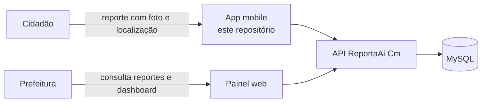

# ReportaAi Cm (Mobile)

App do cidadão do **ReportaAi Cm**, plataforma para que os moradores de **Campo Mourão (PR)** reportem buracos no asfalto e para que a prefeitura acompanhe e analise esses reportes.

> **Status:** em desenvolvimento (Projeto Integrador). A base do app está pronta: arquitetura, ambientes, cliente HTTP, navegação, tema, testes e CI. O login e a tela inicial com os dados do cidadão entram no próximo épico, e os reportes, nas sprints seguintes.

## Sumário

- [Sobre o projeto](#sobre-o-projeto)
- [Stack](#stack)
- [Pré-requisitos](#pré-requisitos)
- [Instalação e execução local](#instalação-e-execução-local)
- [Conectando à API local](#conectando-à-api-local)
- [Variáveis de ambiente](#variáveis-de-ambiente)
- [Comandos disponíveis](#comandos-disponíveis)
- [Estrutura de pastas](#estrutura-de-pastas)
- [Documentação](#documentação)
- [Contribuindo](#contribuindo)

## Sobre o projeto

Buracos no asfalto afetam a segurança e o dia a dia de quem circula pela cidade, mas nem sempre chegam ao conhecimento da prefeitura de forma organizada. O ReportaAi Cm conecta quem encontra o problema a quem pode resolvê-lo.

Este app é a porta de entrada do **cidadão**. Qualquer morador de Campo Mourão pode **abrir um reporte** de buraco no asfalto pelo celular:

- a **localização** do problema é capturada no momento do reporte;
- o cidadão envia uma **foto** do buraco.

> O que acontece com o reporte depois de aberto (acompanhamento, status e retorno ao cidadão) ainda está em definição.

Os servidores da prefeitura usam um **painel web** à parte, para visualizar os reportes e analisar os dados num dashboard. Os dois falam com a mesma [API backend](https://github.com/jgtsuchiya/projeto_integrador_reportaAiCm_backend).



## Stack

| Camada              | Tecnologia                                               |
| ------------------- | -------------------------------------------------------- |
| Plataformas         | Android e iOS                                            |
| Framework           | Flutter 3.47 (Dart 3.13), com a versão fixada pelo FVM   |
| Interface           | Material 3 (`material_ui`), tema claro e escuro          |
| Estado e injeção    | Riverpod 3.4 (`flutter_riverpod`), sem geração de código |
| Navegação           | go_router 18                                             |
| HTTP                | Dio 5.11                                                 |
| Idioma              | pt-BR, com `flutter_localizations` e `intl`              |
| Análise estática    | `very_good_analysis` 11 e `dart format` (100 colunas)    |
| Testes              | `flutter_test`, `mocktail` e `integration_test`          |
| Hooks e commits     | Husky, commitlint e lint-staged (os mesmos do backend)   |
| Integração contínua | GitHub Actions                                           |

Todas as dependências usam **versão exata** (sem `^`), no `pubspec.yaml` e no `package.json`, e o `pubspec.lock` é versionado.

## Pré-requisitos

- **Git**.
- **FVM 4**, que instala a versão do Flutter do projeto (fixada no [.fvmrc](.fvmrc)). No Linux e no macOS: `curl -fsSL https://fvm.app/install.sh | bash`. No macOS, também pelo Homebrew: `brew tap btwld/fvm && brew install btwld/fvm/fvm`. Outras formas na [documentação do FVM](https://fvm.app/documentation/getting-started/installation).
- **Para o Android:** o **Android Studio**, que traz o Android SDK e o emulador, ou só o Android SDK com um **celular Android** conectado por USB ou pela depuração Wi-Fi. Com pouca memória (8 GB ou menos), o celular físico deixa a máquina livre para a API.
- **Para o iOS:** um Mac com o **Xcode**. Instalar num iPhone exige uma conta de desenvolvedor da Apple.
- **Node.js 24.11+**, só para os hooks do Git (a versão está no [.nvmrc](.nvmrc)). O app não depende de nenhum pacote do npm.
- **VS Code** (recomendado), com as extensões Dart e Flutter, sugeridas ao abrir o projeto.

Para conferir o ambiente, rode `fvm flutter doctor` depois do passo 2 abaixo.

## Instalação e execução local

```bash
# 1. Clone o repositório e entre na branch de desenvolvimento
git clone https://github.com/jgtsuchiya/projeto_integrador_reportaAiCm_mobile.git
cd projeto_integrador_reportaAiCm_mobile
git switch develop

# 2. Instale a versão do Flutter do projeto
fvm install

# 3. Instale os hooks do Git (uma vez só)
npm install

# 4. Crie o arquivo de ambiente e ajuste a API_URL para o seu aparelho (tabela abaixo)
cp env/dev.example.json env/dev.json

# 5. Baixe as dependências e rode o app, com o emulador aberto ou o celular conectado
fvm flutter pub get
fvm flutter run --dart-define-from-file=env/dev.json
```

No VS Code, o passo 5 é a configuração **ReportaAi Cm (dev)** do _Run and Debug_ (F5), que já passa o `--dart-define-from-file`.

Sem uma sessão guardada, o app abre no login. Para conferir a conexão com a API, toque em **Diagnóstico da API**, embaixo do "Entrar": a tela mostra o endereço usado e **ok** quando a API responde. O atalho e a tela de diagnóstico só existem em debug.

## Conectando à API local

O app fala com a [API backend](https://github.com/jgtsuchiya/projeto_integrador_reportaAiCm_backend). Para subi-la na sua máquina, siga a [instalação do README do backend](https://github.com/jgtsuchiya/projeto_integrador_reportaAiCm_backend#instalação-e-execução-local) (Docker, migrations, seed e `npm run start:dev`). Ela está no ar quando http://localhost:3000/api/health responde `{"status":"ok", ...}`.

O `localhost` do aparelho não é o da sua máquina. Ajuste a `API_URL` do `env/dev.json` conforme onde o app roda:

| Onde o app roda                                | `API_URL`                     |
| ---------------------------------------------- | ----------------------------- |
| Emulador Android                               | `http://10.0.2.2:3000`        |
| Simulador iOS                                  | `http://localhost:3000`       |
| Celular conectado por USB, com o `adb reverse` | `http://localhost:3000`       |
| Celular na mesma rede Wi-Fi                    | `http://<IP da máquina>:3000` |

- **`adb reverse`:** com o celular Android no USB, `adb reverse tcp:3000 tcp:3000` faz o `localhost:3000` do celular chegar à sua máquina. O comando vale até o cabo ser desconectado.
- **IP da máquina:** no Linux, `hostname -I`. No macOS, `ipconfig getifaddr en0`. No Windows, `ipconfig`. O firewall precisa liberar a porta 3000, e a rede não pode isolar os aparelhos (algumas redes de visitantes isolam).

Depois de trocar a `API_URL`, pare o app e rode de novo: o hot reload não relê o `env/dev.json`.

### Problemas comuns

| Sintoma                                                           | Causa                                                                     | Solução                                                                              |
| ----------------------------------------------------------------- | ------------------------------------------------------------------------- | ------------------------------------------------------------------------------------ |
| `Did not find the file passed to "--dart-define-from-file"`       | O `env/dev.json` não existe                                               | `cp env/dev.example.json env/dev.json`                                               |
| O app abre na tela "Configuração incompleta"                      | O app rodou sem o `--dart-define-from-file`, ou a `API_URL` está inválida | Rode com `--dart-define-from-file=env/dev.json` e confira a mensagem da tela         |
| A `API_URL` é recusada por terminar em `/api`                     | O app acrescenta o `/api` sozinho                                         | Use só o endereço, como `http://10.0.2.2:3000`                                       |
| O diagnóstico mostra "Não foi possível conectar ao servidor"      | A API está fora do ar ou a `API_URL` não serve para o aparelho            | Confira o `/api/health` no navegador da máquina e a tabela acima                     |
| O diagnóstico funciona no emulador, mas não no celular pelo Wi-Fi | Firewall ou rede que isola os aparelhos                                   | Libere a porta 3000 ou use o USB com o `adb reverse`                                 |
| O commit falha com `fvm: command not found`                       | Os hooks usam o FVM, que não está no `PATH` do terminal ou do editor      | Instale o FVM e abra o terminal (ou o VS Code) de novo                               |
| O commit é recusado pelo analyzer                                 | Há um aviso no código                                                     | Rode `fvm flutter analyze --fatal-infos` e corrija                                   |
| `flutter` usa outra versão, ou o VS Code não acha o SDK           | O comando rodou sem o FVM                                                 | Use sempre `fvm flutter ...`. O VS Code lê o SDK do FVM pelo `.vscode/settings.json` |

## Variáveis de ambiente

O app lê a configuração no build, pelo `--dart-define-from-file=env/<ambiente>.json`, e a valida na abertura: com um valor ausente ou inválido, ele abre a tela "Configuração incompleta", com o que corrigir. O modelo está em [env/dev.example.json](env/dev.example.json), e o `env/dev.json` fica fora do Git, porque o endereço muda por aparelho.

| Variável  | Obrigatória | Exemplo                | Descrição                                                                                                             |
| --------- | ----------- | ---------------------- | --------------------------------------------------------------------------------------------------------------------- |
| `API_URL` | sim         | `http://10.0.2.2:3000` | Endereço da API, sem o `/api` e sem a barra do final. É também o `apiDomain` do SDK do SuperTokens, no épico de login |

Por enquanto, só existe o ambiente de dev. O HTTP sem TLS só é aceito no build de debug: o de release do Android aceita só HTTPS.

## Comandos disponíveis

Rode todos pelo FVM, para usar a versão do Flutter do projeto.

**Desenvolvimento**

| Comando                                                | O que faz                                         |
| ------------------------------------------------------ | ------------------------------------------------- |
| `fvm install`                                          | Instala a versão do Flutter do `.fvmrc`           |
| `npm install`                                          | Instala os hooks (Husky e commitlint). Uma vez só |
| `fvm flutter pub get`                                  | Baixa as dependências do `pubspec.lock`           |
| `fvm flutter devices`                                  | Lista os emuladores e aparelhos conectados        |
| `fvm flutter run --dart-define-from-file=env/dev.json` | Roda o app em dev                                 |

**Qualidade de código**

| Comando                               | O que faz                                        |
| ------------------------------------- | ------------------------------------------------ |
| `dart format .`                       | Formata o código (100 colunas)                   |
| `dart format --set-exit-if-changed .` | Confere a formatação sem alterar arquivos (o CI) |
| `fvm flutter analyze --fatal-infos`   | Análise estática, sem aceitar nenhum aviso       |

**Testes**

| Comando                                                                  | O que faz                                                             |
| ------------------------------------------------------------------------ | --------------------------------------------------------------------- |
| `fvm flutter test`                                                       | Testes unitários, de widget, de fluxo e de arquitetura                |
| `fvm flutter test --coverage`                                            | O mesmo, com o relatório de cobertura em `coverage/lcov.info`         |
| `fvm dart run tool/check_coverage.dart`                                  | Confere a cobertura mínima no relatório, como o CI                    |
| `fvm flutter test integration_test --dart-define-from-file=env/dev.json` | Testes de integração, com a API local no ar e um emulador ou aparelho |

**Build**

| Comando                                                              | O que faz                                                      |
| -------------------------------------------------------------------- | -------------------------------------------------------------- |
| `fvm flutter build apk --debug --dart-define-from-file=env/dev.json` | APK de debug, para instalar num aparelho (o mesmo build do CI) |
| `fvm flutter build apk --dart-define-from-file=env/<ambiente>.json`  | APK de release (só aceita a API em HTTPS)                      |
| `fvm flutter build ios --dart-define-from-file=env/dev.json`         | Build do iOS (só no macOS, com o Xcode)                        |

### Ícone e splash

O ícone e o splash são provisórios: um pino de localização branco sobre a cor-base do tema. As imagens ficam em [assets/branding/](assets/branding), e a configuração dos geradores, em [flutter_launcher_icons.yaml](flutter_launcher_icons.yaml) e [flutter_native_splash.yaml](flutter_native_splash.yaml). Para trocar, substitua as imagens (e a cor, se mudar) e rode:

```bash
fvm dart run flutter_launcher_icons
fvm dart run flutter_native_splash:create
```

## Estrutura de pastas

```
.
├── lib/
│   ├── main.dart              # lê o ambiente e roda o app
│   ├── app/                   # MaterialApp, rotas, tema e idioma
│   ├── core/                  # código compartilhado: config, rede, utils e componentes
│   └── features/              # uma pasta por funcionalidade
│       └── <feature>/
│           ├── domain/        # modelos e contratos dos repositórios
│           ├── data/          # implementações que chamam a API e DTOs
│           └── presentation/  # telas e ViewModels
├── test/                      # testes unitários, de widget, de fluxo e de arquitetura (espelha lib/)
├── integration_test/          # testes ponta a ponta, contra a API local
├── tool/                      # scripts do desenvolvimento e do CI (cobertura mínima)
├── env/                       # configuração por ambiente (dev.example.json)
├── assets/branding/           # imagens do ícone e do splash
├── android/ e ios/            # projetos nativos
├── docs/                      # documentação técnica e planos das sprints
└── .github/                   # CI, template de PR e rulesets
```

Cada funcionalidade é uma pasta independente, dividida em camadas. A regra de dependência entre elas é conferida por um teste. Os detalhes estão em [docs/ARCHITECTURE.md](docs/ARCHITECTURE.md).

## Documentação

| Documento                                                                                        | Conteúdo                                                                                                      |
| ------------------------------------------------------------------------------------------------ | ------------------------------------------------------------------------------------------------------------- |
| [docs/ARCHITECTURE.md](docs/ARCHITECTURE.md)                                                     | Camadas, regra de dependência, Riverpod, rede e erros da API, navegação, tema, nomes e como criar uma feature |
| [docs/TESTING.md](docs/TESTING.md)                                                               | Tipos de teste, o que testar em cada camada, `pumpApp`, fakes, acessibilidade, cobertura e comandos           |
| [CONTRIBUTING.md](CONTRIBUTING.md)                                                               | Git Flow, padrão de commits, Pull Requests e releases                                                         |
| [docs/sprints/sprint-4-configuracao.md](docs/sprints/sprint-4-configuracao.md)                   | Plano da sprint 4: configuração e arquitetura do app                                                          |
| [docs/sprints/sprint-4-login.md](docs/sprints/sprint-4-login.md)                                 | Plano da sprint 4: login e tela inicial (RM01 a RM10)                                                         |
| [README do backend](https://github.com/jgtsuchiya/projeto_integrador_reportaAiCm_backend#readme) | A API: instalação, rotas, autenticação e regras de negócio                                                    |

## Contribuindo

O projeto segue o **Git Flow** (`main` para o que foi publicado e `develop` para integração), com commits no padrão **Conventional Commits**, com as mesmas regras do backend:

```bash
git switch develop && git pull
git switch -c feature/12-tela-de-reporte
git commit -m "feat(reports): cria tela de reporte"
```

Os hooks do Git formatam e analisam o código, validam a mensagem de commit e o nome da branch. Os Pull Requests para a `develop` precisam de aprovação e do CI passando. O fluxo completo está no [CONTRIBUTING.md](CONTRIBUTING.md).
