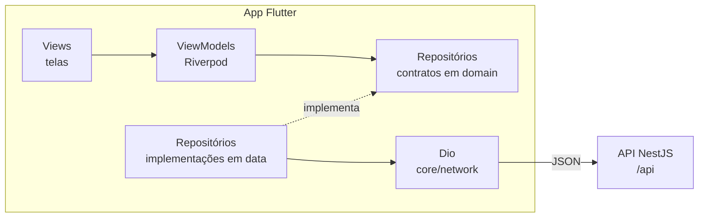

# Arquitetura do app

App em **Flutter**, organizado por **feature**. Dentro de cada feature, o código segue a [arquitetura recomendada pelo Flutter](https://docs.flutter.dev/app-architecture/guide): uma camada de UI (Views e ViewModels) e uma camada de dados (repositórios), mais uma camada de **domínio** com os modelos e os contratos.

É o mesmo princípio do backend: cada funcionalidade do ReportaAi Cm (ex.: `auth`, `profile`, `reports`) é autocontida, e as regras não dependem de framework nem de HTTP.



- A **View** só desenha e repassa as ações do usuário. A lógica da tela fica no **ViewModel**.
- O **ViewModel** conhece só o contrato do repositório, nunca a implementação. Nos testes, o contrato é trocado por um fake.
- O **repositório** fala com a API pelo `Dio` compartilhado e devolve modelos do domínio, não JSON.

## Estrutura de pastas

```
lib/
├── main.dart                    # lê o ambiente, inicializa e roda o app
├── app/
│   ├── app.dart                 # MaterialApp.router: tema, idioma e rotas
│   ├── config_error_app.dart    # o que abre quando a configuração do build é inválida
│   ├── localization.dart        # pt-BR: o idioma do app e a preparação do intl
│   ├── router.dart              # go_router: rotas e redirect central
│   ├── routes.dart              # caminhos das rotas (/inicio, /diagnostico)
│   └── theme/                   # cores e tema claro e escuro
├── core/                        # código transversal (o shared/ do backend)
│   ├── config/                  # AppConfig: a API_URL, validada na abertura
│   ├── network/                 # Dio, exceções da API, conversão dos erros e log
│   ├── utils/                   # formatadores (datas)
│   └── widgets/                 # componentes reutilizados (botão, campo, erro, carregando)
└── features/
    └── <feature>/
        ├── <feature>_providers.dart   # liga o contrato à implementação (o <feature>.module.ts)
        ├── domain/
        │   ├── models/                # modelos imutáveis, só Dart
        │   └── repositories/          # contratos (abstract interface class)
        ├── data/
        │   ├── repositories/          # implementações dos contratos (ex.: ApiHealthRepository)
        │   └── dtos/                  # conversão JSON da API <-> modelos
        └── presentation/
            ├── view_models/           # estado e ações da tela
            ├── views/                 # telas (*_view.dart)
            └── widgets/               # widgets usados só nesta feature
test/                            # espelha lib/
├── support/                     # pumpApp e fakes compartilhados
└── architecture_test.dart       # confere a regra de dependência
integration_test/                # fluxos ponta a ponta, contra a API local
env/
├── dev.example.json             # versionado
└── dev.json                     # ignorado pelo Git (o endereço muda por aparelho)
```

As subpastas só são criadas quando houver conteúdo, como no backend. A feature [`health`](../lib/features/health) é o exemplo mínimo de referência, com todas as camadas: `HealthRepository` → `GET /api/health` → tela de diagnóstico. A [`home`](../lib/features/home) só tem a tela inicial provisória, que o épico de login substitui.

## O paralelo com o backend

| No app                                   | No backend                                       | Papel                                            |
| ---------------------------------------- | ------------------------------------------------ | ------------------------------------------------ |
| `features/<feature>/`                    | `modules/<feature>/`                             | Uma funcionalidade autocontida                   |
| `<feature>_providers.dart`               | `<feature>.module.ts`                            | Liga o contrato à implementação                  |
| `domain/models/`                         | `domain/entities/` e `domain/value-objects/`     | Dados e regras, sem framework                    |
| `domain/repositories/`                   | `domain/repositories/` e `application/ports/`    | Contratos que a camada de cima conhece           |
| `data/repositories/` (`Api*Repository`)  | `infra/` (`TypeOrm*Repository`, adapters)        | Implementação que fala com o mundo de fora       |
| `data/dtos/`                             | `infra/database/mappers/` e `presentation/dtos/` | Conversão entre o formato de fora e o domínio    |
| `presentation/view_models/`              | `application/use-cases/`                         | A lógica de cada tela (no backend, de cada rota) |
| `presentation/views/`                    | `presentation/controllers/`                      | A borda: recebe a ação e devolve o resultado     |
| `core/`                                  | `shared/`                                        | Código transversal                               |
| `app/` e `main.dart`                     | `app.module.ts`, `configure-app.ts` e `main.ts`  | Monta a aplicação                                |
| `test/support/` (`FakeHealthRepository`) | `shared/testing/` (`FakeMailSender`)             | Fakes escritos à mão para os testes              |

## Regra de dependência

As dependências apontam para o domínio:

```
presentation ──► domain ◄── data
```

| Camada                     | Pode importar                                                                   | Não pode importar                                      |
| -------------------------- | ------------------------------------------------------------------------------- | ------------------------------------------------------ |
| `domain`                   | Dart, o `package:meta` e outros arquivos de `domain/`                           | Flutter, Dio, Riverpod, `core`, `data`, `presentation` |
| `data`                     | `domain`, `core/network`, pacotes externos (Dio)                                | `presentation`, Riverpod                               |
| `presentation`             | `domain`, `<feature>_providers.dart`, `core`, `material_ui`, Flutter e Riverpod | `data`, Dio                                            |
| `<feature>_providers.dart` | tudo da própria feature e o `core`                                              |                                                        |
| `core`                     | Dart, Flutter e pacotes externos                                                | `features`, `app`                                      |

O [test/architecture_test.dart](../test/architecture_test.dart) lê os imports de `lib/` e falha quando a regra é quebrada, no papel do `no-restricted-imports` do ESLint no backend. Ele roda com os outros testes, no CI. Cada regra é uma entrada da lista `architectureRules`: uma regra nova (como a do épico de login, em que só o `core/auth/` importa o SDK do SuperTokens) entra nela.

A presentation chega à implementação só pelo `<feature>_providers.dart`, que devolve o contrato. Assim, o ViewModel nunca conhece a `ApiHealthRepository`, e o teste troca a implementação por um fake com um override.

### Material: `material_ui`, não `package:flutter/material.dart`

O Flutter 3.47 publicou o Material como um pacote à parte, o [`material_ui`](https://pub.dev/packages/material_ui), e o go_router 18 já usa ele. O app importa `package:material_ui/material_ui.dart` em todo lugar. Misturar os dois quebra o tema e as rotas: o `Theme` de um não enxerga o do outro, e o go_router só reconhece o `MaterialApp` do `material_ui`. O teste de arquitetura recusa o `package:flutter/material.dart` e o `package:flutter/cupertino.dart`.

Os pacotes `package:flutter/widgets.dart` e `package:flutter/foundation.dart` continuam valendo: eles não fazem parte do Material.

## Injeção de dependências com Riverpod

Os providers fazem o papel do container de injeção do NestJS. O app usa o `flutter_riverpod` sem geração de código.

| Provider                  | Onde                                            | O que fornece                                                      |
| ------------------------- | ----------------------------------------------- | ------------------------------------------------------------------ |
| `appConfigProvider`       | `core/config/app_config_provider.dart`          | A configuração validada. Sem valor padrão: o `main` faz o override |
| `dioProvider`             | `core/network/dio_provider.dart`                | O `Dio` único do app                                               |
| `routerProvider`          | `app/router.dart`                               | O `GoRouter`                                                       |
| `<contrato>Provider`      | `features/<feature>/<feature>_providers.dart`   | A implementação do contrato (ex.: `healthRepositoryProvider`)      |
| `<tela>ViewModelProvider` | `presentation/view_models/`, junto do ViewModel | O estado da tela (ex.: `diagnosticsViewModelProvider`)             |

```dart
// features/health/health_providers.dart
final healthRepositoryProvider = Provider<HealthRepository>(
  (ref) => ApiHealthRepository(ref.watch(dioProvider)),
);

// features/health/presentation/view_models/diagnostics_view_model.dart
final AsyncNotifierProvider<DiagnosticsViewModel, HealthStatus> diagnosticsViewModelProvider =
    AsyncNotifierProvider.autoDispose(DiagnosticsViewModel.new);

final class DiagnosticsViewModel extends AsyncNotifier<HealthStatus> {
  @override
  Future<HealthStatus> build() => ref.watch(healthRepositoryProvider).check();

  void refresh() => ref.invalidateSelf();
}
```

- **ViewModel:** um `Notifier` ou `AsyncNotifier` por tela, com o provider no mesmo arquivo. Quando a tela só carrega um dado, o `AsyncNotifier` já traz os estados de carregando, erro e sucesso (`AsyncValue`), que a View desenha com o `when`. Os providers de tela são `autoDispose`: o estado some quando a tela fecha.
- **Sem repetição automática:** o Riverpod 3 repete até 10 vezes um provider que falhou com uma exceção. O app desliga isso (`retry: noAutomaticRetry`, no `ProviderScope` do `main`): quem decide repetir é a tela, com o "Tentar de novo".
- **Nos testes**, o contrato é trocado por override: `healthRepositoryProvider.overrideWithValue(FakeHealthRepository())`. Os detalhes estão no [TESTING.md](TESTING.md).

## Configuração (`core/config`)

O [`AppConfig`](../lib/core/config/app_config.dart) lê a `API_URL` do build (`--dart-define-from-file=env/dev.json`) e a valida na abertura, como o schema de ambiente da API. Ele guarda a URL sem a barra do final e recusa um valor terminado em `/api`, o erro mais comum.

Sem a configuração, o `main` não monta o app: ele abre o [`ConfigErrorApp`](../lib/app/config_error_app.dart), com a mensagem do que falta, e repete a mensagem no console.

O HTTP sem TLS só é liberado em dev: no Android, o `android:usesCleartextTraffic="true"` fica só no manifest de debug (`android/app/src/debug/AndroidManifest.xml`), e no iOS, o `NSAllowsLocalNetworking` libera só os endereços locais. O build de release do Android aceita só HTTPS.

## Rede (`core/network`)

Todas as chamadas à API passam pelo mesmo `Dio`, fornecido pelo `dioProvider`:

- `baseUrl` `${API_URL}/api`, JSON na ida e na volta, 10 s para conectar e 15 s para a resposta;
- os caminhos começam com `/`, sem o prefixo: `dio.get('/health')` chama `GET /api/health`;
- no épico de login, o SDK do SuperTokens registra o interceptor dele aqui, antes do de log.

### Erros: `callApi` e as `ApiException`

O repositório passa a chamada inteira (a requisição e a leitura da resposta) pelo [`callApi`](../lib/core/network/api_error_mapper.dart). Qualquer erro sai dele como uma [`ApiException`](../lib/core/network/api_exception.dart), com a `message` em português, pronta para a tela:

```dart
@override
Future<HealthStatus> check() => callApi(() async {
  final response = await _dio.get<Object?>('/health');
  return HealthStatusDto.fromJson(response.data).toModel();
});
```

| Resposta da API                                                | Exceção                        | Detalhe                                            |
| -------------------------------------------------------------- | ------------------------------ | -------------------------------------------------- |
| 400                                                            | `ValidationException`          | `fieldErrors` e `messageFor(campo)`                |
| 401                                                            | `UnauthorizedException`        | `field` (ex.: senha atual incorreta)               |
| 403 com `claimValidationErrors` (sessão pendente, SuperTokens) | `SecondFactorPendingException` | Falta o código da verificação em duas etapas       |
| 403                                                            | `ForbiddenException`           | O papel não pode fazer a operação                  |
| 404                                                            | `NotFoundException`            |                                                    |
| 409                                                            | `ConflictException`            | `field` (ex.: `email` ou `cpf`)                    |
| 422                                                            | `BusinessRuleException`        |                                                    |
| 429                                                            | `RateLimitException`           | `retryAfter`, do header `Retry-After`              |
| 5xx, outro status, resposta fora do formato ou erro inesperado | `ServerException`              | Sempre a mensagem padrão. O motivo fica no `cause` |
| Sem conexão ou timeout                                         | `NetworkException`             | `isTimeout`                                        |

- A `message` vem da API quando o corpo está no formato de erro da aplicação (`statusCode`, `error`, `message`, `details`). Sem ele, como sem conexão ou nas respostas do SuperTokens, que vêm em inglês (`unauthorised`, `invalid claim`), vale o texto padrão de cada exceção.
- A tela mostra o erro com `ApiException.messageOf(error)`, que também cobre um erro que não é da API.
- Um erro inesperado (ex.: um campo que não veio no JSON) vira `ServerException` e não derruba o app. Em debug, o motivo vai para o console.

### Log

Em debug, o [`ApiLogInterceptor`](../lib/core/network/api_log_interceptor.dart) mostra cada requisição no console: método, endereço, status, tempo, headers e corpo. Ele nunca mostra a sessão nem dados pessoais:

- os headers de sessão (`Authorization`, `st-access-token`, `st-refresh-token`, `front-token`, `anti-csrf` e os cookies) saem como `***`;
- o corpo das rotas de `/api/auth` (login, renovação e saída) não aparece;
- nos outros corpos e na query, os campos `password`, `currentPassword`, `newPassword`, `token`, `code` e `cpf` saem como `***`.

## Navegação (`app/router.dart`)

As rotas usam o **go_router**, com os caminhos em [`AppRoutes`](../lib/app/routes.dart):

| Rota           | Tela                             | Quando existe                                           |
| -------------- | -------------------------------- | ------------------------------------------------------- |
| `/inicio`      | Tela inicial (provisória)        | Sempre. O épico de login a troca pela tela com os dados |
| `/diagnostico` | Diagnóstico da conexão com a API | Só em debug (`kDebugMode`)                              |

- **Redirect central:** a função `_redirect` é o único lugar que escolhe a tela a partir do estado do app. Nesta sprint ela não tem regra. No épico de login, ela leva ao login quem não tem sessão, e nenhuma tela navega sozinha depois do login ou do "Sair".
- **`refreshListenable`:** o `RouterRefreshNotifier` avisa o go_router para reavaliar o redirect. No épico de login, o `routerProvider` passa a ouvir o estado da sessão e chama o `notify()`.
- **Rota que não existe** (um deep link antigo, ou o `/diagnostico` no release) leva à tela inicial.
- Para abrir uma tela por cima da atual, com o "voltar", use `context.push(AppRoutes...)`. Para trocar de seção, `context.go(...)`.

## Tema, idioma e componentes

- **Tema** ([`app/theme/`](../lib/app/theme)): Material 3 com `ColorScheme.fromSeed`, a partir de uma cor provisória (`AppColors.seed`). Os modos claro e escuro seguem o sistema. Quando o protótipo existir, o tema muda só nessa pasta. O ícone e o splash usam a mesma cor ([README](../README.md#ícone-e-splash)).
- **Idioma:** só pt-BR, com `flutter_localizations` e `intl`. Os textos ficam direto no código, sem arquivos ARB, enquanto houver um idioma só. As datas saem em `dd/MM/yyyy` pelos [formatadores](../lib/core/utils/date_formatters.dart).
- **Componentes** ([`core/widgets/`](../lib/core/widgets)):

| Componente         | Uso                                                                                                      |
| ------------------ | -------------------------------------------------------------------------------------------------------- |
| `PrimaryButton`    | Ação principal da tela. Com `isLoading`, mostra o indicador e ignora o toque, para não enviar duas vezes |
| `AppTextField`     | Campo com rótulo e mensagem de erro, da validação local (`validator`) ou da API (`errorText`)            |
| `ErrorView`        | Tela de erro, com o "Tentar de novo" quando há `onRetry`. O leitor de tela anuncia o erro                |
| `LoadingIndicator` | Indicador de carregamento, com uma mensagem opcional                                                     |
| `ScrollableCenter` | Centraliza o conteúdo e rola quando ele não cabe (ex.: fonte em 200%)                                    |

- **Acessibilidade:** os botões têm pelo menos 48 dp de altura, e toda tela rola, para aguentar a fonte do sistema em 200% sem cortar texto. Os testes dos componentes passam pelas verificações do Flutter (`androidTapTargetGuideline`, `labeledTapTargetGuideline` e `textContrastGuideline`), nos dois temas.

## Convenções de nomenclatura

| Item                          | Padrão                                                    | Exemplo                                                 |
| ----------------------------- | --------------------------------------------------------- | ------------------------------------------------------- |
| Arquivos e pastas             | `snake_case`                                              | `diagnostics_view_model.dart`                           |
| Features                      | em inglês, no singular ou plural do domínio               | `auth`, `profile`, `reports`                            |
| Tela                          | `*_view.dart` → `*View`                                   | `diagnostics_view.dart` → `DiagnosticsView`             |
| ViewModel                     | `*_view_model.dart` → `*ViewModel` e `*ViewModelProvider` | `DiagnosticsViewModel` e `diagnosticsViewModelProvider` |
| Contrato de repositório       | `*_repository.dart` → `*Repository`                       | `health_repository.dart` → `HealthRepository`           |
| Implementação que chama a API | `api_*_repository.dart` → `Api*Repository`                | `api_health_repository.dart` → `ApiHealthRepository`    |
| DTO                           | `*_dto.dart` → `*Dto`, com `fromJson` e `toModel`         | `HealthStatusDto`                                       |
| Ligação da feature            | `<feature>_providers.dart`                                | `health_providers.dart`                                 |
| Providers                     | `camelCase` com o sufixo `Provider`                       | `healthRepositoryProvider`                              |
| Rotas                         | em português, `kebab-case`, em `AppRoutes`                | `/inicio`, `/diagnostico`                               |
| Testes                        | espelham `lib/`, com `_test.dart`                         | `test/core/config/app_config_test.dart`                 |
| Fakes                         | `Fake*`, em `test/support/`                               | `FakeHealthRepository`                                  |

Outras convenções, a maioria conferida pelo analyzer (`very_good_analysis`):

- O código fica em inglês. A documentação, as mensagens de commit e os textos da tela ficam em português.
- Imports sempre pelo pacote (`package:reportaai_cm/...`), nunca relativos, dentro de `lib/`.
- Construtores na forma curta do Dart 3.13: `const new(...)` e `factory fromJson(...)`, sem repetir o nome da classe.
- Classes que não são estendidas são `final class`. Os modelos são imutáveis (`@immutable`, do `package:meta`), escritos à mão, com `==`, `hashCode` e `toString`.
- Contratos de repositório são `abstract interface class`.

## Adicionando uma nova feature

Usando como exemplo uma feature `reports` que lista os reportes do usuário:

1. **Domínio:** crie o modelo em `features/reports/domain/models/report.dart` (imutável, só Dart) e o contrato em `domain/repositories/report_repository.dart` (`abstract interface class ReportRepository`).
2. **Dados:** crie o DTO em `data/dtos/report_dto.dart` (`fromJson` que lança `FormatException` e `toModel`) e a implementação em `data/repositories/api_report_repository.dart`, com cada chamada dentro do `callApi`.
3. **Ligação:** crie `features/reports/reports_providers.dart`, com o `reportRepositoryProvider` que devolve o contrato.
4. **Tela:** crie o ViewModel em `presentation/view_models/` e a View em `presentation/views/reports_view.dart`. A View usa os componentes de `core/widgets/` para o carregando e o erro.
5. **Rota:** adicione o caminho em `AppRoutes` e a `GoRoute` em `app/router.dart`.
6. **Testes:** o fake do contrato em `test/support/` (se outros testes também usarem) e os testes espelhando `lib/`: o DTO, o repositório (com o `FakeHttpAdapter`), o ViewModel e a View em cada estado ([TESTING.md](TESTING.md)).
