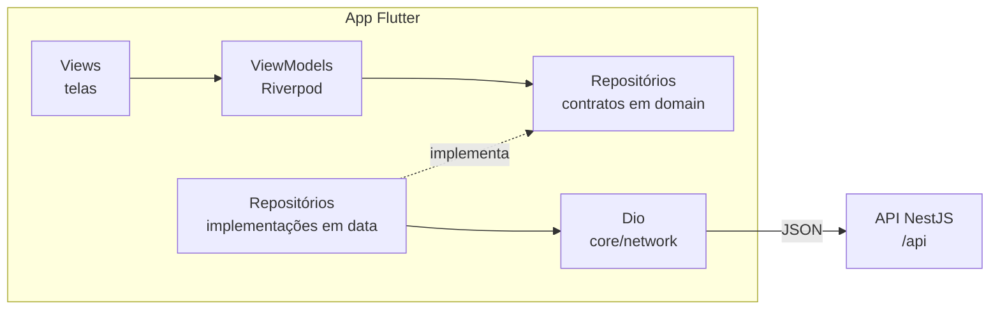

# Arquitetura do app

App em **Flutter**, organizado por **feature**. Dentro de cada feature, o código segue a [arquitetura recomendada pelo Flutter](https://docs.flutter.dev/app-architecture/guide): uma camada de UI (Views e ViewModels) e uma camada de dados (repositórios), mais uma camada de **domínio** com os modelos e os contratos.

É o mesmo princípio do backend: cada funcionalidade do ReportaAi Cm (ex.: `auth`, `profile`, `reports`) é autocontida, e as regras não dependem de framework nem de HTTP.



- A **View** só desenha e repassa as ações do usuário. A lógica da tela fica no **ViewModel**.
- O **ViewModel** conhece só o contrato do repositório, nunca a implementação. Nos testes, o contrato é trocado por um fake.
- O **repositório** fala com a API pelo `Dio` compartilhado e devolve modelos do domínio, não JSON.

## Estrutura de pastas

```
lib/
├── main.dart                    # lê o ambiente, inicializa e roda o app
├── app/
│   ├── app.dart                 # MaterialApp.router: tema, idioma e rotas
│   ├── config_error_app.dart    # o que abre quando a configuração do build é inválida
│   ├── localization.dart        # pt-BR: o idioma do app e a preparação do intl
│   ├── router.dart              # go_router: rotas e redirect a partir do estado de login
│   ├── routes.dart              # caminhos das rotas e as rotas públicas (/cadastro, /esqueci-senha)
│   └── theme/                   # cores e tema claro e escuro
├── core/                        # código transversal (o shared/ do backend)
│   ├── auth/                    # SessionManager e o SDK do SuperTokens (o único lugar que o importa)
│   ├── config/                  # AppConfig: a API_URL, validada na abertura
│   ├── location/                # LocationService e o geolocator (o único lugar que o importa)
│   ├── media/                   # PhotoCapture e ImageCompressor: a câmera e o tratamento da foto
│   ├── network/                 # Dio, User-Agent do app, exceções da API, conversão dos erros e log
│   ├── utils/                   # formatadores, máscaras, a contagem regressiva e o UUID
│   └── widgets/                 # componentes reutilizados (botão, campo, erro, carregando)
└── features/
    └── <feature>/
        ├── <feature>_providers.dart   # liga o contrato à implementação (o <feature>.module.ts)
        ├── domain/
        │   ├── models/                # modelos imutáveis, só Dart
        │   └── repositories/          # contratos (abstract interface class)
        ├── data/
        │   ├── repositories/          # implementações dos contratos (ex.: ApiHealthRepository)
        │   └── dtos/                  # conversão JSON da API <-> modelos
        └── presentation/
            ├── controllers/           # estado do app inteiro, que várias telas usam (ex.: AuthController)
            ├── view_models/           # estado e ações da tela
            ├── views/                 # telas (*_view.dart)
            └── widgets/               # widgets usados só nesta feature
test/                            # espelha lib/
├── support/                     # pumpApp e fakes compartilhados
├── flows/                       # fluxos do app inteiro, com os fakes
└── architecture_test.dart       # confere a regra de dependência
integration_test/                # fluxos ponta a ponta, contra a API local (support/ com o TestApi)
tool/                            # scripts do desenvolvimento e do CI (cobertura mínima)
env/
├── dev.example.json             # versionado
└── dev.json                     # ignorado pelo Git (o endereço muda por aparelho)
```

As subpastas só são criadas quando houver conteúdo, como no backend. A feature [`health`](../lib/features/health) é o exemplo mínimo de referência, com todas as camadas: `HealthRepository` → `GET /api/health` → tela de diagnóstico. As features do acesso são a [`auth`](../lib/features/auth) (login, cadastro, "Esqueci minha senha", sessão, abertura, a tela do código da segunda etapa, o `AuthController` e o aviso do e-mail), a [`profile`](../lib/features/profile) (as rotas de `/api/users/me` e o cartão dos dados, o `ProfileCard`) e a [`account`](../lib/features/account) (a "Minha conta", com as telas de cada ação, e as sessões abertas), explicadas no [AUTH.md](AUTH.md). A `account` depende da `auth` e da `profile`, e nenhuma das duas depende dela. A [`home`](../lib/features/home) só tem a apresentação: a tela inicial, com o ViewModel do "puxar para atualizar", lê o perfil do `AuthController` e abre as telas dos reportes. A [`reports`](../lib/features/reports) é a dos reportes de buraco: abrir, acompanhar, editar e excluir, explicada no [REPORTS.md](REPORTS.md). Ela usa o aviso do e-mail da `auth`, e nenhuma feature depende dela.

## O paralelo com o backend

| No app                                                          | No backend                                                                               | Papel                                            |
| --------------------------------------------------------------- | ---------------------------------------------------------------------------------------- | ------------------------------------------------ |
| `features/<feature>/`                                           | `modules/<feature>/`                                                                     | Uma funcionalidade autocontida                   |
| `<feature>_providers.dart`                                      | `<feature>.module.ts`                                                                    | Liga o contrato à implementação                  |
| `domain/models/`                                                | `domain/entities/` e `domain/value-objects/`                                             | Dados e regras, sem framework                    |
| `domain/repositories/`                                          | `domain/repositories/` e `application/ports/`                                            | Contratos que a camada de cima conhece           |
| `data/repositories/` (`Api*Repository`)                         | `infra/` (`TypeOrm*Repository`, adapters)                                                | Implementação que fala com o mundo de fora       |
| `data/dtos/`                                                    | `infra/database/mappers/` e `presentation/dtos/`                                         | Conversão entre o formato de fora e o domínio    |
| `presentation/view_models/`                                     | `application/use-cases/`                                                                 | A lógica de cada tela (no backend, de cada rota) |
| `presentation/views/`                                           | `presentation/controllers/`                                                              | A borda: recebe a ação e devolve o resultado     |
| `AuthController` e `redirectFor`                                | `AuthGuard`                                                                              | Decidem quem passa: sem sessão, não entra        |
| `core/auth/` (`SessionManager`)                                 | `application/ports/` (`IdentityProvider`)                                                | A porta para o SDK do SuperTokens                |
| `core/`                                                         | `shared/`                                                                                | Código transversal                               |
| `app/` e `main.dart`                                            | `app.module.ts`, `configure-app.ts` e `main.ts`                                          | Monta a aplicação                                |
| `test/support/` (`FakeHealthRepository` e `FakeSessionManager`) | `shared/testing/` e `modules/users/testing/` (`FakeMailSender` e `FakeIdentityProvider`) | Fakes escritos à mão para os testes              |

**Regras repetidas do backend.** Quando o app confere antes de enviar uma regra que a API também confere, ela fica no `domain/` da feature, com o mesmo comportamento do value object do backend. Uma regra diferente da API faria o app recusar o que ela aceita, ou o contrário. Os testes de cada uma repetem os casos do `*.spec.ts` do value object.

| No app ([`auth/domain/models/`](../lib/features/auth/domain/models)) | No backend                           | Regra                                                                                           |
| -------------------------------------------------------------------- | ------------------------------------ | ----------------------------------------------------------------------------------------------- |
| `isValidEmail` e `normalizeEmail` (`email.dart`)                     | `Email`                              | Parte local, `@` e domínio com ponto, até 254 caracteres, em minúsculas e sem os espaços (RN02) |
| `isValidCpf` (`cpf.dart`)                                            | `Cpf`                                | Com ou sem a máscara, os dígitos verificadores certos, sem as sequências repetidas (RN07)       |
| `isValidPhone` (`phone.dart`)                                        | `Phone`                              | DDD sem zero e o celular com 9 dígitos começando por 9, ou o fixo com 8 começando de 2 a 5      |
| `isCalendarDate` e `isValidBirthDate` (`birth_date.dart`)            | `BirthDate`                          | `AAAA-MM-DD`, uma data que existe, de 1900 em diante e antes de hoje (em UTC, como a API)       |
| `validatePassword` e `PasswordRule` (`password.dart`)                | `Password`                           | De 8 a 128 caracteres, com pelo menos uma letra e um número (RN08)                              |
| `isValidUserName` (`user_name.dart`)                                 | `userNameSchema` e a entidade `User` | De 1 a 120 caracteres, sem os espaços das pontas                                                |

Os reportes também repetem as regras da imagem e da descrição, em [`reports/domain/models/`](../lib/features/reports/domain/models): o `parseJpeg` e o `PreparedPhoto.create` fazem o percurso dos segmentos do `ReportImage` do backend (a assinatura, o tamanho, as dimensões e a remoção dos metadados, RN29), e o `isValidReportDescription` conta os caracteres como o `ReportDescription` (até 500, depois do `trim`). Os limites ficam no `ReportLimits`, iguais aos padrões da API.

As mensagens também são as da API, juntadas pelo `validateRegistration` (`registration_validation.dart`) no estilo do `validateSignIn`. Duas mudam: o campo vazio pede o campo ("Informe o CPF."), como no login, e a data fora do formato pede o da tela (`DD/MM/AAAA`), que é o que o cidadão digita.

## Regra de dependência

As dependências apontam para o domínio:

```
presentation ──► domain ◄── data
```

| Camada                        | Pode importar                                                                   | Não pode importar                                      |
| ----------------------------- | ------------------------------------------------------------------------------- | ------------------------------------------------------ |
| `domain`                      | Dart, o `package:meta` e outros arquivos de `domain/`                           | Flutter, Dio, Riverpod, `core`, `data`, `presentation` |
| `data`                        | `domain`, `core/network`, pacotes externos (Dio)                                | `presentation`, Riverpod                               |
| `presentation`                | `domain`, `<feature>_providers.dart`, `core`, `material_ui`, Flutter e Riverpod | `data`, Dio                                            |
| `<feature>_providers.dart`    | tudo da própria feature e o `core`                                              |                                                        |
| `core`                        | Dart, Flutter e pacotes externos                                                | `features`, `app`                                      |
| Tudo fora de `core/auth/`     |                                                                                 | O SDK do SuperTokens (`package:supertokens_flutter`)   |
| Tudo fora de `core/location/` |                                                                                 | O `geolocator` e os pacotes dele                       |
| Tudo fora de `core/media/`    |                                                                                 | O `image_picker` e o `flutter_image_compress`          |

O [test/architecture_test.dart](../test/architecture_test.dart) lê os imports de `lib/` e falha quando a regra é quebrada, no papel do `no-restricted-imports` do ESLint no backend. Ele roda com os outros testes, no CI. Cada regra é uma entrada da lista `architectureRules`: uma regra nova entra nela, com um teste que mostra o import recusado.

O SDK do SuperTokens fica só em `core/auth/`, atrás do `SessionManager`, como o `supertokens-node` fica só na `infra` do backend. As telas, os repositórios e o `main` usam o contrato, e os testes o trocam pelo `FakeSessionManager` ([AUTH.md](AUTH.md#integração-com-o-supertokens)).

Os pacotes do aparelho seguem a mesma ideia ([REPORTS.md](REPORTS.md#visão-geral)):

| Pasta            | Contrato                                      | Implementação                                           | Fake nos testes       |
| ---------------- | --------------------------------------------- | ------------------------------------------------------- | --------------------- |
| `core/location/` | `LocationService` (GPS, permissão e posição)  | `GeolocatorLocationService`, pelo `geolocator`          | `FakeLocationService` |
| `core/media/`    | `PhotoCapture` (a câmera)                     | `ImagePickerPhotoCapture`, pelo `image_picker`          | `FakePhotoCapture`    |
| `core/media/`    | `ImageCompressor` (tamanho, qualidade e EXIF) | `FlutterImageCompressor`, pelo `flutter_image_compress` | `FakeImageCompressor` |

Cada implementação recebe o pacote por parâmetro (a plataforma do `geolocator`, o `ImagePicker`, a função de compressão), e os testes dela passam um falso no lugar: o pacote de verdade só roda no aparelho.

A presentation chega à implementação só pelo `<feature>_providers.dart`, que devolve o contrato. Assim, o ViewModel nunca conhece a `ApiHealthRepository`, e o teste troca a implementação por um fake com um override.

### Material: `material_ui`, não `package:flutter/material.dart`

O Flutter 3.47 publicou o Material como um pacote à parte, o [`material_ui`](https://pub.dev/packages/material_ui), e o go_router 18 já usa ele. O app importa `package:material_ui/material_ui.dart` em todo lugar. Misturar os dois quebra o tema e as rotas: o `Theme` de um não enxerga o do outro, e o go_router só reconhece o `MaterialApp` do `material_ui`. O teste de arquitetura recusa o `package:flutter/material.dart` e o `package:flutter/cupertino.dart`.

Os pacotes `package:flutter/widgets.dart` e `package:flutter/foundation.dart` continuam valendo: eles não fazem parte do Material.

## Injeção de dependências com Riverpod

Os providers fazem o papel do container de injeção do NestJS. O app usa o `flutter_riverpod` sem geração de código.

| Provider                                                                      | Onde                                            | O que fornece                                                                                |
| ----------------------------------------------------------------------------- | ----------------------------------------------- | -------------------------------------------------------------------------------------------- |
| `appConfigProvider`                                                           | `core/config/app_config_provider.dart`          | A configuração validada. Sem valor padrão: o `main` faz o override                           |
| `sessionManagerProvider`                                                      | `core/auth/session_manager_provider.dart`       | A sessão, com o SDK já inicializado. Sem valor padrão: o `main` faz o override               |
| `dioProvider`                                                                 | `core/network/dio_provider.dart`                | O `Dio` único do app, com a sessão                                                           |
| `routerProvider`                                                              | `app/router.dart`                               | O `GoRouter`, que ouve o `authControllerProvider`                                            |
| `authControllerProvider`                                                      | `features/auth/presentation/controllers/`       | O estado de login do app inteiro ([AUTH.md](AUTH.md#estado-de-login-o-authcontroller))       |
| `locationServiceProvider`, `photoCaptureProvider` e `imageCompressorProvider` | `core/location/` e `core/media/`                | O GPS, a câmera e o tratamento da foto. Os testes trocam pelos fakes                         |
| `reportPhotoProvider`                                                         | `features/reports/reports_providers.dart`       | O cache das fotos dos reportes, pelo id da foto ([REPORTS.md](REPORTS.md#o-cache-das-fotos)) |
| `<contrato>Provider`                                                          | `features/<feature>/<feature>_providers.dart`   | A implementação do contrato (ex.: `healthRepositoryProvider`)                                |
| `<tela>ViewModelProvider`                                                     | `presentation/view_models/`, junto do ViewModel | O estado da tela (ex.: `diagnosticsViewModelProvider`)                                       |

```dart
// features/health/health_providers.dart
final healthRepositoryProvider = Provider<HealthRepository>(
  (ref) => ApiHealthRepository(ref.watch(dioProvider)),
);

// features/health/presentation/view_models/diagnostics_view_model.dart
final AsyncNotifierProvider<DiagnosticsViewModel, HealthStatus> diagnosticsViewModelProvider =
    AsyncNotifierProvider.autoDispose(DiagnosticsViewModel.new);

final class DiagnosticsViewModel extends AsyncNotifier<HealthStatus> {
  @override
  Future<HealthStatus> build() => ref.watch(healthRepositoryProvider).check();

  void refresh() => ref.invalidateSelf();
}
```

- **ViewModel:** um `Notifier` ou `AsyncNotifier` por tela, com o provider no mesmo arquivo. Quando a tela só carrega um dado, o `AsyncNotifier` já traz os estados de carregando, erro e sucesso (`AsyncValue`), que a View desenha com o `when`. Os providers de tela são `autoDispose`: o estado some quando a tela fecha.
- **Controller:** o estado que vale para o app inteiro, e não para uma tela, fica num `Notifier` em `presentation/controllers/`, sem `autoDispose`. Hoje, o `AuthController` e o `EmailVerificationController`, que guarda a espera do reenvio do e-mail entre as telas. Os ViewModels chamam as ações dele (o `LoginViewModel` chama o `signIn`) e guardam só o estado da tela (o erro de cada campo, a contagem do 429).
- **Sem repetição automática:** o Riverpod 3 repete até 10 vezes um provider que falhou com uma exceção. O app desliga isso (`retry: noAutomaticRetry`, no `ProviderScope` do `main`): quem decide repetir é a tela, com o "Tentar de novo".
- **Nos testes**, o contrato é trocado por override: `healthRepositoryProvider.overrideWithValue(FakeHealthRepository())`. Os detalhes estão no [TESTING.md](TESTING.md).

## Configuração (`core/config`)

O [`AppConfig`](../lib/core/config/app_config.dart) lê a `API_URL` do build (`--dart-define-from-file=env/dev.json`) e a valida na abertura, como o schema de ambiente da API. Ele guarda a URL sem a barra do final e recusa um valor terminado em `/api`, o erro mais comum.

Sem a configuração, o `main` não monta o app: ele abre o [`ConfigErrorApp`](../lib/app/config_error_app.dart), com a mensagem do que falta, e repete a mensagem no console.

O HTTP sem TLS só é liberado em dev: no Android, o `android:usesCleartextTraffic="true"` fica só no manifest de debug (`android/app/src/debug/AndroidManifest.xml`), e no iOS, o `NSAllowsLocalNetworking` libera só os endereços locais. O build de release do Android aceita só HTTPS.

## Rede (`core/network`)

Todas as chamadas à API passam pelo mesmo `Dio`, fornecido pelo `dioProvider`:

- `baseUrl` `${API_URL}/api`, JSON na ida e na volta, 10 s para conectar e 15 s para a resposta;
- os caminhos começam com `/`, sem o prefixo: `dio.get('/health')` chama `GET /api/health`;
- os interceptors da sessão (o do SDK do SuperTokens e o `UnauthorizedResponseInterceptor`) entram antes do de log: o access token vai no `Authorization`, e o vencido é renovado sozinho ([AUTH.md](AUTH.md#interceptors-no-dio));
- o `User-Agent` do app, `ReportaAiCm/<versão> (<sistema>)`, como `ReportaAiCm/0.1.0 (Android)`, que a API grava em cada login e a lista de sessões abertas mostra ([AUTH.md](AUTH.md#sessões-abertas)).

**`User-Agent`.** O [`buildUserAgent`](../lib/core/network/user_agent.dart) monta o texto com a versão do `pubspec.yaml`, lida pelo pacote **`package_info_plus`** no `main`, e o sistema do `Platform` do `dart:io`. Ele entra no `ProviderScope` pelo `userAgentProvider`, e o `dioProvider` o passa ao `createDio`. A versão do sistema só vai no iOS e no macOS: no Android e no Linux, o `Platform.operatingSystemVersion` é a versão do kernel (`Linux 5.10.66-android12-9-...`), que não diz nada ao usuário, e o texto leva só o nome (`(Android)`). Nos testes, sem o override, vale o padrão do `dart:io`.

### Erros: `callApi` e as `ApiException`

O repositório passa a chamada inteira (a requisição e a leitura da resposta) pelo [`callApi`](../lib/core/network/api_error_mapper.dart). Qualquer erro sai dele como uma [`ApiException`](../lib/core/network/api_exception.dart), com a `message` em português, pronta para a tela:

```dart
@override
Future<HealthStatus> check() => callApi(() async {
  final response = await _dio.get<Object?>('/health');
  return HealthStatusDto.fromJson(response.data).toModel();
});
```

| Resposta da API                                                | Exceção                        | Detalhe                                                                                                                                                           |
| -------------------------------------------------------------- | ------------------------------ | ----------------------------------------------------------------------------------------------------------------------------------------------------------------- |
| 400                                                            | `ValidationException`          | `fieldErrors` e `messageFor(campo)`                                                                                                                               |
| 401                                                            | `UnauthorizedException`        | Só a sessão: sem sessão ou sessão vencida                                                                                                                         |
| 403 com `claimValidationErrors` (sessão pendente, SuperTokens) | `SecondFactorPendingException` | Falta o código da verificação em duas etapas                                                                                                                      |
| 403                                                            | `ForbiddenException`           | O papel não pode fazer a operação                                                                                                                                 |
| 404                                                            | `NotFoundException`            |                                                                                                                                                                   |
| 409                                                            | `ConflictException`            | `field` (ex.: `email` ou `cpf`)                                                                                                                                   |
| 422                                                            | `BusinessRuleException`        | `field` (ex.: senha de confirmação incorreta)                                                                                                                     |
| 429                                                            | `RateLimitException`           | `retryAfter`, do header `Retry-After`                                                                                                                             |
| 5xx, outro status, resposta fora do formato ou erro inesperado | `ServerException`              | Sempre a mensagem padrão. O motivo fica no `cause`, e o status no `statusCode` (ex.: o 413 do corpo grande, que a abertura do reporte trata como a foto recusada) |
| Sem conexão ou timeout                                         | `NetworkException`             | `isTimeout`                                                                                                                                                       |

- O 401 só chega ao `callApi` quando a sessão não renova mais: antes disso, o interceptor do SDK renova a sessão e repete a chamada. A API só responde 401 para a sessão: a senha de confirmação incorreta é um 422, com o `field` do campo ([AUTH.md](AUTH.md#a-senha-de-confirmação-rm15)).
- A `message` vem da API quando o corpo está no formato de erro da aplicação (`statusCode`, `error`, `message`, `details`). Sem ele, como sem conexão ou nas respostas do SuperTokens, que vêm em inglês (`unauthorised`, `invalid claim`), vale o texto padrão de cada exceção.
- A tela mostra o erro com `ApiException.messageOf(error)`, que também cobre um erro que não é da API.
- Um erro inesperado (ex.: um campo que não veio no JSON) vira `ServerException` e não derruba o app. Em debug, o motivo vai para o console.

### Log

Em debug, o [`ApiLogInterceptor`](../lib/core/network/api_log_interceptor.dart) mostra cada requisição no console: método, endereço, status, tempo, headers e corpo. Ele nunca mostra a sessão nem dados pessoais:

- os headers de sessão (`Authorization`, `st-access-token`, `st-refresh-token`, `front-token`, `anti-csrf` e os cookies) saem como `***`;
- o corpo das rotas de `/api/auth` (login, renovação e saída) não aparece;
- nos outros corpos e na query, os campos `password`, `currentPassword`, `newPassword`, `token`, `code`, `cpf`, `ipAddress` e `userAgent` (os dois últimos, da lista de sessões abertas) saem como `***`, e também a `latitude`, a `longitude` e o `accuracyMeters` dos reportes (RM27);
- as imagens em base64 dos reportes (`content` e `thumbnail`) saem como `*** (512 KB)`, só com o tamanho do texto (RM27).

## Navegação (`app/router.dart`)

As rotas usam o **go_router**, com os caminhos em [`AppRoutes`](../lib/app/routes.dart):

| Rota                   | Tela                                            | Quando abre                                            |
| ---------------------- | ----------------------------------------------- | ------------------------------------------------------ |
| `/abertura`            | Abertura: o carregando e o erro sem rede (RM06) | Enquanto o app confere a sessão. É a rota inicial      |
| `/login`               | Login                                           | Sem sessão                                             |
| `/cadastro`            | Cadastro do Client (RM11 e RM12)                | Sem sessão (rota pública), pelo "Criar conta" do login |
| `/esqueci-senha`       | "Esqueci minha senha" (RM13)                    | Sem sessão (rota pública), pelo link do login          |
| `/verificacao`         | Código da verificação em duas etapas (RM18)     | Com a sessão pendente da segunda etapa                 |
| `/inicio`              | Tela inicial, com o aviso do e-mail e os dados  | Com o Client dentro                                    |
| `/conta`               | "Minha conta"                                   | Com o Client dentro, pela ação da tela inicial         |
| `/conta/dados`         | Editar o nome, o telefone e a data              | Com o Client dentro, pela "Minha conta"                |
| `/conta/senha`         | Trocar a senha (RM15 e RM16)                    | Com o Client dentro, pela "Minha conta"                |
| `/conta/sessoes`       | Sessões abertas (RM19)                          | Com o Client dentro, pela "Minha conta"                |
| `/conta/verificacao`   | Ativar e desativar a verificação em duas etapas | Com o Client dentro, pela "Minha conta"                |
| `/conta/excluir`       | Excluir a conta (RM17)                          | Com o Client dentro, pela "Minha conta"                |
| `/reportes`            | "Meus reportes"                                 | Com o Client dentro, pela tela inicial                 |
| `/reportes/novo`       | "Novo reporte" (RM20 a RM24)                    | Com o Client dentro, pela tela inicial ou pela lista   |
| `/reportes/:id`        | O detalhe do reporte                            | Pela lista, pelo envio ou pelo aviso do repetido       |
| `/reportes/:id/editar` | Editar a descrição e a foto (RM25)              | Pelo detalhe                                           |
| `/diagnostico`         | Diagnóstico da conexão com a API                | Só em debug (`kDebugMode`), em qualquer estado         |

- **Redirect central:** o `redirectFor` é o único lugar que escolhe a tela, a partir do estado do `AuthController`. Toda rota, menos o diagnóstico e as públicas (`AppRoutes.public`), exige a sessão. Com o Client dentro, as públicas levam à tela inicial, e a sessão pendente da segunda etapa só abre a `/verificacao`. Nenhuma tela navega sozinha depois do login ou do "Sair": ela muda o estado, e o redirect leva à tela certa ([AUTH.md](AUTH.md#rotas-e-redirect)).
- **`refreshListenable`:** o `routerProvider` ouve o `authControllerProvider` e, quando o tipo do estado muda (`changesRoute`), chama o `notify()` do `RouterRefreshNotifier`, que faz o go_router reavaliar o redirect. O perfil novo não reavalia: o go_router reconstruiria a pilha a partir da última rota que conhece, e a tela que acabou de fechar com o `pop` voltaria a abrir.
- **Rotas aninhadas:** as telas da conta ficam embaixo da `/conta` (`routes:` da `GoRoute`), e um deep link para uma delas abre com a `/conta` atrás. As dos reportes ficam embaixo da `/reportes`, com o `novo` antes do `:id`, para não ser lido como um id, e a edição embaixo do detalhe.
- **Rota que não existe** (um deep link antigo, ou o `/diagnostico` no release) leva à tela inicial, ou ao login, para quem não entrou.
- Para abrir uma tela por cima da atual, com o "voltar", use `context.push(AppRoutes...)`. Para trocar de seção, `context.go(...)`.

## Tema, idioma e componentes

- **Tema** ([`app/theme/`](../lib/app/theme)): Material 3 com `ColorScheme.fromSeed`, a partir de uma cor provisória (`AppColors.seed`). Os modos claro e escuro seguem o sistema. Quando o protótipo existir, o tema muda só nessa pasta. O ícone e o splash usam a mesma cor ([README](../README.md#ícone-e-splash)).
- **Idioma:** só pt-BR, com `flutter_localizations` e `intl`. Os textos ficam direto no código, sem arquivos ARB, enquanto houver um idioma só.
- **Formatadores** ([`core/utils/`](../lib/core/utils)): a API manda os dados crus, e a máscara é do app.

| Função                          | Exemplo                                                                                                |
| ------------------------------- | ------------------------------------------------------------------------------------------------------ |
| `formatDate` e `formatDateTime` | `20/05/1990` e `20/05/1990 14:30`                                                                      |
| `formatMonthYear`               | `outubro de 2026`                                                                                      |
| `maskCpf`                       | `52998224725` → `***.982.247-**`. Fora do formato, mascara tudo (RM09)                                 |
| `formatPhone`                   | `44999998888` → `(44) 99999-8888`, e o fixo, `(44) 3333-4444`                                          |
| `digitsOnly`                    | `529.982.247-25` → `52998224725`: como o app envia o CPF e o telefone                                  |
| `maskedDateToIso`               | `20/05/1990` → `1990-05-20`, ou `null` sem os 8 dígitos                                                |
| `countdownSecondsOf`            | O `Retry-After` em segundos inteiros, arredondado para cima, com pelo menos 1                          |
| `randomUuidV4`                  | `3b241101-e2bb-4255-8caf-4136c566a962`, com o `Random.secure`: a `Idempotency-Key` do envio do reporte |

- **Máscaras dos campos** ([`core/utils/`](../lib/core/utils)): `TextInputFormatter` próprios, sem pacote, sobre o `MaskedDigitsInputFormatter`. O campo fica só com os dígitos e é formatado de novo a cada mudança: colar com ou sem a pontuação dá o mesmo resultado, o cursor fica depois do mesmo dígito, e o "apagar" logo depois da pontuação apaga também o dígito antes dela. Use no `inputFormatters` do `AppTextField`.

| Máscara               | Formato                                                                                             | Para enviar       |
| --------------------- | --------------------------------------------------------------------------------------------------- | ----------------- |
| `CpfInputFormatter`   | `000.000.000-00`                                                                                    | `digitsOnly`      |
| `PhoneInputFormatter` | `(00) 0000-0000` e, com 11 dígitos, `(00) 00000-0000`. Tira o `+55` do número preenchido de uma vez | `digitsOnly`      |
| `DateInputFormatter`  | `dd/mm/aaaa`                                                                                        | `maskedDateToIso` |

- **Contagem regressiva** ([`Countdown`](../lib/core/utils/countdown.dart)): o `Timer.periodic` dos botões que voltam sozinhos, como o "Criar conta" depois do 429 e os reenvios de e-mail. O ViewModel cria um, chama o `start(segundos)` e o `cancel` no `ref.onDispose`.

- **Componentes** ([`core/widgets/`](../lib/core/widgets)):

| Componente         | Uso                                                                                                                                                                                                                                                                                                                                                                                                                                                                                                                                       |
| ------------------ | ----------------------------------------------------------------------------------------------------------------------------------------------------------------------------------------------------------------------------------------------------------------------------------------------------------------------------------------------------------------------------------------------------------------------------------------------------------------------------------------------------------------------------------------- |
| `PrimaryButton`    | Ação principal da tela. Com `isLoading`, mostra o indicador e ignora o toque, para não enviar duas vezes                                                                                                                                                                                                                                                                                                                                                                                                                                  |
| `AppTextField`     | Campo com rótulo e mensagem de erro, da validação local (`validator`) ou da API (`errorText`). Com `obscureText`, o teclado não corrige, não sugere e não aprende o texto. No campo de senha que pode ficar visível, `enableSuggestions: false` mantém isso. Aceita as máscaras (`inputFormatters`), a ajuda embaixo (`helperText`), o texto longo (`minLines`, `maxLines` e o contador do `maxLength`, como a descrição do reporte) e o `scrollPadding` maior no último campo, para o botão de enviar ficar à vista com o teclado aberto |
| `ErrorView`        | Tela de erro, com o "Tentar de novo" quando há `onRetry` e uma ação a mais no `secondaryAction` (ex.: o "Sair" da abertura). O leitor de tela anuncia o erro                                                                                                                                                                                                                                                                                                                                                                              |
| `LoadingIndicator` | Indicador de carregamento, com uma mensagem opcional                                                                                                                                                                                                                                                                                                                                                                                                                                                                                      |
| `ScrollableCenter` | Centraliza o conteúdo e rola quando ele não cabe (ex.: fonte em 200%)                                                                                                                                                                                                                                                                                                                                                                                                                                                                     |

- **Acessibilidade:** os botões têm pelo menos 48 dp de altura, e toda tela rola, para aguentar a fonte do sistema em 200% sem cortar texto. Os testes dos componentes passam pelas verificações do Flutter (`androidTapTargetGuideline`, `labeledTapTargetGuideline` e `textContrastGuideline`), nos dois temas.

## Convenções de nomenclatura

| Item                          | Padrão                                                      | Exemplo                                                 |
| ----------------------------- | ----------------------------------------------------------- | ------------------------------------------------------- |
| Arquivos e pastas             | `snake_case`                                                | `diagnostics_view_model.dart`                           |
| Features                      | em inglês, no singular ou plural do domínio                 | `auth`, `profile`, `reports`                            |
| Tela                          | `*_view.dart` → `*View`                                     | `diagnostics_view.dart` → `DiagnosticsView`             |
| ViewModel                     | `*_view_model.dart` → `*ViewModel` e `*ViewModelProvider`   | `DiagnosticsViewModel` e `diagnosticsViewModelProvider` |
| Controller                    | `*_controller.dart` → `*Controller` e `*ControllerProvider` | `AuthController` e `authControllerProvider`             |
| Contrato de repositório       | `*_repository.dart` → `*Repository`                         | `health_repository.dart` → `HealthRepository`           |
| Implementação que chama a API | `api_*_repository.dart` → `Api*Repository`                  | `api_health_repository.dart` → `ApiHealthRepository`    |
| DTO                           | `*_dto.dart` → `*Dto`, com `fromJson` e `toModel`           | `HealthStatusDto`                                       |
| Ligação da feature            | `<feature>_providers.dart`                                  | `health_providers.dart`                                 |
| Providers                     | `camelCase` com o sufixo `Provider`                         | `healthRepositoryProvider`                              |
| Rotas                         | em português, `kebab-case`, em `AppRoutes`                  | `/abertura`, `/inicio`, `/diagnostico`                  |
| Testes                        | espelham `lib/`, com `_test.dart`                           | `test/core/config/app_config_test.dart`                 |
| Fakes                         | `Fake*`, em `test/support/`                                 | `FakeHealthRepository`, `FakeSessionManager`            |

Outras convenções, a maioria conferida pelo analyzer (`very_good_analysis`):

- O código fica em inglês. A documentação, as mensagens de commit e os textos da tela ficam em português.
- Imports sempre pelo pacote (`package:reportaai_cm/...`), nunca relativos, dentro de `lib/`.
- Construtores na forma curta do Dart 3.13: `const new(...)` e `factory fromJson(...)`, sem repetir o nome da classe.
- Classes que não são estendidas são `final class`. Os modelos são imutáveis (`@immutable`, do `package:meta`), escritos à mão, com `==`, `hashCode` e `toString`.
- Contratos de repositório são `abstract interface class`.

## Adicionando uma nova feature

Usando como exemplo uma feature `reports` que lista os reportes do usuário:

1. **Domínio:** crie o modelo em `features/reports/domain/models/report.dart` (imutável, só Dart) e o contrato em `domain/repositories/report_repository.dart` (`abstract interface class ReportRepository`).
2. **Dados:** crie o DTO em `data/dtos/report_dto.dart` (`fromJson` que lança `FormatException` e `toModel`) e a implementação em `data/repositories/api_report_repository.dart`, com cada chamada dentro do `callApi`.
3. **Ligação:** crie `features/reports/reports_providers.dart`, com o `reportRepositoryProvider` que devolve o contrato.
4. **Tela:** crie o ViewModel em `presentation/view_models/` e a View em `presentation/views/reports_view.dart`. A View usa os componentes de `core/widgets/` para o carregando e o erro.
5. **Rota:** adicione o caminho em `AppRoutes` e a `GoRoute` em `app/router.dart`. A rota já nasce exigindo a sessão: o que muda numa tela autenticada (o perfil, os erros da sessão, o "Sair" e os testes com o `AuthFakes`) está em [como criar uma tela autenticada nova](AUTH.md#como-criar-uma-tela-autenticada-nova).
6. **Testes:** o fake do contrato em `test/support/` (se outros testes também usarem) e os testes espelhando `lib/`: o DTO, o repositório (com o `FakeHttpAdapter`), o ViewModel e a View em cada estado ([TESTING.md](TESTING.md)).
