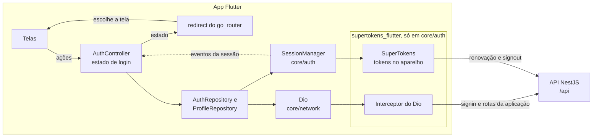
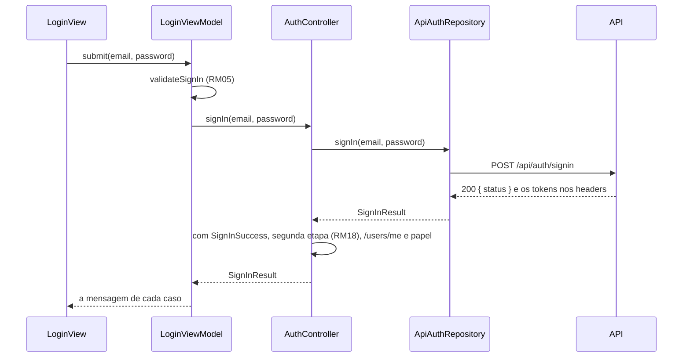
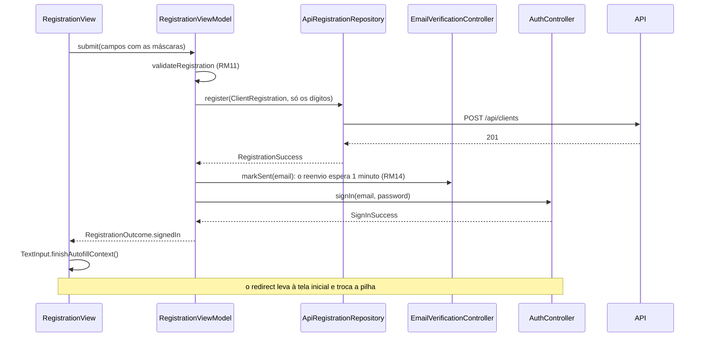
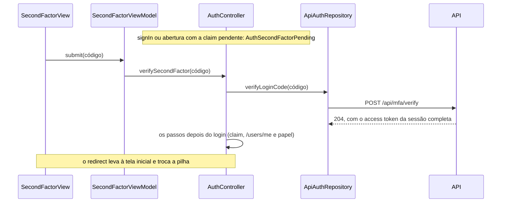
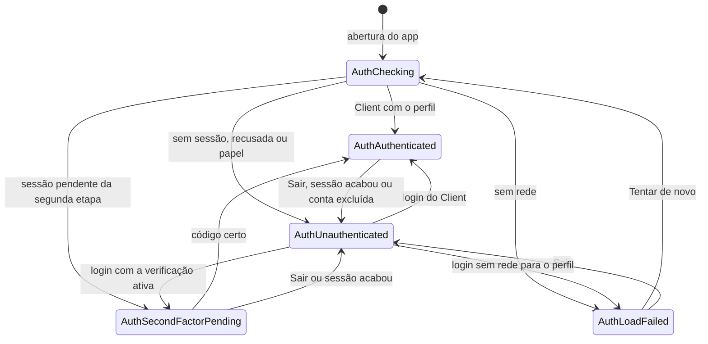

# Login, sessão e acesso no app

O app usa o **SuperTokens** da API pelo SDK [`supertokens_flutter`](https://pub.dev/packages/supertokens_flutter) 0.6.5, com a sessão por header. Este documento explica como o SDK está integrado, como o app decide qual tela mostrar, como o cidadão cria a conta, recupera o acesso, confirma o e-mail, passa pela verificação em duas etapas e cuida da própria conta, e como criar uma tela autenticada nova.

> O funcionamento da sessão do lado da API (Core, guard, papéis e renovação) está no [AUTH.md do backend](https://github.com/jgtsuchiya/projeto_integrador_reportaAiCm_backend/blob/develop/docs/AUTH.md), e o guia das rotas para os fronts, no [FRONTEND.md](https://github.com/jgtsuchiya/projeto_integrador_reportaAiCm_backend/blob/develop/docs/FRONTEND.md). As decisões e as regras RM01 a RM10 estão no [plano do login](sprints/sprint-3-login.md), e as RM11 a RM19, no [plano do acesso](sprints/sprint-4-acesso.md). A RM18 substitui a RM08.

## Sumário

- [Visão geral](#visão-geral)
- [Integração com o SuperTokens](#integração-com-o-supertokens)
- [Login](#login)
- [Cadastro](#cadastro)
- [Esqueci minha senha](#esqueci-minha-senha)
- [Confirmação do e-mail](#confirmação-do-e-mail)
- [Verificação em duas etapas](#verificação-em-duas-etapas)
- [Minha conta](#minha-conta)
- [Estado de login: o AuthController](#estado-de-login-o-authcontroller)
- [Rotas e redirect](#rotas-e-redirect)
- [Regras do app](#regras-do-app)
- [Como criar uma tela autenticada nova](#como-criar-uma-tela-autenticada-nova)
- [Cuidados](#cuidados)
- [Fora do escopo](#fora-do-escopo)

## Visão geral



Três pontos valem para todo o resto do documento:

- **Só o `core/auth/` conhece o SDK.** O resto do app depende da interface `SessionManager`, no papel do `IdentityProvider` do backend. O [teste de arquitetura](../test/architecture_test.dart) barra o `package:supertokens_flutter` fora dessa pasta.
- **O `AuthController` é a fonte da verdade.** Ele confere a sessão na abertura, entra, conclui a segunda etapa, atualiza o perfil, sai, exclui a conta e ouve o fim da sessão. As telas chamam as ações dele e desenham o estado.
- **Nenhuma tela navega sozinha depois do login, do código da segunda etapa, do "Sair" ou da exclusão da conta.** A tela muda o estado, e o redirect do go_router leva à tela certa.

| Peça                                                                                                                                  | Papel                                                                                                                              |
| ------------------------------------------------------------------------------------------------------------------------------------- | ---------------------------------------------------------------------------------------------------------------------------------- |
| [`SessionManager`](../lib/core/auth/session_manager.dart)                                                                             | Contrato da sessão: `hasSession`, `isSecondFactorPending`, `signOut` e o `Stream` de `SessionEvent`                                |
| [`SuperTokensSessionManager`](../lib/core/auth/supertokens_session_manager.dart)                                                      | Implementação com o SDK. Faz o `SuperTokens.init` e converte os eventos do SDK                                                     |
| [`sessionInterceptors`](../lib/core/auth/session_interceptors.dart)                                                                   | Os interceptors da sessão, para o `Dio` compartilhado: o do SDK e o `UnauthorizedResponseInterceptor`                              |
| [`sessionManagerProvider`](../lib/core/auth/session_manager_provider.dart)                                                            | O `SessionManager` do app. Sem valor padrão: o `main` e os testes o fornecem por override                                          |
| [`ApiAuthRepository`](../lib/features/auth/data/repositories/api_auth_repository.dart)                                                | O login pelo `POST /api/auth/signin` e o código da segunda etapa, no `Dio`. O resto da sessão vai para o `SessionManager`          |
| [`ApiProfileRepository`](../lib/features/profile/data/repositories/api_profile_repository.dart)                                       | O perfil e o papel (`GET /api/users/me`), a edição dos dados, a troca de senha, a verificação em duas etapas e a exclusão da conta |
| [`AuthController`](../lib/features/auth/presentation/controllers/auth_controller.dart) e `AuthState`                                  | O estado de login do app inteiro ([AuthController](#estado-de-login-o-authcontroller))                                             |
| [`redirectFor` e `routerProvider`](../lib/app/router.dart)                                                                            | Escolhem a tela a partir do `AuthState` ([rotas](#rotas-e-redirect))                                                               |
| [`SplashView`](../lib/features/auth/presentation/views/splash_view.dart)                                                              | Abertura (`/abertura`): o carregando e, sem rede, o erro com "Tentar de novo" e "Sair"                                             |
| [`LoginView` e `LoginViewModel`](../lib/features/auth/presentation/views/login_view.dart)                                             | Login (`/login`): os campos, a conferência antes de enviar, a mensagem de cada resposta e a contagem do 429                        |
| [`ApiRegistrationRepository`](../lib/features/auth/data/repositories/api_registration_repository.dart)                                | O cadastro do Client pelo `POST /api/clients` ([cadastro](#cadastro))                                                              |
| [`RegistrationView` e `RegistrationViewModel`](../lib/features/auth/presentation/views/registration_view.dart)                        | Cadastro (`/cadastro`): os campos com as máscaras, a regra da senha e o login automático (RM11 e RM12)                             |
| [`ForgotPasswordView` e `ForgotPasswordViewModel`](../lib/features/auth/presentation/views/forgot_password_view.dart)                 | "Esqueci minha senha" (`/esqueci-senha`): o pedido do link e a espera para pedir de novo (RM13)                                    |
| [`EmailVerificationNotice` e `EmailVerificationController`](../lib/features/auth/presentation/widgets/email_verification_notice.dart) | O aviso do e-mail não confirmado, com o reenvio do link, usado pela tela inicial e pelas dos reportes (RM14)                       |
| [`SecondFactorView` e `SecondFactorViewModel`](../lib/features/auth/presentation/views/second_factor_view.dart)                       | Código da segunda etapa (`/verificacao`), com a sessão pendente: o código, o reenvio e o "Sair" (RM18)                             |
| [`HomeView` e `HomeViewModel`](../lib/features/home/presentation/views/home_view.dart)                                                | Tela inicial (`/inicio`): os dados do `/users/me`, a "Minha conta" e o "puxar para atualizar"                                      |
| [`features/account/`](../lib/features/account)                                                                                        | A "Minha conta" (`/conta` e as telas embaixo dela) e as sessões abertas ([Minha conta](#minha-conta))                              |
| [`SignOutButton`](../lib/features/auth/presentation/widgets/sign_out_button.dart)                                                     | O "Sair", com a confirmação e o erro sem conexão. Serve a qualquer tela                                                            |

## Integração com o SuperTokens

### Inicialização

O SDK é global e aceita uma inicialização só. O `main` o inicializa antes do `runApp`, e o `SessionManager` entra no `ProviderScope` por override:

```dart
// lib/main.dart
final sessionManager = SuperTokensSessionManager.initialize(config);

runApp(
  ProviderScope(
    overrides: [
      appConfigProvider.overrideWithValue(config),
      sessionManagerProvider.overrideWithValue(sessionManager),
    ],
    retry: noAutomaticRetry,
    child: const App(),
  ),
);
```

O `SuperTokensSessionManager.initialize` chama o `SuperTokens.init` com:

| Opção                 | Valor                                     | Por quê                                                                      |
| --------------------- | ----------------------------------------- | ---------------------------------------------------------------------------- |
| `apiDomain`           | A `API_URL` (ex.: `http://10.0.2.2:3000`) | Sem o `/api`: o SDK monta as rotas com o `apiBasePath`                       |
| `apiBasePath`         | `/api/auth`                               | Onde a API atende as rotas do SuperTokens                                    |
| `tokenTransferMethod` | `HEADER`                                  | O modo que a API espera do app. É o padrão do SDK, deixado explícito         |
| `eventHandler`        | `_onSdkEvent`                             | Converte os eventos do SDK em `SessionEvent` ([eventos](#eventos-da-sessão)) |
| `enableDebugLogs`     | `false`                                   | O log do SDK mostra os tokens (RM09): fica desligado também em debug         |

### Interceptors no Dio

O [`createDio`](../lib/core/network/dio_provider.dart) registra os interceptors da sessão no `Dio` compartilhado, antes do de log:

| Ordem | Interceptor                       | O que faz                                                                                                                                                                  |
| ----- | --------------------------------- | -------------------------------------------------------------------------------------------------------------------------------------------------------------------------- |
| 1     | `SuperTokensInterceptorWrapper`   | Do SDK. Põe o access token no `Authorization`, guarda os tokens que voltam nos headers (inclusive os do login) e, num 401, renova a sessão e repete a chamada              |
| 2     | `UnauthorizedResponseInterceptor` | Do app. Quando a sessão não renova, o SDK entrega o 401 como uma resposta comum: este interceptor a devolve como erro, e o `callApi` a converte na `UnauthorizedException` |
| 3     | `ApiLogInterceptor`               | Só em debug. Mostra a requisição depois da renovação, com os headers de sessão mascarados ([ARCHITECTURE.md](ARCHITECTURE.md#log))                                         |

A renovação (`/api/auth/session/refresh`) e o signout (`/api/auth/signout`) saem pelo pacote `http`, por dentro do SDK, e não passam pelo `Dio`: elas não aparecem no log do app.

### SessionManager

| Método                    | Função do SDK                     | Comportamento                                                                                                                                         |
| ------------------------- | --------------------------------- | ----------------------------------------------------------------------------------------------------------------------------------------------------- |
| `hasSession()`            | `doesSessionExist()`              | Se há sessão guardada. Com o access token vencido, tenta renovar antes. Sem rede para renovar, responde `true`: a sessão não é apagada (RM06)         |
| `isSecondFactorPending()` | `getAccessTokenPayloadSecurely()` | Se a claim `mfa-verified` do access token tem `v == false` (RN25). Lança a `UnauthorizedException` se a sessão acabou e a `NetworkException` sem rede |
| `signOut()`               | `signOut()`                       | Encerra a sessão na API e apaga os tokens. Sem resposta da API, o SDK mantém os tokens, e o método lança a `NetworkException` (RM10)                  |
| `events`                  | `eventHandler`                    | Os `SessionEvent` enquanto o app está aberto: `expired` e `signedOut`                                                                                 |

O SDK não diz se uma falha foi da rede ou da API. O `SuperTokensSessionManager` descobre pelos tokens guardados: se o SDK os apagou, a API recusou a sessão (`UnauthorizedException`); se não, a API não respondeu (`NetworkException`).

### Eventos da sessão

| Evento do SDK                                                         | `SessionEvent` | No `AuthController`                                                                                                                                        |
| --------------------------------------------------------------------- | -------------- | ---------------------------------------------------------------------------------------------------------------------------------------------------------- |
| `UNAUTHORISED`                                                        | `expired`      | Login com "Sua sessão expirou. Entre de novo." (RM07). Vale em qualquer estado, menos no próprio login e na saída do próprio controller (a conta excluída) |
| `SIGN_OUT`, com os tokens já apagados                                 | `signedOut`    | Login sem aviso. Ignorado quando quem saiu foi o próprio controller (RM01 e RM17), que mostra o motivo dele                                                |
| `SESSION_CREATED`, `REFRESH_SESSION` e `ACCESS_TOKEN_PAYLOAD_UPDATED` | (nenhum)       | O app não depende deles                                                                                                                                    |

O `UNAUTHORISED` chega quando a sessão não renova mais: o refresh token venceu (7 dias sem uso), o usuário foi inativado ou excluído, ou a sessão foi encerrada em outro aparelho (pela lista de sessões, pela troca ou pela redefinição de senha). O usuário inativado ou excluído perde o acesso na chamada seguinte, porque a API confere o status a cada requisição. A sessão encerrada em outro aparelho só cai na renovação seguinte, em até 15 minutos.

O SDK avisa o `SIGN_OUT` mesmo quando o signout não chegou à API. Por isso o `signedOut` só sai com os tokens apagados.

### Onde os tokens ficam

O SDK guarda o access token, o refresh token e o front token no **SharedPreferences**, sem criptografia. No Android, é um arquivo privado do app, e o backup automático está desligado (`android:allowBackup="false"` no [AndroidManifest](../android/app/src/main/AndroidManifest.xml)), para os tokens não irem para a nuvem. Guardar no Keychain ou no Keystore exigiria trocar o armazenamento do SDK: é um dos [pontos em aberto](sprints/sprint-3-login.md#9-pontos-em-aberto).

## Login

O SDK de Flutter só cuida da sessão e não tem função de login. O login é uma chamada à API pelo `Dio` compartilhado, e o interceptor do SDK guarda os tokens que voltam na resposta:



- O corpo vai no formato do SuperTokens (`formFields`), com o e-mail sem os espaços das pontas e em minúsculas (RN02), pelo `normalizeEmail` de [`email.dart`](../lib/features/auth/domain/models/email.dart). O mesmo arquivo tem o `isValidEmail`, com as regras do value object `Email` do backend.
- Antes de enviar, o `validateSignIn` confere só que o e-mail está preenchido e no formato e que a senha está preenchida (RM05). A política de senha (RN08) fica para o cadastro.
- O 429 vem no formato de erro da aplicação, sem `status`. O `ApiAuthRepository` o converte no `SignInRateLimited`, com o `Retry-After` (ou 1 minuto, sem o header).

| Resposta da API                               | `SignInResult` ou exceção | Na tela                                                                                          |
| --------------------------------------------- | ------------------------- | ------------------------------------------------------------------------------------------------ |
| 200, `OK`                                     | `SignInSuccess`           | Segue para a tela do código, se a conta tem a verificação ativa, ou para o `/users/me` e o papel |
| 200, `WRONG_CREDENTIALS_ERROR`                | `SignInWrongCredentials`  | "E-mail ou senha incorretos." A senha é apagada, e o e-mail continua (RM02)                      |
| 200, `FIELD_ERROR`                            | `SignInFieldError`        | A mensagem de cada campo embaixo dele, em português (as do SuperTokens vêm em inglês)            |
| 200, `GENERAL_ERROR`                          | `SignInLocked`            | A `message` da API, sem contagem: a API não diz quanto falta (RN17, RM03)                        |
| 429                                           | `SignInRateLimited`       | "Muitas tentativas. Tente de novo em N s.", com o "Entrar" desativado até o fim (RN18, RM04)     |
| Sem conexão ou timeout                        | `NetworkException`        | "Não foi possível conectar ao servidor. Confira a sua internet."                                 |
| 5xx, outro status ou resposta fora do formato | `ServerException`         | "Algo deu errado. Tente de novo em instantes."                                                   |

Com o `SignInSuccess`, a `LoginView` chama o `TextInput.finishAutofillContext()`, para o gerenciador de senhas do aparelho oferecer salvar. Os campos ficam num `AutofillGroup`, com as dicas `email` e `password`.

## Cadastro

O cidadão cria a conta pelo "Criar conta" do login, que abre o cadastro (`/cadastro`) por cima dele. A API não abre a sessão no cadastro: com a conta criada, o app entra sozinho, pelo mesmo `AuthController.signIn` do login, com o e-mail e a senha que o cidadão acabou de digitar (RM12).



- **Conferência antes de enviar (RM11).** O [`validateRegistration`](../lib/features/auth/domain/models/registration_validation.dart) repete as regras dos value objects da API (`Cpf`, `Phone`, `BirthDate`, `Password` e o tamanho do nome), com as mesmas mensagens. Duas mudam de propósito: o campo vazio pede o campo ("Informe o CPF."), como no login, e a data fora do formato pede o da tela (`DD/MM/AAAA`), e não o da API ([ARCHITECTURE.md](ARCHITECTURE.md#o-paralelo-com-o-backend)).
- **Máscaras.** O CPF, o telefone e a data usam os `TextInputFormatter` de [`core/utils/`](../lib/core/utils). O app envia o CPF e o telefone só com os dígitos (`digitsOnly`) e a data em `AAAA-MM-DD` (`maskedDateToIso`).
- **Senha.** A regra da RN08 aparece embaixo do campo, com cada item marcado quando cumprido ([`PasswordRules`](../lib/features/auth/presentation/widgets/password_rules.dart)). A [troca de senha](#trocar-a-senha) usa o mesmo widget e o mesmo `validatePassword`.
- **A senha não fica guardada.** O ViewModel não guarda a senha depois do envio. Com a conta criada, a tela chama o `TextInput.finishAutofillContext()`, e só o gerenciador de senhas do aparelho a salva. Os campos ficam num `AutofillGroup`, com as dicas `name`, `email`, `newPassword` e `telephoneNumber`.
- **Log.** O `ApiLogInterceptor` mostra o corpo do cadastro com a `password` e o `cpf` como `***`, na ida e na volta (RM09). O `ClientRegistration.toString` também os esconde.

| Resposta da API                | `RegistrationResult` ou exceção                | Na tela                                                                                            |
| ------------------------------ | ---------------------------------------------- | -------------------------------------------------------------------------------------------------- |
| 201                            | `RegistrationSuccess`                          | O login automático e a tela inicial com o aviso do e-mail (RM12)                                   |
| 400 com o `details`            | `RegistrationFieldErrors`                      | A mensagem de cada campo embaixo dele                                                              |
| 409, campo `email`             | `RegistrationFieldErrors(alreadyInUse: email)` | A `message` no campo do e-mail, com os atalhos "Entrar" e "Esqueci minha senha"                    |
| 409, campo `cpf`               | `RegistrationFieldErrors(alreadyInUse: cpf)`   | A `message` no campo do CPF                                                                        |
| 429                            | `RegistrationRateLimited`                      | "Muitas tentativas. Tente de novo em N s.", com o "Criar conta" desativado até o fim (como a RM04) |
| 400 ou 409 sem campo conhecido | `ValidationException` ou `ConflictException`   | A `message` geral, acima do "Criar conta"                                                          |
| Sem conexão, 5xx               | `NetworkException` ou `ServerException`        | As mensagens padrão do `core/network`. Os campos continuam preenchidos                             |

**Login automático que não entra (RM12).** Se o login depois do 201 não entrar (sem conexão, ou uma resposta inesperada), a conta já existe: a tela volta ao login com o e-mail preenchido e o aviso "Sua conta foi criada. Entre com o e-mail e a senha.".

### Voltar ao login: o `LoginPrefill`

O cadastro e o "Esqueci minha senha" abrem com o `context.push`, por cima do login, e voltam a ele com o [`returnToLogin`](../lib/features/auth/presentation/views/login_view.dart), que fecha a tela com um `LoginPrefill`: o e-mail para preencher o campo e o aviso, se houver. O login preenche o e-mail, apaga a senha e mostra o aviso pelo `LoginViewModel.showNotice` (que não interrompe a contagem do 429).

O atalho "Esqueci minha senha" do 409 também volta ao login, com o `openForgotPassword`, e o login abre o "Esqueci minha senha" em seguida. Assim, o "voltar" de lá volta ao login, e não ao cadastro. Trocar o cadastro pelo "Esqueci minha senha" com o `pushReplacement` não serviria: o go_router cria um `Future` novo, e o do `push` do login nunca completaria.

## Esqueci minha senha

O "Esqueci minha senha" do login abre o `/esqueci-senha` com o e-mail que já estava digitado (pelo `extra` da rota). A tela pede o link pelo `AuthRepository.requestPasswordReset` (`POST /api/password-resets`, com o e-mail pelo `normalizeEmail`). A senha nova é criada na página `/redefinir-senha` do painel web, que o link do e-mail abre no navegador: a tela explica isso e pede para o cidadão voltar ao app depois.

| Resposta da API  | Na tela                                                                                                                                                                                   |
| ---------------- | ----------------------------------------------------------------------------------------------------------------------------------------------------------------------------------------- |
| 204              | Sempre a mesma mensagem, com ou sem conta (RN20): "Se este e-mail tiver uma conta, você vai receber um link para criar uma senha nova. O link vale por 60 minutos." e o "Voltar ao login" |
| 400              | A mensagem do e-mail, no campo                                                                                                                                                            |
| 429              | A contagem do `Retry-After`, como no login                                                                                                                                                |
| Sem conexão, 5xx | As mensagens padrão do `core/network`                                                                                                                                                     |

- **Espera para pedir de novo (RM13).** Depois do 204, o botão vira "Enviar de novo em N s" e volta em 60 s: a API manda no máximo um e-mail por minuto para a mesma conta. Com outro e-mail no campo (o cidadão corrigiu o que digitou), é outra conta, e o botão volta a pedir o link sem a espera. A contagem do 429 continua, porque o limite é do IP.
- **Voltar ao login.** O "Voltar ao login" leva o e-mail do campo para o login.

## Confirmação do e-mail

O Client nasce com o e-mail não confirmado (`emailVerifiedAt` nulo) e recebe, no cadastro, o link de confirmação, que abre a página `/verificar-email` do painel web. O login não depende disso, mas os reportes exigem o e-mail confirmado.

O [`EmailVerificationNotice`](../lib/features/auth/presentation/widgets/email_verification_notice.dart) é o aviso "Confirme o seu e-mail", com o endereço, o motivo (abrir e validar reportes) e o "Reenviar e-mail" (`ProfileRepository.resendEmailVerification`, `POST /api/users/me/email-verification`). Ele aparece só com o Client dentro e o `emailVerifiedAt` nulo, e serve a qualquer tela: a inicial o mostra antes do cartão dos dados, no lugar do selo da sprint 3, a da verificação em duas etapas o mostra no lugar do interruptor, e as telas dos reportes vão usar o mesmo widget.

```dart
// Numa tela autenticada que exige o e-mail confirmado. Fora do e-mail não confirmado, ele não
// desenha nada.
const EmailVerificationNotice(),
```

O estado do reenvio fica no [`EmailVerificationController`](../lib/features/auth/presentation/controllers/email_verification_controller.dart), sem `autoDispose`, porque a espera vale para o app inteiro (RM14):

- **Espera de 1 minuto.** Depois de cada reenvio e logo depois do cadastro (`markSent`), o botão vira "Reenviar e-mail em N s". A espera é da conta do último envio (`forAccount`): a do cadastro de uma conta não vale para outra que entrar depois.
- **Resultado anunciado.** "Enviamos um novo link para o seu e-mail." ou o erro, num `liveRegion`. O 422 mostra a `message` da API (o e-mail já confirmado ou o último envio há menos de 1 minuto) e atualiza o perfil, porque o e-mail pode ter sido confirmado no navegador.
- **Volta para o primeiro plano.** Enquanto o aviso está na tela, um `AppLifecycleListener` chama o `refreshOnResume`, que atualiza o perfil pelo `AuthController.refreshProfile`, no máximo uma vez a cada 30 s. Depois de o Client confirmar o e-mail no navegador e voltar ao app, o aviso some sozinho. Uma falha nessa atualização não aparece na tela: o "puxar para atualizar" continua mostrando os erros.

## Verificação em duas etapas

Com a verificação ativa (o `mfaEnabled` do perfil), o login passa pela senha e abre uma **sessão pendente**: a claim `mfa-verified` do access token vem com `v` igual a `false`, e a API manda um código de 6 dígitos por e-mail (RN25). A sessão pendente só acessa as rotas do código, e o app fica na tela do código até ele ser confirmado (RM18, no lugar da RM08, que encerrava a sessão).



- **A tela do código (`/verificacao`).** O campo de 6 dígitos (teclado numérico, `AutofillHints.oneTimeCode` e só dígitos), o "Confirmar", o "Enviar outro código" e o "Sair" na barra. Na abertura com a sessão pendente (o cidadão fechou o app antes do código), o app volta para esta tela.
- **Código errado.** O 422 mostra a `message` da API no campo ("Código inválido ou expirado.", a mesma para o código errado, vencido, já usado ou invalidado). A API invalida o código no 5º erro seguido, e a tela conta os erros e orienta a pedir outro. O código fora do formato é recusado antes de enviar, com a mesma mensagem do 400 da API.
- **Outro código.** O "Enviar outro código" (`POST /api/mfa/code`) começa desativado por 60 s, porque o login acabou de mandar um, e espera de novo depois de cada envio. O código novo invalida o anterior, e a contagem de erros volta a zero.
- **"Sair".** O `SignOutButton` encerra a sessão pendente, como qualquer outra (a API aceita o signout dela).
- **Log.** O `ApiLogInterceptor` mascara o campo `code`.

Ativar e desativar fica na tela [`/conta/verificacao`](#verificação-em-duas-etapas-na-conta), da "Minha conta".

## Minha conta

A "Minha conta" (`/conta`) abre pela ação da barra da tela inicial, com o `context.push`, e mostra o cartão dos dados (o mesmo da tela inicial, com o CPF mascarado, RM09), as entradas das telas abaixo e o "Sair". Cada tela abre por cima dela, e o "voltar" volta para ela. As telas ficam em [`features/account/`](../lib/features/account), que depende das features `auth` e `profile` sem que elas dependam dela.

| Tela                       | Rota                 | Rotas da API                                                           |
| -------------------------- | -------------------- | ---------------------------------------------------------------------- |
| Editar dados               | `/conta/dados`       | `PATCH /api/users/me`                                                  |
| Trocar senha               | `/conta/senha`       | `PATCH /api/users/me/password`                                         |
| Sessões abertas            | `/conta/sessoes`     | `GET /api/users/me/sessions`, `DELETE /api/users/me/sessions` e `/:id` |
| Verificação em duas etapas | `/conta/verificacao` | `PATCH /api/users/me/mfa`                                              |
| Excluir conta              | `/conta/excluir`     | `DELETE /api/users/me`                                                 |

**O perfil novo vai para o `AuthController`.** A edição dos dados e a verificação em duas etapas devolvem o perfil atualizado, que vai para o `AuthController.replaceProfile`: a tela inicial e a "Minha conta" mostram os dados novos sem buscar o perfil de novo.

### A senha de confirmação (RM15)

A troca de senha, a verificação em duas etapas e a exclusão pedem a senha atual. A senha errada responde **422** (`BusinessRuleException`, com o `field` igual a `currentPassword` ou `password`), desde a T8 do backend: antes, ela respondia 401, que o SDK trata como sessão vencida, renovando a sessão e repetindo a chamada até 10 vezes. O `isIncorrectPassword` reconhece o caso, e a tela mostra "Senha atual incorreta." no campo e o apaga. A senha errada nunca leva ao login.

### Editar dados

O nome, o telefone e a data de nascimento, com as regras e as máscaras do cadastro (o [`validateProfileChanges`](../lib/features/profile/domain/models/profile_changes.dart) usa as mesmas funções e mensagens do `validateRegistration`). O e-mail e o CPF aparecem, sem edição. Só os campos que mudaram vão para a API (o `profileChangesOf` compara com o perfil), e sem mudança o "Salvar" fica desativado. Ao sair com alterações não salvas, um `PopScope` pergunta se quer descartá-las.

### Trocar a senha

A senha atual, a nova (com a regra visível) e a confirmação, num `AutofillGroup` (dicas `password` e `newPassword`). Antes do botão, o aviso de que os outros aparelhos vão sair (RM16): a API revoga as outras sessões, e este aparelho continua logado. Com o 204, a tela chama o `TextInput.finishAutofillContext()`, para o gerenciador de senhas oferecer atualizar a senha guardada, e volta para a "Minha conta" com o aviso.

### Sessões abertas

A lista vem do `SessionsRepository`, com a sessão deste aparelho primeiro, marcada "Este aparelho" e sem o "Encerrar" (RM19). Cada sessão mostra o aparelho (lido do user agent pelo `deviceOf`: "App ReportaAi (Android)", "Navegador" ou "Aparelho desconhecido"), a data e a hora do login e o IP. O "Encerrar" e o "Encerrar todas as outras" pedem confirmação, e o 404 (a sessão já tinha acabado) tira a sessão da lista sem erro. Puxar para atualizar busca a lista de novo. O IP e o user agent não vão para o log.

O `Dio` manda o `User-Agent` do app, `ReportaAiCm/<versão> (<sistema>)`, com a versão do `package_info_plus` ([ARCHITECTURE.md](ARCHITECTURE.md#rede-corenetwork)). A API grava o do login: as sessões abertas antes da sprint 4, ou por outro cliente (como o `api.http`), aparecem como "Aparelho desconhecido".

### Verificação em duas etapas na conta

O estado atual, o interruptor e, depois de mexer nele, a senha atual e o botão de confirmar. Ao ativar, o aviso de que os outros aparelhos saem e vão pedir o código no próximo login. Ativar exige o e-mail confirmado: sem ele, a tela mostra o `EmailVerificationNotice` no lugar do interruptor. Desativar não exige.

### Excluir a conta (RM17)

A tela explica o que acontece (os dados pessoais apagados, o nome "Usuário excluído", a saída de todos os aparelhos, o e-mail e o CPF livres e os reportes com a prefeitura, sem o nome), e o "Excluir minha conta", na cor de erro, só fica ativo com a senha e a caixa "Entendo que a exclusão não pode ser desfeita". A exclusão dentro do app é exigência da Google Play para os apps que permitem criar conta.

Com o 204, o `AuthController.deleteAccount` apaga a sessão do aparelho e volta ao login com "Sua conta foi excluída.". A API não manda apagar os tokens na resposta, e a sessão já não existe nela: o `signOut` do SDK é recusado, a renovação também, e só então o SDK apaga os tokens e avisa o `UNAUTHORISED`, como se a sessão tivesse vencido. O controller ignora os eventos da saída que ele mesmo faz, e o motivo mostrado é o da exclusão, e não o da RM07.

## Estado de login: o AuthController

O [`AuthController`](../lib/features/auth/presentation/controllers/auth_controller.dart) é um `Notifier` do Riverpod, sem `autoDispose`: o `routerProvider` o ouve enquanto o app está aberto. O estado é o `AuthState`, uma `sealed class`:

| Estado                        | Quando                                                                                                               | Tela           |
| ----------------------------- | -------------------------------------------------------------------------------------------------------------------- | -------------- |
| `AuthChecking`                | Conferindo a sessão guardada, na abertura ou no "Tentar de novo"                                                     | `/abertura`    |
| `AuthUnauthenticated(reason)` | Sem sessão. O `reason` diz por que o usuário voltou ao login, e é `null` quando ele nunca entrou ou saiu pelo "Sair" | `/login`       |
| `AuthSecondFactorPending`     | A sessão está pendente da segunda etapa: falta o código enviado por e-mail (RM18)                                    | `/verificacao` |
| `AuthAuthenticated(profile)`  | O Client entrou, com o perfil do `GET /api/users/me`                                                                 | `/inicio`      |
| `AuthLoadFailed(error)`       | Há sessão, mas o perfil não carregou (sem rede ou API fora do ar). A sessão não é apagada (RM06)                     | `/abertura`    |



### Os passos depois que existe uma sessão

Na abertura, no login e depois do código da segunda etapa, os passos são os mesmos, nesta ordem:

1. **Segunda etapa pendente (RM18).** Com a claim `mfa-verified` em `false`, o controller vai para o `AuthSecondFactorPending`, sem chamar o `/users/me`, e o redirect abre a tela do código. A sessão continua.
2. **`GET /api/users/me`.** Um 403 de sessão pendente aqui (`SecondFactorPendingException`) também leva ao `AuthSecondFactorPending`.
3. **Papel CLIENT (RM01).** Com outro papel (ou um `Role.unknown`), o controller encerra a sessão e volta ao login com o aviso.
4. **Tela inicial**, com o `AuthAuthenticated(profile)`.

O "puxar para atualizar" da tela inicial repete os passos 2 e 3.

### Ações

| Ação                       | Quem chama                                                                      | O que faz                                                                                                 | Com erro                                                                                |
| -------------------------- | ------------------------------------------------------------------------------- | --------------------------------------------------------------------------------------------------------- | --------------------------------------------------------------------------------------- |
| `build()`                  | O `routerProvider`, na abertura                                                 | `hasSession()` e, com sessão, os passos acima                                                             | Sessão recusada: login com o aviso (RM07). Sem rede: `AuthLoadFailed` (RM06)            |
| `retry()`                  | O "Tentar de novo" da abertura                                                  | O mesmo do `build()`                                                                                      | O mesmo do `build()`                                                                    |
| `signIn(...)`              | `LoginViewModel` e `RegistrationViewModel` (o login automático)                 | Tira o motivo da tela, chama o signin e, com o `SignInSuccess`, os passos acima. Devolve o `SignInResult` | Lança a `ApiException` do signin, e o usuário continua no login                         |
| `verifySecondFactor(code)` | `SecondFactorViewModel`                                                         | Confere o código (`POST /api/mfa/verify`) e segue os passos acima. Só com a sessão pendente               | Lança a `ApiException` (o 422 do código errado), e a sessão continua pendente           |
| `replaceProfile(profile)`  | Os ViewModels da edição dos dados e da verificação em duas etapas               | Troca o perfil guardado pelo que a API devolveu. Só com o Client dentro                                   | (nenhum)                                                                                |
| `deleteAccount(password)`  | `DeleteAccountViewModel`                                                        | Exclui a conta (`DELETE /api/users/me`), apaga a sessão e volta ao login com o aviso (RM17)               | Lança a `ApiException` (o 422 da senha incorreta), e o Client continua dentro           |
| `refreshProfile()`         | `HomeViewModel` e `EmailVerificationController` (a volta para o primeiro plano) | O `/users/me` e o papel de novo                                                                           | Lança a `ApiException`, e o perfil na tela continua. Sessão recusada: login com o aviso |
| `signOut()`                | `SignOutButton`                                                                 | Encerra a sessão na API e volta ao login, sem aviso. Vale também com a sessão pendente                    | Lança a `NetworkException`, e o usuário continua logado (RM10)                          |

### Motivos de voltar ao login

| `UnauthenticatedReason` | Mensagem no login                                                     | Regra |
| ----------------------- | --------------------------------------------------------------------- | ----- |
| `sessionExpired`        | "Sua sessão expirou. Entre de novo."                                  | RM07  |
| `roleNotAllowed`        | "Este aplicativo é para cidadãos. Administradores usam o painel web." | RM01  |
| `accountDeleted`        | "Sua conta foi excluída."                                             | RM17  |

O motivo sai da tela assim que o usuário tenta entrar de novo.

### Operações atropeladas

Uma operação pode esperar a API enquanto o estado muda por outro caminho: a sessão expira (evento do SDK) enquanto o `/users/me` da abertura espera, o usuário sai durante o "puxar para atualizar", ou o perfil salvo chega (`replaceProfile`) com uma atualização em andamento. Cada operação ganha um número, e ela só guarda o resultado se nada mudou o estado enquanto esperava. Assim, o aviso da RM07 não é apagado por uma resposta atrasada, e o perfil antigo não volta por cima do novo.

## Rotas e redirect

O [`redirectFor`](../lib/app/router.dart) é uma função pura, testada sem tela, que escolhe a rota a partir do `AuthState`:

| Estado                             | Rota pedida                                          | Vai para       |
| ---------------------------------- | ---------------------------------------------------- | -------------- |
| `AuthChecking` ou `AuthLoadFailed` | qualquer uma, também as públicas                     | `/abertura`    |
| `AuthUnauthenticated`              | uma pública (`/cadastro` ou `/esqueci-senha`)        | a pedida       |
| `AuthUnauthenticated`              | outra                                                | `/login`       |
| `AuthSecondFactorPending`          | qualquer uma                                         | `/verificacao` |
| `AuthAuthenticated`                | `/abertura`, `/login`, `/verificacao` ou uma pública | `/inicio`      |
| `AuthAuthenticated`                | outra                                                | a pedida       |
| qualquer um                        | `/diagnostico` (só em debug)                         | a pedida       |

- **Rotas públicas.** O cadastro e o "Esqueci minha senha" abrem sem sessão, como uma rota com o `@Public()` no backend. A lista fica em `AppRoutes.public`. Com o Client dentro, elas levam à tela inicial: é assim que o login automático do cadastro sai do `/cadastro`.

- O `routerProvider` ouve o `authControllerProvider` e chama o `notify()` do `RouterRefreshNotifier` (o `refreshListenable`), que faz o go_router reavaliar o redirect, quando o **tipo** do estado muda (`changesRoute`). O perfil novo depois de salvar os dados não reavalia: o go_router reconstruiria a pilha a partir da última rota que conhece, e a tela que acabou de fechar com o `pop` voltaria a abrir.
- **As telas da conta** ficam embaixo da `/conta` no `createRouter`: um deep link para `/conta/dados` abre com a `/conta` atrás. Elas abrem só com o Client dentro, como qualquer rota autenticada.
- O redirect troca a pilha inteira. Por isso, o "voltar" do Android na tela inicial fecha o app, sem voltar ao login nem ao cadastro, e o "voltar" no login, depois do "Sair", não volta à tela inicial.
- O cadastro e o "Esqueci minha senha" abrem com o `context.push`, por cima do login: o "voltar" deles volta ao login ([`LoginPrefill`](#voltar-ao-login-o-loginprefill)).
- Uma rota que não existe leva à tela inicial, ou ao login pelo redirect.

## Regras do app

O texto completo das regras está no [plano do login](sprints/sprint-3-login.md#3-regras-do-app) (RM01 a RM10) e no [plano do acesso](sprints/sprint-4-acesso.md#3-regras-do-app) (RM11 a RM19). Cada teste que confere uma regra termina com o código dela: `fvm flutter test --name RM07` roda todos os da RM07.

| Código | Regra                                                                                                                                         | Onde fica                                                                                                                                           | Testes principais                                                                                                                     |
| ------ | --------------------------------------------------------------------------------------------------------------------------------------------- | --------------------------------------------------------------------------------------------------------------------------------------------------- | ------------------------------------------------------------------------------------------------------------------------------------- |
| RM01   | Só o CLIENT entra. Outro papel sai da sessão, com o aviso no login                                                                            | `AuthController` (`_loadProfile`) e `Role`                                                                                                          | `auth_controller_test.dart` e `login_flow_test.dart`                                                                                  |
| RM02   | A mesma mensagem para senha errada e conta inexistente, inativa ou excluída                                                                   | `LoginViewModel` e `LoginView` (apaga a senha)                                                                                                      | `login_view_model_test.dart` e `login_view_test.dart`                                                                                 |
| RM03   | Bloqueio por tentativas: a `message` da API, sem contagem                                                                                     | `SignInResponseDto` e `LoginViewModel`                                                                                                              | `sign_in_response_dto_test.dart` e `login_view_model_test.dart`                                                                       |
| RM04   | Limite por IP: o "Entrar" desativado com a contagem do `Retry-After`                                                                          | `ApiAuthRepository` e `LoginViewModel` (`Timer.periodic`)                                                                                           | `login_view_model_test.dart` (com o `fakeAsync`) e `login_view_test.dart`                                                             |
| RM05   | Antes de enviar, só o e-mail preenchido e no formato e a senha preenchida                                                                     | `validateSignIn` e `isValidEmail`                                                                                                                   | `sign_in_validation_test.dart` e `email_test.dart`                                                                                    |
| RM06   | Com sessão, abre direto na tela inicial. Sem rede, erro com "Tentar de novo" e "Sair"                                                         | `SessionManager.hasSession`, `AuthController` e `SplashView`                                                                                        | `auth_controller_test.dart`, `splash_view_test.dart` e `login_flow_test.dart`                                                         |
| RM07   | A sessão acabou: login com "Sua sessão expirou. Entre de novo."                                                                               | `SuperTokensSessionManager` (`UNAUTHORISED`) e `AuthController`                                                                                     | `supertokens_session_manager_test.dart` e `login_flow_test.dart`                                                                      |
| RM08   | Substituída pela RM18: a sessão pendente não é mais encerrada                                                                                 | (nenhum)                                                                                                                                            | (nenhum)                                                                                                                              |
| RM09   | Senha, tokens e CPF fora do log e das mensagens. CPF mascarado na tela                                                                        | `ApiLogInterceptor`, `enableDebugLogs: false`, `UserProfile.toString` e `maskCpf`                                                                   | `api_log_interceptor_test.dart`, `cpf_formatters_test.dart` e `home_view_test.dart`                                                   |
| RM10   | "Sair" com confirmação. Sem conexão, avisa e continua logado                                                                                  | `SignOutButton` e `SuperTokensSessionManager.signOut`                                                                                               | `sign_out_button_test.dart`, `supertokens_session_manager_test.dart` e `login_flow_test.dart`                                         |
| RM11   | O cadastro confere antes de enviar as regras da API, com as mesmas mensagens. Os erros da API aparecem embaixo de cada campo                  | `validateRegistration` (com `isValidCpf`, `isValidPhone`, `isValidBirthDate`, `validatePassword` e `isValidUserName`) e `ApiRegistrationRepository` | `registration_validation_test.dart`, `registration_view_model_test.dart` e `registration_view_test.dart`                              |
| RM12   | Depois do cadastro, entra sozinho e abre a tela inicial. Se o login falhar, volta ao login com o e-mail. A senha não fica guardada            | `RegistrationViewModel` (`_signIn`), `RegistrationView` e `LoginPrefill`                                                                            | `registration_view_model_test.dart`, `registration_view_test.dart` e `access_flow_test.dart`                                          |
| RM13   | "Esqueci minha senha" com a mesma mensagem, com ou sem conta, e o "Enviar de novo" desativado por 60 s                                        | `ForgotPasswordViewModel` e `ForgotPasswordView`                                                                                                    | `forgot_password_view_model_test.dart`, `forgot_password_view_test.dart` e `access_flow_test.dart`                                    |
| RM14   | O aviso do e-mail com o "Reenviar e-mail" (60 s de espera, também depois do cadastro), que some ao voltar para o primeiro plano               | `EmailVerificationController` e `EmailVerificationNotice`                                                                                           | `email_verification_controller_test.dart`, `email_verification_notice_test.dart` e `access_flow_test.dart`                            |
| RM15   | A senha atual errada aparece no campo ("Senha atual incorreta."), que é apagado, e nunca leva ao login                                        | `isIncorrectPassword` (o 422 com o `field`) e os ViewModels da troca de senha, da verificação e da exclusão                                         | `change_password_view_test.dart`, `second_factor_settings_view_test.dart`, `delete_account_view_test.dart` e `account_flow_test.dart` |
| RM16   | A troca de senha avisa antes que os outros aparelhos vão sair, e este continua logado                                                         | `ChangePasswordView` e `ChangePasswordViewModel`                                                                                                    | `change_password_view_test.dart` e `account_flow_test.dart`                                                                           |
| RM17   | A exclusão explica o que acontece, pede a senha e a confirmação, e volta ao login com "Sua conta foi excluída."                               | `DeleteAccountView` e `AuthController.deleteAccount` (que ignora o evento da própria saída)                                                         | `auth_controller_test.dart`, `delete_account_view_test.dart` e `account_flow_test.dart`                                               |
| RM18   | Com a verificação ativa, o login e a abertura levam à tela do código. "Enviar outro código" espera 60 s, e o "Sair" encerra a sessão pendente | `AuthController` (`_enter`), `redirectFor`, `SecondFactorViewModel` e `SecondFactorView`                                                            | `auth_controller_test.dart`, `router_test.dart`, `second_factor_view_test.dart` e `login_flow_test.dart`                              |
| RM19   | As sessões marcam "Este aparelho", sem o "Encerrar", e o "Encerrar todas as outras" pede confirmação                                          | `SessionsViewModel`, `SessionsView` e `deviceOf`                                                                                                    | `sessions_view_model_test.dart`, `sessions_view_test.dart` e `account_flow_test.dart`                                                 |

## Como criar uma tela autenticada nova

Usando como exemplo a tela "Meus reportes" (`/reportes`), aberta pela tela inicial. A feature em si (domínio, dados e ViewModel) segue o passo a passo do [ARCHITECTURE.md](ARCHITECTURE.md#adicionando-uma-nova-feature). O que muda por ela ser autenticada:

**1. Rota.** Adicione o caminho em [`AppRoutes`](../lib/app/routes.dart) e a `GoRoute` no `createRouter`:

```dart
// lib/app/routes.dart
static const reports = '/reportes';

// lib/app/router.dart, na lista de routes do createRouter
GoRoute(path: AppRoutes.reports, builder: (context, state) => const ReportsView()),
```

A rota já nasce protegida, como uma rota do backend sem decorator: o `redirectFor` leva ao login qualquer rota, menos o diagnóstico, enquanto o estado não for `AuthAuthenticated`. Uma rota **pública** (como o cadastro e o "Esqueci minha senha") é a exceção, como o `@Public()`: ela entra no `AppRoutes.public` e ganha os casos dela no teste do `redirectFor`, no [`router_test.dart`](../test/app/router_test.dart).

**2. Repositório.** Chame a API pelo `Dio` do `dioProvider`, dentro do `callApi`. A sessão vai sozinha: o interceptor do SDK põe o `Authorization` e renova o access token vencido. O repositório não lê token nem importa o SDK:

```dart
// lib/features/reports/data/repositories/api_report_repository.dart
@override
Future<List<Report>> listMine() => callApi(() async {
  final response = await _dio.get<Object?>('/reports/mine');
  return ReportListDto.fromJson(response.data).toModel();
});
```

Não envie o id do usuário logado: as rotas do usuário (`/users/me/...`, `/reports/mine`) o leem da sessão, na API.

**3. Quem está logado.** O perfil fica no `AuthController`. Na View, leia o estado e desenhe nada fora do `AuthAuthenticated`: depois do "Sair", a tela ainda aparece durante a troca para o login, já sem o perfil (como na [`HomeView`](../lib/features/home/presentation/views/home_view.dart)):

```dart
final profile = switch (ref.watch(authControllerProvider)) {
  AuthAuthenticated(:final profile) => profile,
  _ => null,
};
```

Não guarde uma cópia do perfil no ViewModel: a fonte da verdade é o controller, e o "puxar para atualizar" da tela inicial a muda.

**4. E-mail confirmado.** Se a tela exige o e-mail confirmado (como as dos reportes), mostre o [`EmailVerificationNotice`](#confirmação-do-e-mail) no lugar da ação: ele já tem o reenvio e some sozinho depois da confirmação.

**5. Erros.** Mostre o erro com `ApiException.messageOf(error)`, como em qualquer tela. A tela não trata o fim da sessão: num 401 que não renova, o SDK avisa o `UNAUTHORISED`, e o `AuthController` leva ao login com o aviso da RM07.

**6. Navegação e "Sair".** Abra a tela com `context.push(AppRoutes.reports)`, para o "voltar" voltar à tela inicial. Se a tela tiver a barra superior própria, use o [`SignOutButton`](../lib/features/auth/presentation/widgets/sign_out_button.dart) nas `actions`: ele pede a confirmação e mostra o erro sem conexão. Nenhuma tela chama o `context.go` para o login.

**7. Testes.** O [`AuthFakes`](../test/support/auth_fakes.dart) liga o `FakeSessionManager`, o `FakeAuthRepository`, o `FakeProfileRepository`, o `FakeRegistrationRepository` e o `FakeSessionsRepository`. Com `signedIn: true`, o controller chega ao `AuthAuthenticated` com o Client de exemplo:

```dart
testWidgets('deve mostrar os reportes do Client', (tester) async {
  final fakes = AuthFakes(signedIn: true);

  await tester.pumpApp(
    const ReportsView(),
    overrides: [
      ...fakes.overrides,
      reportRepositoryProvider.overrideWithValue(FakeReportRepository()),
    ],
  );
  await tester.pump();

  expect(find.text('Rua das Flores, 120'), findsOneWidget);
});
```

- **Fim da sessão:** `fakes.session.expire()` simula o `UNAUTHORISED` do SDK.
- **Outro perfil:** `fakes.profile.result = clientProfileWith(name: 'João')`, ou o `adminProfile`, para a RM01.
- **O caminho inteiro**, da abertura até a tela nova, fica num teste de fluxo, em `test/flows/`, com o `pumpWholeApp` ([TESTING.md](TESTING.md#fluxos-do-app-inteiro)).

## Cuidados

- **O 401 é só da sessão.** O SDK trata qualquer 401 como sessão vencida: renova a sessão, repete a chamada até 10 vezes e depois desiste. Por isso a senha de confirmação errada responde 422 desde a T8 do backend ([RM15](#a-senha-de-confirmação-rm15)). Uma tela nova que confere a senha atual trata o 422 com o `isIncorrectPassword`, e não o 401.
- **Log.** Não registre a senha, os tokens nem o CPF (RM09): nem com `debugPrint`, nem na mensagem de uma exceção. O `ApiLogInterceptor` já mascara os headers de sessão e os campos sensíveis, e o `UserProfile.toString` não mostra o CPF.
- **O SDK é global.** Ele guarda a sessão em variáveis estáticas, além do SharedPreferences, e só aceita o primeiro `init`. Os testes de `core/auth/` usam o SDK de verdade com o [`FakeSessionApi`](../test/support/fake_session_api.dart), que inicializa uma vez por arquivo e encerra a sessão no fim de cada teste. Os outros testes usam o `FakeSessionManager`.
- **Testar a renovação sem esperar 15 minutos.** No `docker-compose.yml` do backend, baixe o `ACCESS_TOKEN_VALIDITY` do SuperTokens Core para `60`, recrie o container (`npm run db:up`) e use o app por mais de 1 minuto. Não faça commit dessa mudança.
- **Sessão pendente fora do login.** Uma rota da aplicação com a sessão pendente responde 403 com `claimValidationErrors`, que o `callApi` converte na `SecondFactorPendingException`, e não na `ForbiddenException`. O `AuthController` a trata como a sessão pendente, e o redirect leva à tela do código.
- **Uma tela que muda o perfil e fecha.** Mande o perfil novo pelo `replaceProfile` e feche a tela com o `context.pop()`. Não chame o `refreshProfile` só para atualizar a tela inicial: ele busca o perfil de novo, sem necessidade.

## Fora do escopo

Ainda não existem no app: a troca de e-mail, a biometria, o "lembrar este aparelho" na segunda etapa, o aplicativo autenticador (TOTP) e o deep link. A senha nova e a confirmação do e-mail ficam nas páginas `/redefinir-senha` e `/verificar-email` do painel web, que os links dos e-mails abrem no navegador; os termos de uso também ficam fora.

Os pontos em aberto estão no fim do [plano do login](sprints/sprint-3-login.md#9-pontos-em-aberto) (os tokens no SharedPreferences, o "Sair" sem internet, o CPF completo na tela inicial e a validade do refresh token) e do [plano do acesso](sprints/sprint-4-acesso.md#9-pontos-em-aberto) (as páginas do painel para os links dos e-mails, os termos de uso, a idade mínima, a exclusão sem o app e o e-mail digitado errado).
