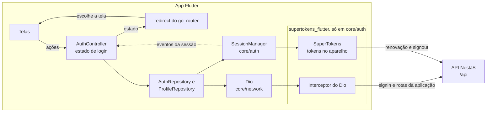
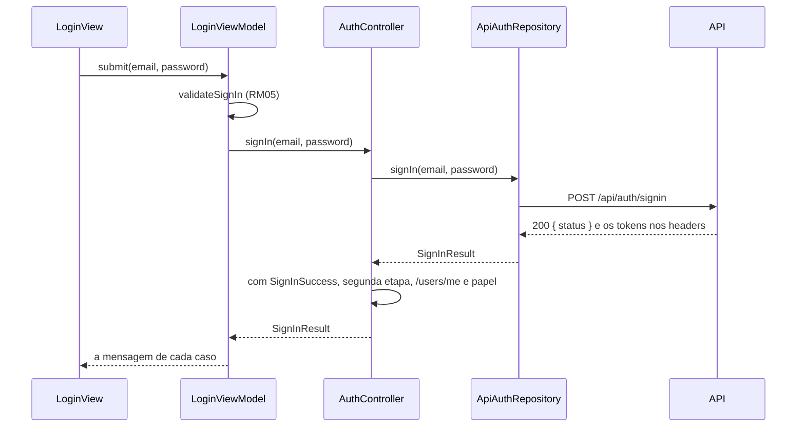
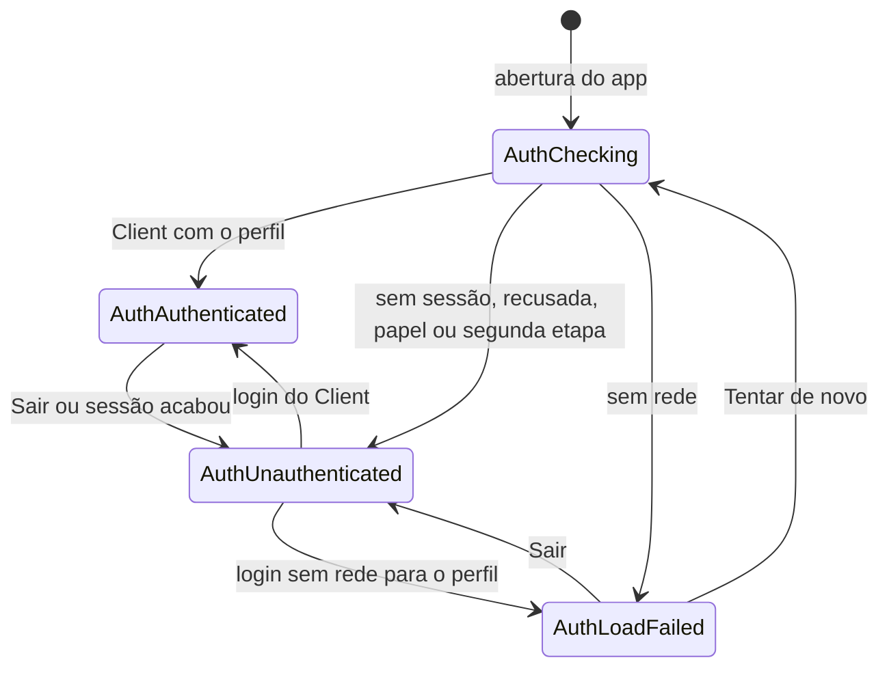

# Login e sessão no app

O app usa o **SuperTokens** da API pelo SDK [`supertokens_flutter`](https://pub.dev/packages/supertokens_flutter) 0.6.5, com a sessão por header. Este documento explica como o SDK está integrado, como o app decide qual tela mostrar e como criar uma tela autenticada nova.

> O funcionamento da sessão do lado da API (Core, guard, papéis e renovação) está no [AUTH.md do backend](https://github.com/jgtsuchiya/projeto_integrador_reportaAiCm_backend/blob/develop/docs/AUTH.md), e o guia das rotas para os fronts, no [FRONTEND.md](https://github.com/jgtsuchiya/projeto_integrador_reportaAiCm_backend/blob/develop/docs/FRONTEND.md). As decisões e as regras RM01 a RM10 estão no [plano do login](sprints/sprint-3-login.md).

## Sumário

- [Visão geral](#visão-geral)
- [Integração com o SuperTokens](#integração-com-o-supertokens)
- [Login](#login)
- [Estado de login: o AuthController](#estado-de-login-o-authcontroller)
- [Rotas e redirect](#rotas-e-redirect)
- [Regras do app](#regras-do-app)
- [Como criar uma tela autenticada nova](#como-criar-uma-tela-autenticada-nova)
- [Cuidados](#cuidados)
- [Fora do escopo](#fora-do-escopo)

## Visão geral



Três pontos valem para todo o resto do documento:

- **Só o `core/auth/` conhece o SDK.** O resto do app depende da interface `SessionManager`, no papel do `IdentityProvider` do backend. O [teste de arquitetura](../test/architecture_test.dart) barra o `package:supertokens_flutter` fora dessa pasta.
- **O `AuthController` é a fonte da verdade.** Ele confere a sessão na abertura, entra, atualiza o perfil, sai e ouve o fim da sessão. As telas chamam as ações dele e desenham o estado.
- **Nenhuma tela navega sozinha depois do login ou do "Sair".** A tela muda o estado, e o redirect do go_router leva à tela certa.

| Peça                                                                                                 | Papel                                                                                                       |
| ---------------------------------------------------------------------------------------------------- | ----------------------------------------------------------------------------------------------------------- |
| [`SessionManager`](../lib/core/auth/session_manager.dart)                                            | Contrato da sessão: `hasSession`, `isSecondFactorPending`, `signOut` e o `Stream` de `SessionEvent`         |
| [`SuperTokensSessionManager`](../lib/core/auth/supertokens_session_manager.dart)                     | Implementação com o SDK. Faz o `SuperTokens.init` e converte os eventos do SDK                              |
| [`sessionInterceptors`](../lib/core/auth/session_interceptors.dart)                                  | Os interceptors da sessão, para o `Dio` compartilhado: o do SDK e o `UnauthorizedResponseInterceptor`       |
| [`sessionManagerProvider`](../lib/core/auth/session_manager_provider.dart)                           | O `SessionManager` do app. Sem valor padrão: o `main` e os testes o fornecem por override                   |
| [`ApiAuthRepository`](../lib/features/auth/data/repositories/api_auth_repository.dart)               | O login pelo `POST /api/auth/signin`, no `Dio`. O resto da sessão vai para o `SessionManager`               |
| [`ApiProfileRepository`](../lib/features/profile/data/repositories/api_profile_repository.dart)      | O perfil e o papel, pelo `GET /api/users/me`                                                                |
| [`AuthController`](../lib/features/auth/presentation/controllers/auth_controller.dart) e `AuthState` | O estado de login do app inteiro ([AuthController](#estado-de-login-o-authcontroller))                      |
| [`redirectFor` e `routerProvider`](../lib/app/router.dart)                                           | Escolhem a tela a partir do `AuthState` ([rotas](#rotas-e-redirect))                                        |
| [`SplashView`](../lib/features/auth/presentation/views/splash_view.dart)                             | Abertura (`/abertura`): o carregando e, sem rede, o erro com "Tentar de novo" e "Sair"                      |
| [`LoginView` e `LoginViewModel`](../lib/features/auth/presentation/views/login_view.dart)            | Login (`/login`): os campos, a conferência antes de enviar, a mensagem de cada resposta e a contagem do 429 |
| [`HomeView` e `HomeViewModel`](../lib/features/home/presentation/views/home_view.dart)               | Tela inicial (`/inicio`): os dados do `/users/me` e o "puxar para atualizar"                                |
| [`SignOutButton`](../lib/features/auth/presentation/widgets/sign_out_button.dart)                    | O "Sair", com a confirmação e o erro sem conexão. Serve a qualquer tela                                     |

## Integração com o SuperTokens

### Inicialização

O SDK é global e aceita uma inicialização só. O `main` o inicializa antes do `runApp`, e o `SessionManager` entra no `ProviderScope` por override:

```dart
// lib/main.dart
final sessionManager = SuperTokensSessionManager.initialize(config);

runApp(
  ProviderScope(
    overrides: [
      appConfigProvider.overrideWithValue(config),
      sessionManagerProvider.overrideWithValue(sessionManager),
    ],
    retry: noAutomaticRetry,
    child: const App(),
  ),
);
```

O `SuperTokensSessionManager.initialize` chama o `SuperTokens.init` com:

| Opção                 | Valor                                     | Por quê                                                                      |
| --------------------- | ----------------------------------------- | ---------------------------------------------------------------------------- |
| `apiDomain`           | A `API_URL` (ex.: `http://10.0.2.2:3000`) | Sem o `/api`: o SDK monta as rotas com o `apiBasePath`                       |
| `apiBasePath`         | `/api/auth`                               | Onde a API atende as rotas do SuperTokens                                    |
| `tokenTransferMethod` | `HEADER`                                  | O modo que a API espera do app. É o padrão do SDK, deixado explícito         |
| `eventHandler`        | `_onSdkEvent`                             | Converte os eventos do SDK em `SessionEvent` ([eventos](#eventos-da-sessão)) |
| `enableDebugLogs`     | `false`                                   | O log do SDK mostra os tokens (RM09): fica desligado também em debug         |

### Interceptors no Dio

O [`createDio`](../lib/core/network/dio_provider.dart) registra os interceptors da sessão no `Dio` compartilhado, antes do de log:

| Ordem | Interceptor                       | O que faz                                                                                                                                                                  |
| ----- | --------------------------------- | -------------------------------------------------------------------------------------------------------------------------------------------------------------------------- |
| 1     | `SuperTokensInterceptorWrapper`   | Do SDK. Põe o access token no `Authorization`, guarda os tokens que voltam nos headers (inclusive os do login) e, num 401, renova a sessão e repete a chamada              |
| 2     | `UnauthorizedResponseInterceptor` | Do app. Quando a sessão não renova, o SDK entrega o 401 como uma resposta comum: este interceptor a devolve como erro, e o `callApi` a converte na `UnauthorizedException` |
| 3     | `ApiLogInterceptor`               | Só em debug. Mostra a requisição depois da renovação, com os headers de sessão mascarados ([ARCHITECTURE.md](ARCHITECTURE.md#log))                                         |

A renovação (`/api/auth/session/refresh`) e o signout (`/api/auth/signout`) saem pelo pacote `http`, por dentro do SDK, e não passam pelo `Dio`: elas não aparecem no log do app.

### SessionManager

| Método                    | Função do SDK                     | Comportamento                                                                                                                                         |
| ------------------------- | --------------------------------- | ----------------------------------------------------------------------------------------------------------------------------------------------------- |
| `hasSession()`            | `doesSessionExist()`              | Se há sessão guardada. Com o access token vencido, tenta renovar antes. Sem rede para renovar, responde `true`: a sessão não é apagada (RM06)         |
| `isSecondFactorPending()` | `getAccessTokenPayloadSecurely()` | Se a claim `mfa-verified` do access token tem `v == false` (RN25). Lança a `UnauthorizedException` se a sessão acabou e a `NetworkException` sem rede |
| `signOut()`               | `signOut()`                       | Encerra a sessão na API e apaga os tokens. Sem resposta da API, o SDK mantém os tokens, e o método lança a `NetworkException` (RM10)                  |
| `events`                  | `eventHandler`                    | Os `SessionEvent` enquanto o app está aberto: `expired` e `signedOut`                                                                                 |

O SDK não diz se uma falha foi da rede ou da API. O `SuperTokensSessionManager` descobre pelos tokens guardados: se o SDK os apagou, a API recusou a sessão (`UnauthorizedException`); se não, a API não respondeu (`NetworkException`).

### Eventos da sessão

| Evento do SDK                                                         | `SessionEvent` | No `AuthController`                                                                                         |
| --------------------------------------------------------------------- | -------------- | ----------------------------------------------------------------------------------------------------------- |
| `UNAUTHORISED`                                                        | `expired`      | Login com "Sua sessão expirou. Entre de novo." (RM07). Vale em qualquer estado, menos no próprio login      |
| `SIGN_OUT`, com os tokens já apagados                                 | `signedOut`    | Login sem aviso. Ignorado quando quem saiu foi o próprio controller (RM01 e RM08), que mostra o motivo dele |
| `SESSION_CREATED`, `REFRESH_SESSION` e `ACCESS_TOKEN_PAYLOAD_UPDATED` | (nenhum)       | O app não depende deles                                                                                     |

O `UNAUTHORISED` chega quando a sessão não renova mais: o refresh token venceu (7 dias sem uso), o usuário foi inativado ou excluído, ou a sessão foi encerrada em outro aparelho (pela lista de sessões, pela troca ou pela redefinição de senha). O usuário inativado ou excluído perde o acesso na chamada seguinte, porque a API confere o status a cada requisição. A sessão encerrada em outro aparelho só cai na renovação seguinte, em até 15 minutos.

O SDK avisa o `SIGN_OUT` mesmo quando o signout não chegou à API. Por isso o `signedOut` só sai com os tokens apagados.

### Onde os tokens ficam

O SDK guarda o access token, o refresh token e o front token no **SharedPreferences**, sem criptografia. No Android, é um arquivo privado do app, e o backup automático está desligado (`android:allowBackup="false"` no [AndroidManifest](../android/app/src/main/AndroidManifest.xml)), para os tokens não irem para a nuvem. Guardar no Keychain ou no Keystore exigiria trocar o armazenamento do SDK: é um dos [pontos em aberto](sprints/sprint-3-login.md#9-pontos-em-aberto).

## Login

O SDK de Flutter só cuida da sessão e não tem função de login. O login é uma chamada à API pelo `Dio` compartilhado, e o interceptor do SDK guarda os tokens que voltam na resposta:



- O corpo vai no formato do SuperTokens (`formFields`), com o e-mail sem os espaços das pontas e em minúsculas (RN02), pelo `normalizeEmail` de [`email.dart`](../lib/features/auth/domain/models/email.dart). O mesmo arquivo tem o `isValidEmail`, com as regras do value object `Email` do backend.
- Antes de enviar, o `validateSignIn` confere só que o e-mail está preenchido e no formato e que a senha está preenchida (RM05). A política de senha (RN08) fica para o cadastro.
- O 429 vem no formato de erro da aplicação, sem `status`. O `ApiAuthRepository` o converte no `SignInRateLimited`, com o `Retry-After` (ou 1 minuto, sem o header).

| Resposta da API                               | `SignInResult` ou exceção | Na tela                                                                                      |
| --------------------------------------------- | ------------------------- | -------------------------------------------------------------------------------------------- |
| 200, `OK`                                     | `SignInSuccess`           | Segue para a segunda etapa, o `/users/me` e o papel                                          |
| 200, `WRONG_CREDENTIALS_ERROR`                | `SignInWrongCredentials`  | "E-mail ou senha incorretos." A senha é apagada, e o e-mail continua (RM02)                  |
| 200, `FIELD_ERROR`                            | `SignInFieldError`        | A mensagem de cada campo embaixo dele, em português (as do SuperTokens vêm em inglês)        |
| 200, `GENERAL_ERROR`                          | `SignInLocked`            | A `message` da API, sem contagem: a API não diz quanto falta (RN17, RM03)                    |
| 429                                           | `SignInRateLimited`       | "Muitas tentativas. Tente de novo em N s.", com o "Entrar" desativado até o fim (RN18, RM04) |
| Sem conexão ou timeout                        | `NetworkException`        | "Não foi possível conectar ao servidor. Confira a sua internet."                             |
| 5xx, outro status ou resposta fora do formato | `ServerException`         | "Algo deu errado. Tente de novo em instantes."                                               |

Com o `SignInSuccess`, a `LoginView` chama o `TextInput.finishAutofillContext()`, para o gerenciador de senhas do aparelho oferecer salvar. Os campos ficam num `AutofillGroup`, com as dicas `email` e `password`.

## Estado de login: o AuthController

O [`AuthController`](../lib/features/auth/presentation/controllers/auth_controller.dart) é um `Notifier` do Riverpod, sem `autoDispose`: o `routerProvider` o ouve enquanto o app está aberto. O estado é o `AuthState`, uma `sealed class`:

| Estado                        | Quando                                                                                                               | Tela        |
| ----------------------------- | -------------------------------------------------------------------------------------------------------------------- | ----------- |
| `AuthChecking`                | Conferindo a sessão guardada, na abertura ou no "Tentar de novo"                                                     | `/abertura` |
| `AuthUnauthenticated(reason)` | Sem sessão. O `reason` diz por que o usuário voltou ao login, e é `null` quando ele nunca entrou ou saiu pelo "Sair" | `/login`    |
| `AuthAuthenticated(profile)`  | O Client entrou, com o perfil do `GET /api/users/me`                                                                 | `/inicio`   |
| `AuthLoadFailed(error)`       | Há sessão, mas o perfil não carregou (sem rede ou API fora do ar). A sessão não é apagada (RM06)                     | `/abertura` |



### Os passos depois que existe uma sessão

Na abertura e no login, os passos são os mesmos, nesta ordem:

1. **Segunda etapa pendente (RM08).** Com a claim `mfa-verified` em `false`, o controller encerra a sessão e volta ao login com o aviso. A tela do código entra no próximo épico.
2. **`GET /api/users/me`.** Um 403 de sessão pendente aqui (`SecondFactorPendingException`) também cai na RM08.
3. **Papel CLIENT (RM01).** Com outro papel (ou um `Role.unknown`), o controller encerra a sessão e volta ao login com o aviso.
4. **Tela inicial**, com o `AuthAuthenticated(profile)`.

O "puxar para atualizar" da tela inicial repete os passos 2 e 3.

### Ações

| Ação               | Quem chama                      | O que faz                                                                                                 | Com erro                                                                                |
| ------------------ | ------------------------------- | --------------------------------------------------------------------------------------------------------- | --------------------------------------------------------------------------------------- |
| `build()`          | O `routerProvider`, na abertura | `hasSession()` e, com sessão, os passos acima                                                             | Sessão recusada: login com o aviso (RM07). Sem rede: `AuthLoadFailed` (RM06)            |
| `retry()`          | O "Tentar de novo" da abertura  | O mesmo do `build()`                                                                                      | O mesmo do `build()`                                                                    |
| `signIn(...)`      | `LoginViewModel`                | Tira o motivo da tela, chama o signin e, com o `SignInSuccess`, os passos acima. Devolve o `SignInResult` | Lança a `ApiException` do signin, e o usuário continua no login                         |
| `refreshProfile()` | `HomeViewModel`                 | O `/users/me` e o papel de novo                                                                           | Lança a `ApiException`, e o perfil na tela continua. Sessão recusada: login com o aviso |
| `signOut()`        | `SignOutButton`                 | Encerra a sessão na API e volta ao login, sem aviso                                                       | Lança a `NetworkException`, e o usuário continua logado (RM10)                          |

### Motivos de voltar ao login

| `UnauthenticatedReason` | Mensagem no login                                                     | Regra |
| ----------------------- | --------------------------------------------------------------------- | ----- |
| `sessionExpired`        | "Sua sessão expirou. Entre de novo."                                  | RM07  |
| `roleNotAllowed`        | "Este aplicativo é para cidadãos. Administradores usam o painel web." | RM01  |
| `secondFactorPending`   | "A verificação em duas etapas ainda não está disponível no app."      | RM08  |

O motivo sai da tela assim que o usuário tenta entrar de novo.

### Operações atropeladas

Uma operação pode esperar a API enquanto o estado muda por outro caminho: a sessão expira (evento do SDK) enquanto o `/users/me` da abertura espera, ou o usuário sai durante o "puxar para atualizar". Cada operação ganha um número, e ela só guarda o resultado se nada mudou o estado enquanto esperava. Assim, o aviso da RM07 não é apagado por uma resposta atrasada.

## Rotas e redirect

O [`redirectFor`](../lib/app/router.dart) é uma função pura, testada sem tela, que escolhe a rota a partir do `AuthState`:

| Estado                             | Rota pedida                  | Vai para    |
| ---------------------------------- | ---------------------------- | ----------- |
| `AuthChecking` ou `AuthLoadFailed` | qualquer uma                 | `/abertura` |
| `AuthUnauthenticated`              | qualquer uma                 | `/login`    |
| `AuthAuthenticated`                | `/abertura` ou `/login`      | `/inicio`   |
| `AuthAuthenticated`                | outra                        | a pedida    |
| qualquer um                        | `/diagnostico` (só em debug) | a pedida    |

- O `routerProvider` ouve o `authControllerProvider` e chama o `notify()` do `RouterRefreshNotifier` (o `refreshListenable`), que faz o go_router reavaliar o redirect a cada mudança do estado.
- O redirect troca a pilha inteira. Por isso, o "voltar" do Android na tela inicial fecha o app, sem voltar ao login, e o "voltar" no login, depois do "Sair", não volta à tela inicial.
- Uma rota que não existe leva à tela inicial, ou ao login pelo redirect.

## Regras do app

O texto completo das regras está no [plano do login](sprints/sprint-3-login.md#3-regras-do-app). Cada teste que confere uma regra termina com o código dela: `fvm flutter test --name RM07` roda todos os da RM07.

| Código | Regra                                                                                 | Onde fica                                                                         | Testes principais                                                                             |
| ------ | ------------------------------------------------------------------------------------- | --------------------------------------------------------------------------------- | --------------------------------------------------------------------------------------------- |
| RM01   | Só o CLIENT entra. Outro papel sai da sessão, com o aviso no login                    | `AuthController` (`_loadProfile`) e `Role`                                        | `auth_controller_test.dart` e `login_flow_test.dart`                                          |
| RM02   | A mesma mensagem para senha errada e conta inexistente, inativa ou excluída           | `LoginViewModel` e `LoginView` (apaga a senha)                                    | `login_view_model_test.dart` e `login_view_test.dart`                                         |
| RM03   | Bloqueio por tentativas: a `message` da API, sem contagem                             | `SignInResponseDto` e `LoginViewModel`                                            | `sign_in_response_dto_test.dart` e `login_view_model_test.dart`                               |
| RM04   | Limite por IP: o "Entrar" desativado com a contagem do `Retry-After`                  | `ApiAuthRepository` e `LoginViewModel` (`Timer.periodic`)                         | `login_view_model_test.dart` (com o `fakeAsync`) e `login_view_test.dart`                     |
| RM05   | Antes de enviar, só o e-mail preenchido e no formato e a senha preenchida             | `validateSignIn` e `isValidEmail`                                                 | `sign_in_validation_test.dart` e `email_test.dart`                                            |
| RM06   | Com sessão, abre direto na tela inicial. Sem rede, erro com "Tentar de novo" e "Sair" | `SessionManager.hasSession`, `AuthController` e `SplashView`                      | `auth_controller_test.dart`, `splash_view_test.dart` e `login_flow_test.dart`                 |
| RM07   | A sessão acabou: login com "Sua sessão expirou. Entre de novo."                       | `SuperTokensSessionManager` (`UNAUTHORISED`) e `AuthController`                   | `supertokens_session_manager_test.dart` e `login_flow_test.dart`                              |
| RM08   | Segunda etapa pendente: sai da sessão, com o aviso no login                           | `isSecondFactorPendingIn` e `AuthController` (`_enter`)                           | `auth_controller_test.dart` e `login_flow_test.dart`                                          |
| RM09   | Senha, tokens e CPF fora do log e das mensagens. CPF mascarado na tela                | `ApiLogInterceptor`, `enableDebugLogs: false`, `UserProfile.toString` e `maskCpf` | `api_log_interceptor_test.dart`, `cpf_formatters_test.dart` e `home_view_test.dart`           |
| RM10   | "Sair" com confirmação. Sem conexão, avisa e continua logado                          | `SignOutButton` e `SuperTokensSessionManager.signOut`                             | `sign_out_button_test.dart`, `supertokens_session_manager_test.dart` e `login_flow_test.dart` |

## Como criar uma tela autenticada nova

Usando como exemplo a tela "Meus reportes" (`/reportes`), aberta pela tela inicial. A feature em si (domínio, dados e ViewModel) segue o passo a passo do [ARCHITECTURE.md](ARCHITECTURE.md#adicionando-uma-nova-feature). O que muda por ela ser autenticada:

**1. Rota.** Adicione o caminho em [`AppRoutes`](../lib/app/routes.dart) e a `GoRoute` no `createRouter`:

```dart
// lib/app/routes.dart
static const reports = '/reportes';

// lib/app/router.dart, na lista de routes do createRouter
GoRoute(path: AppRoutes.reports, builder: (context, state) => const ReportsView()),
```

A rota já nasce protegida, como uma rota do backend sem decorator: o `redirectFor` leva ao login qualquer rota, menos o diagnóstico, enquanto o estado não for `AuthAuthenticated`. Uma rota **pública** (como o cadastro e o "Esqueci minha senha", dos próximos épicos) é a exceção, como o `@Public()`: ela precisa de uma regra no `redirectFor` e de um teste no [`router_test.dart`](../test/app/router_test.dart).

**2. Repositório.** Chame a API pelo `Dio` do `dioProvider`, dentro do `callApi`. A sessão vai sozinha: o interceptor do SDK põe o `Authorization` e renova o access token vencido. O repositório não lê token nem importa o SDK:

```dart
// lib/features/reports/data/repositories/api_report_repository.dart
@override
Future<List<Report>> listMine() => callApi(() async {
  final response = await _dio.get<Object?>('/reports/mine');
  return ReportListDto.fromJson(response.data).toModel();
});
```

Não envie o id do usuário logado: as rotas do usuário (`/users/me/...`, `/reports/mine`) o leem da sessão, na API.

**3. Quem está logado.** O perfil fica no `AuthController`. Na View, leia o estado e desenhe nada fora do `AuthAuthenticated`: depois do "Sair", a tela ainda aparece durante a troca para o login, já sem o perfil (como na [`HomeView`](../lib/features/home/presentation/views/home_view.dart)):

```dart
final profile = switch (ref.watch(authControllerProvider)) {
  AuthAuthenticated(:final profile) => profile,
  _ => null,
};
```

Não guarde uma cópia do perfil no ViewModel: a fonte da verdade é o controller, e o "puxar para atualizar" da tela inicial a muda.

**4. Erros.** Mostre o erro com `ApiException.messageOf(error)`, como em qualquer tela. A tela não trata o fim da sessão: num 401 que não renova, o SDK avisa o `UNAUTHORISED`, e o `AuthController` leva ao login com o aviso da RM07.

**5. Navegação e "Sair".** Abra a tela com `context.push(AppRoutes.reports)`, para o "voltar" voltar à tela inicial. Se a tela tiver a barra superior própria, use o [`SignOutButton`](../lib/features/auth/presentation/widgets/sign_out_button.dart) nas `actions`: ele pede a confirmação e mostra o erro sem conexão. Nenhuma tela chama o `context.go` para o login.

**6. Testes.** O [`AuthFakes`](../test/support/auth_fakes.dart) liga o `FakeSessionManager`, o `FakeAuthRepository` e o `FakeProfileRepository`. Com `signedIn: true`, o controller chega ao `AuthAuthenticated` com o Client de exemplo:

```dart
testWidgets('deve mostrar os reportes do Client', (tester) async {
  final fakes = AuthFakes(signedIn: true);

  await tester.pumpApp(
    const ReportsView(),
    overrides: [
      ...fakes.overrides,
      reportRepositoryProvider.overrideWithValue(FakeReportRepository()),
    ],
  );
  await tester.pump();

  expect(find.text('Rua das Flores, 120'), findsOneWidget);
});
```

- **Fim da sessão:** `fakes.session.expire()` simula o `UNAUTHORISED` do SDK.
- **Outro perfil:** `fakes.profile.result = clientProfileWith(name: 'João')`, ou o `adminProfile`, para a RM01.
- **O caminho inteiro**, da abertura até a tela nova, fica num teste de fluxo, em `test/flows/`, com o `pumpWholeApp` ([TESTING.md](TESTING.md#fluxos-do-app-inteiro)).

## Cuidados

- **401 da senha de confirmação.** A troca de senha, a ativação da verificação em duas etapas e a exclusão da conta (próximos épicos) respondem 401 quando a senha atual está errada. O SDK trata qualquer 401 como sessão vencida: renova a sessão, repete a chamada até 10 vezes e depois desiste com um erro, que o `callApi` converte em `ServerException`. Essas telas precisam tratar o caso à parte ([FRONTEND.md do backend](https://github.com/jgtsuchiya/projeto_integrador_reportaAiCm_backend/blob/develop/docs/FRONTEND.md#erros)).
- **Log.** Não registre a senha, os tokens nem o CPF (RM09): nem com `debugPrint`, nem na mensagem de uma exceção. O `ApiLogInterceptor` já mascara os headers de sessão e os campos sensíveis, e o `UserProfile.toString` não mostra o CPF.
- **O SDK é global.** Ele guarda a sessão em variáveis estáticas, além do SharedPreferences, e só aceita o primeiro `init`. Os testes de `core/auth/` usam o SDK de verdade com o [`FakeSessionApi`](../test/support/fake_session_api.dart), que inicializa uma vez por arquivo e encerra a sessão no fim de cada teste. Os outros testes usam o `FakeSessionManager`.
- **Testar a renovação sem esperar 15 minutos.** No `docker-compose.yml` do backend, baixe o `ACCESS_TOKEN_VALIDITY` do SuperTokens Core para `60`, recrie o container (`npm run db:up`) e use o app por mais de 1 minuto. Não faça commit dessa mudança.
- **Sessão pendente fora do login.** Uma rota da aplicação com a sessão pendente responde 403 com `claimValidationErrors`, que o `callApi` converte na `SecondFactorPendingException`, e não na `ForbiddenException`.

## Fora do escopo

Ainda não existem no app: o cadastro do Client, o "Esqueci minha senha", o reenvio da verificação de e-mail, a tela do código da segunda etapa, a edição do perfil, a troca de senha, as sessões abertas, a exclusão da conta, a biometria e o deep link. São os próximos épicos.

Os pontos em aberto estão no fim do [plano do login](sprints/sprint-3-login.md#9-pontos-em-aberto): os tokens no SharedPreferences, o "Sair" sem internet, a segunda etapa no app, o CPF completo na tela inicial e a validade do refresh token.
