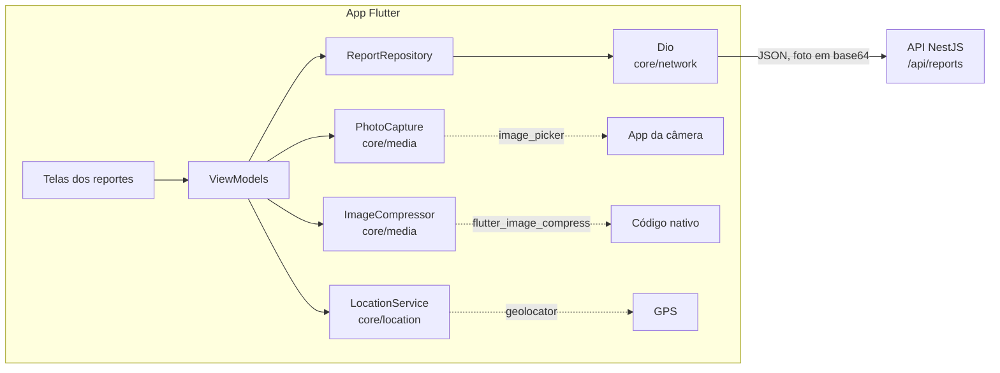
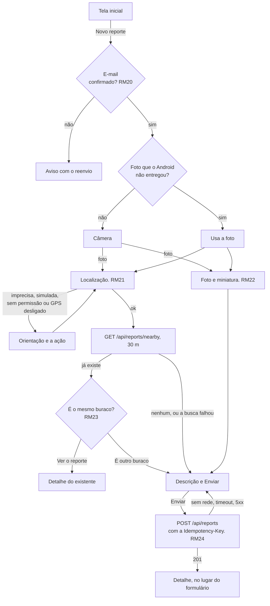
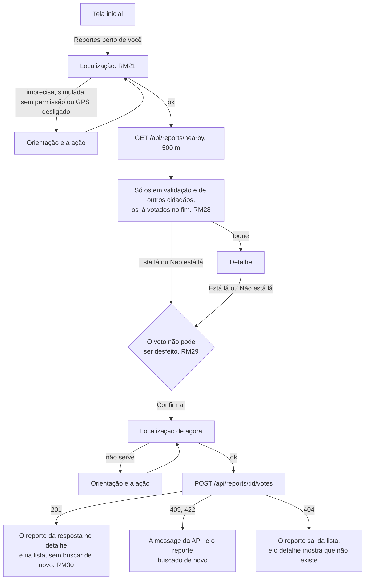

# Reportes no app

O cidadão abre um reporte de buraco com a foto tirada na hora e a localização do aparelho, acompanha os próprios reportes até a validação pelos outros cidadãos, e edita ou exclui o reporte enquanto ele está em validação. Ele também valida os reportes dos outros perto dele, como nos alertas do Waze: "Está lá" ou "Não está lá", e com 10 confirmações o reporte passa a ser considerado verdadeiro. Este documento explica como a feature `reports` funciona por dentro: o caminho da foto, a localização e as permissões, o envio repetido seguro, o cache das fotos, a validação, as regras RM20 a RM30 e como testar sem sair na rua.

> Como a API trata a foto, a localização e os votos está no [REPORTS.md do backend](https://github.com/jgtsuchiya/projeto_integrador_reportaAiCm_backend/blob/develop/docs/REPORTS.md), e o guia das rotas para os fronts, no [FRONTEND.md](https://github.com/jgtsuchiya/projeto_integrador_reportaAiCm_backend/blob/develop/docs/FRONTEND.md#reportes). As decisões e as regras RM20 a RM30 estão no [plano dos reportes](sprints/sprint-4-reportes.md).

## Sumário

- [Visão geral](#visão-geral)
- [Telas e rotas](#telas-e-rotas)
- [Abrir um reporte](#abrir-um-reporte)
- [A foto: da câmera ao JSON e de volta](#a-foto-da-câmera-ao-json-e-de-volta)
- [A localização e as permissões](#a-localização-e-as-permissões)
- [Envio repetido seguro: a Idempotency-Key](#envio-repetido-seguro-a-idempotency-key)
- [Acompanhar, editar e excluir](#acompanhar-editar-e-excluir)
- [O cache das fotos](#o-cache-das-fotos)
- [Validar os reportes dos outros](#validar-os-reportes-dos-outros)
- [Regras do app](#regras-do-app)
- [Testando no aparelho](#testando-no-aparelho)
- [Testando sem sair na rua](#testando-sem-sair-na-rua)
- [Limitações conhecidas](#limitações-conhecidas)

## Visão geral



Os três pacotes do aparelho ficam atrás de interfaces em `core/`, como o SDK do SuperTokens em `core/auth/`: só o `core/media/` importa o `image_picker` e o `flutter_image_compress`, e só o `core/location/` importa o `geolocator`. O [teste de arquitetura](../test/architecture_test.dart) barra o import em outro lugar, e os testes trocam as três interfaces por fakes.

| Peça                                                                                                                                                                                         | Papel                                                                                                                               |
| -------------------------------------------------------------------------------------------------------------------------------------------------------------------------------------------- | ----------------------------------------------------------------------------------------------------------------------------------- |
| [`PhotoCapture`](../lib/core/media/photo_capture.dart) e `ImagePickerPhotoCapture`                                                                                                           | A câmera traseira, sem a galeria, e a foto que o Android não entregou (`retrieveLostPhoto`)                                         |
| [`ImageCompressor`](../lib/core/media/image_compressor.dart) e `FlutterImageCompressor`                                                                                                      | O tamanho, a qualidade, a orientação nos pixels e o EXIF, no código nativo. Baixa a qualidade até caber                             |
| [`LocationService`](../lib/core/location/location_service.dart) e `GeolocatorLocationService`                                                                                                | O GPS, a permissão, a posição com a precisão e o `isMocked`, e as configurações do aparelho                                         |
| [`jpeg.dart`, `jpeg_base64.dart` e `PreparedPhoto`](../lib/features/reports/domain/models/)                                                                                                  | As regras da imagem iguais às da API (RN29): a assinatura, o tamanho e as dimensões do JPEG, a remoção dos metadados e o base64     |
| [`ReportLimits`](../lib/features/reports/domain/models/report_limits.dart)                                                                                                                   | Os limites, iguais aos padrões da API: 1600 e 400 px, 2 MB e 100 KB, 50 m, 30 m, 500 m e 20 por página                              |
| [`ReportRepository`](../lib/features/reports/domain/repositories/report_repository.dart) e [`ApiReportRepository`](../lib/features/reports/data/repositories/api_report_repository.dart)     | As rotas de `/api/reports`, com a `Idempotency-Key`, os 60 s do envio e o base64 da foto grande no `Isolate.run`                    |
| [`reportPhotoProvider`](../lib/features/reports/reports_providers.dart)                                                                                                                      | O cache das fotos em memória ([cache](#o-cache-das-fotos))                                                                          |
| [`reportRefreshProvider`](../lib/features/reports/presentation/view_models/report_refresh.dart)                                                                                              | Atualiza as listas e o detalhe depois de criar, editar, excluir ou votar (`ref.invalidate`, ou o reporte da API), sem estado global |
| [`ReportVoteViewModel`](../lib/features/reports/presentation/view_models/report_vote_view_model.dart) e [`ReportVoteBar`](../lib/features/reports/presentation/widgets/report_vote_bar.dart) | O voto: a confirmação, a localização na hora, o envio e as respostas da API ([validação](#validar-os-reportes-dos-outros))          |

## Telas e rotas

| Tela          | Rota                   | ViewModel                                                                                                   | O que mostra                                                                                      |
| ------------- | ---------------------- | ----------------------------------------------------------------------------------------------------------- | ------------------------------------------------------------------------------------------------- |
| Inicial       | `/inicio`              | `HomeViewModel`                                                                                             | O "Novo reporte" (com o e-mail confirmado), "Meus reportes" e "Reportes perto de você"            |
| Meus reportes | `/reportes`            | [`MyReportsViewModel`](../lib/features/reports/presentation/view_models/my_reports_view_model.dart)         | A lista paginada, com o filtro, a rolagem infinita e o puxar para atualizar                       |
| Novo reporte  | `/reportes/novo`       | [`NewReportViewModel`](../lib/features/reports/presentation/view_models/new_report_view_model.dart)         | A foto, a localização com a precisão, o aviso do reporte repetido, a descrição e o "Enviar"       |
| Detalhe       | `/reportes/:id`        | [`ReportDetailViewModel`](../lib/features/reports/presentation/view_models/report_detail_view_model.dart)   | A foto (o toque amplia), o status, o progresso, as datas, a precisão e as ações que a API permite |
| Editar        | `/reportes/:id/editar` | [`EditReportViewModel`](../lib/features/reports/presentation/view_models/edit_report_view_model.dart)       | A descrição e o "Trocar a foto". A localização não muda                                           |
| Perto de você | `/reportes/perto`      | [`NearbyReportsViewModel`](../lib/features/reports/presentation/view_models/nearby_reports_view_model.dart) | Os reportes em validação a até 500 m, com o voto em cada um, os já votados no fim                 |

No detalhe do reporte de outro cidadão, a [`ReportVoteBar`](../lib/features/reports/presentation/widgets/report_vote_bar.dart) mostra o voto ([validação](#validar-os-reportes-dos-outros)).

As telas ficam embaixo da `/reportes` no go_router, como as da conta embaixo da `/conta`: um deep link para o detalhe abre com a lista atrás, e o da edição, com o detalhe atrás. O `novo` e o `perto` vêm antes do `:id`, para não serem lidos como um id. A tela inicial abre as telas com o `push`, e o "voltar" volta para ela. O detalhe e a edição são `family` pelo id do reporte.

## Abrir um reporte



- **A câmera abre sozinha**, com o e-mail confirmado. Sem ele, a tela mostra o `EmailVerificationNotice` no lugar do formulário, e a câmera abre quando a confirmação chega (o aviso atualiza o perfil na volta do app ao primeiro plano). Na tela inicial, o aviso toma o lugar do botão "Novo reporte".
- **A foto e a localização andam juntas.** Com a foto, o tratamento e a leitura da posição rodam em paralelo. "Tirar outra" refaz as duas. O cidadão que cancela a câmera fica com a foto anterior, se houver.
- **O "Enviar" só fica ativo** com a foto pronta, a localização precisa, a busca dos reportes perto terminada e o aviso do reporte repetido respondido. A busca que falha não bloqueia o envio.
- **Ao sair com a foto tirada e sem enviar**, a tela pergunta se quer descartar (`PopScope`).
- **Depois do 201**, o detalhe toma o lugar do formulário (`context.pushReplacement`), com "Reporte enviado. Agora ele precisa de 10 confirmações de outros cidadãos.", e o "voltar" vai para a tela de antes do formulário.

| Resposta da API           | O que a tela mostra                                                                                          |
| ------------------------- | ------------------------------------------------------------------------------------------------------------ |
| 201                       | O detalhe, com o aviso das 10 confirmações                                                                   |
| 400 de um campo da foto   | "Não foi possível usar esta foto. Tire outra." no lugar da foto (não deveria acontecer: o app confere antes) |
| 400 da descrição          | A mensagem embaixo do campo                                                                                  |
| 400 de outro campo        | A mensagem do campo, acima do "Enviar"                                                                       |
| 413                       | A mesma mensagem da foto                                                                                     |
| 422                       | A `message` da API: e-mail não confirmado, fora de Campo Mourão, localização imprecisa, limite por dia       |
| Sem conexão, timeout, 5xx | "Não foi possível enviar. Seus dados continuam aqui." e o botão vira "Tentar de novo", com a mesma chave     |

## A foto: da câmera ao JSON e de volta

| Etapa       | Onde                                               | Como                                                                                                                                                                        |
| ----------- | -------------------------------------------------- | --------------------------------------------------------------------------------------------------------------------------------------------------------------------------- |
| Captura     | `core/media` (`PhotoCapture`)                      | O `image_picker` abre o app da câmera do aparelho, só a traseira. A foto volta como a câmera gravou (com o EXIF, até 12 MP ou mais)                                         |
| Compressão  | `core/media` (`ImageCompressor`)                   | A foto com o maior lado em 1600 px (JPEG 80, até 60) e a miniatura com 400 px (JPEG 70, até 50), a partir da foto já tratada. A orientação vai para os pixels, e o EXIF sai |
| Conferência | `features/reports/domain` (`PreparedPhoto.create`) | As regras da API: JPEG pela assinatura, a foto até 2 MB e 2048 px e a miniatura até 100 KB e 480 px. Os segmentos de metadados que sobrarem (APP1 e APP13) saem             |
| Encode      | `features/reports/data` (`OpenReportRequestDto`)   | `encodeJpegBase64` no `toJson`. O JSON inteiro é montado no `Isolate.run`: a foto de 2 MB vira 2,7 MB de texto                                                              |
| Envio       | `data` (`ApiReportRepository`)                     | `POST /api/reports`, com a `Idempotency-Key` e 60 s de tempo limite no envio e na resposta                                                                                  |
| Exibição    | `data` e `presentation` (`ReportPhotoView`)        | `GET /api/reports/:id/photo`, o `decodeJpegBase64` (no `Isolate.run` para a foto grande) e o `Image.memory`, pelo cache do id da foto                                       |

**Por que o menor lado.** O `flutter_image_compress` reduz a imagem pelo **menor** lado (o `minWidth` e o `minHeight`). Para o **maior** lado chegar a 1600 px, o `FlutterImageCompressor` lê as dimensões do cabeçalho antes (pelo `ImageDescriptor` do `dart:ui`, sem decodificar os pixels) e pede o menor lado proporcional: uma foto de 4000 x 3000 px pede 1200, e sai com 1600 x 1200. A proporção é a mesma em pé e deitado, então o EXIF não atrapalha a conta (`shortSideFor`).

**Acima do limite.** Se a foto passar de 2 MB, o compressor tenta de novo com a qualidade 10 pontos menor, até a mínima. A última tentativa volta mesmo assim, e a conferência do `domain` a recusa: a tela pede outra foto.

**Por que conferir no app também.** As regras da API ficam repetidas no `domain` ([ARCHITECTURE.md](ARCHITECTURE.md#o-paralelo-com-o-backend)): o `parseJpeg` é o mesmo percurso dos segmentos do `ReportImage` do backend. Assim, a foto que a API recusaria nunca sai do aparelho, e o EXIF nunca vai, mesmo que um aparelho mantenha algum segmento depois da compressão.

**O base64** é o padrão (RFC 4648), com o `=` do fim e sem o prefixo `data:`, o que o `base64Encode` do `dart:convert` gera. O `decodeJpegBase64` é estrito, como o da API, e recusa o texto que não é um JPEG.

## A localização e as permissões

A posição é lida com a precisão alta e o tempo limite de 20 s. O [`readReportLocation`](../lib/features/reports/presentation/view_models/report_location.dart) aplica a RM21 e devolve um `LocationStatus`, que o [`ReportLocationCard`](../lib/features/reports/presentation/widgets/report_location_card.dart) mostra com a ação certa. O voto e os "Reportes perto de você" usam as mesmas regras, e o `LocationPurpose` do cartão troca só o porquê, no texto ("Para enviar", "Para votar", "Para ver os reportes perto").

| `LocationStatus`          | Na tela                                                             | Ação                                            |
| ------------------------- | ------------------------------------------------------------------- | ----------------------------------------------- |
| `ready`                   | "Localização encontrada" e "Precisão de 8 m"                        | "Atualizar localização"                         |
| `inaccurate`              | A precisão (pior que 50 m) e a orientação para um lugar aberto      | "Atualizar localização". O envio fica bloqueado |
| `mocked`                  | "A localização parece falsa" (app de localização simulada, Android) | "Atualizar localização". O envio fica bloqueado |
| `permissionNeeded`        | Por que o app precisa da localização, antes do pedido do sistema    | "Permitir a localização"                        |
| `permissionDenied`        | A explicação de novo, depois de negada uma vez                      | "Permitir a localização"                        |
| `permissionDeniedForever` | A localização bloqueada                                             | "Abrir as configurações"                        |
| `serviceDisabled`         | O GPS desligado                                                     | "Ativar a localização"                          |
| `failed`                  | O aparelho não achou a posição a tempo                              | "Atualizar localização"                         |

Na volta das configurações do aparelho (o `AppLifecycleListener` da tela), a localização bloqueada por elas é lida de novo.

| Permissão   | Android                                           | iOS                                   | Quando é pedida                                   |
| ----------- | ------------------------------------------------- | ------------------------------------- | ------------------------------------------------- |
| Localização | `ACCESS_FINE_LOCATION` e `ACCESS_COARSE_LOCATION` | `NSLocationWhenInUseUsageDescription` | Na primeira leitura, depois da explicação da tela |
| Câmera      | Nenhuma                                           | `NSCameraUsageDescription`            | Na primeira foto (só no iOS)                      |

A permissão `CAMERA` **não** é declarada no Android: o `image_picker` abre o app da câmera do aparelho, e com ela no manifest o Android passaria a exigi-la também para isso. Com a localização aproximada do Android 12 (só a `COARSE`), a precisão fica pior que 50 m, e a tela pede um lugar aberto: o cidadão precisa liberar a localização precisa.

## Envio repetido seguro: a Idempotency-Key

Em rede móvel, a resposta do envio pode se perder depois de o reporte ser gravado. O `NewReportViewModel` cria uma `Idempotency-Key` (um UUID v4, do [`randomUuidV4`](../lib/core/utils/uuid.dart), com o `Random.secure`) quando a tela abre, e manda a mesma em todas as tentativas, inclusive depois do "Tirar outra" (RM24). Repetir com a chave que a API já conhece devolve o reporte já criado, sem abrir outro e sem contar no limite por dia (RN31).

Sem conexão, no timeout e no 5xx, a foto, a localização e a descrição continuam na tela, e o "Enviar" vira "Tentar de novo". Se o app fechar antes do envio, o reporte se perde: a fila no aparelho é um [ponto em aberto](sprints/sprint-4-reportes.md#9-pontos-em-aberto).

## Acompanhar, editar e excluir

- **Meus reportes:** 20 por página, do mais novo ao mais antigo. A página seguinte carrega perto do fim da lista (e na lista que não enche a tela). O erro da primeira página mostra o `ErrorView`, e o de uma página seguinte, um aviso no fim, sem perder o que já carregou. Um reporte que já está na lista não se repete quando a lista anda (um reporte novo no começo empurra os outros). O filtro troca o status pedido à API.
- **Status (RM26):** sempre em texto, com o ícone e a cor de apoio: "Em validação" (com "3 de 10 confirmações" e a barra), "Confirmado" ("Confirmado por outros cidadãos em 10/11/2026"), "Descartado" ("Outros cidadãos não encontraram o buraco") e "Em acompanhamento", para um status que o painel ainda vai criar (`ReportStatus.unknown`).
- **Ações (RM25):** "Editar" e "Excluir" aparecem só com o `canEdit` e o `canDelete` da API. O app não repete as regras (sem votos, em validação).
- **Editar:** a descrição (vazia apaga) e "Trocar a foto", com a câmera e o mesmo tratamento da abertura. Só o que mudou vai no `PATCH`, e sem mudança o "Salvar" fica desativado. O detalhe recebe o reporte da resposta, sem buscar de novo. Se alguém votou enquanto a tela estava aberta (422), a tela mostra a `message` da API e volta ao detalhe, que busca o reporte de novo.
- **Excluir:** pede confirmação ("Excluir o reporte? Esta ação não pode ser desfeita."). Com o 204, o detalhe sai da pilha (`pop`) e o aviso "Reporte excluído." aparece. O 404 (excluído em outro aparelho) também conta como excluído.
- **404 no detalhe:** "Reporte não encontrado" e o "Voltar".
- **Atualização das telas:** depois de criar, editar ou excluir, o ViewModel chama o `reportRefreshProvider`, que invalida a lista e o detalhe (`ref.invalidate`). A tela aberta busca de novo, e a fechada não faz nada. Depois do voto, ele troca o reporte nas telas abertas pelo da resposta, sem buscar de novo ([RM30](#validar-os-reportes-dos-outros)).
- **Reporte de outro cidadão:** o detalhe mostra o voto, a distância que a tela anterior sabe (a lista dos reportes perto e o aviso do reporte repetido a passam no `extra` da rota) e nenhum dado do autor. A API nunca manda o autor: o `isMine` basta.

## O cache das fotos

O [`reportPhotoProvider`](../lib/features/reports/reports_providers.dart) é um `FutureProvider.autoDispose.family` pela chave (o id do reporte, o **id da foto** e o tamanho). O id da foto muda quando ela é trocada: a chave nova busca a foto nova, e o cache nunca mostra a antiga.

- A imagem que chegou fica em memória enquanto aparece em alguma tela e por mais 5 minutos depois (`ref.keepAlive` com um timer, que o `onResume` cancela). A que falhou não fica: a próxima tela busca de novo, e o toque no ícone da imagem quebrada também.
- Na lista, o `ListView.builder` só monta os itens à vista: a miniatura só é buscada quando o item aparece.
- O cache é só em memória. Guardar as miniaturas em disco é um [ponto em aberto](sprints/sprint-4-reportes.md#9-pontos-em-aberto).

## Validar os reportes dos outros



- **Reportes perto de você** (`/reportes/perto`): a localização atual, com as regras da abertura (RM21), e a busca a até 500 m. A API devolve também os confirmados e os do próprio cidadão (o aviso do reporte repetido precisa deles): o [`reportsToValidate`](../lib/features/reports/presentation/view_models/nearby_reports_view_model.dart) deixa só os em validação de outros cidadãos, do mais perto ao mais longe, com os já votados no fim (RM28). Cada item tem a miniatura, a distância ("A 120 m de você"), "3 de 10 confirmações", a data e o voto. O "Atualizar" da barra e o puxar para atualizar leem a localização e buscam a lista de novo. Sem a localização que serve, a tela mostra o motivo e a ação no lugar da lista.
- **O voto** (a [`ReportVoteBar`](../lib/features/reports/presentation/widgets/report_vote_bar.dart)): "Está lá" e "Não está lá" aparecem só com o `canVote` da API (em validação, de outro cidadão e sem o voto dele; na lista, também a até 500 m). O toque pede a confirmação ("Confirmar que o buraco está lá? O voto não pode ser desfeito."), e só então o app lê a localização de agora (RM29). Se ela não servir, o motivo aparece no lugar dos botões, com a ação que resolve ("Atualizar localização", "Permitir a localização", as configurações) e o "Cancelar o voto". Resolvido, o voto que esperava segue sem pedir a confirmação de novo. Depois do voto, "Você confirmou" ou "Você disse que não está lá", e o aviso "Voto registrado." (com o "Com ele, o reporte foi confirmado." quando ele chega a 10).
- **A localização do voto não fica guardada** (RM29): ela vai só no corpo do `POST /api/reports/:id/votes`, que a API confere e descarta (RN38). O estado do `ReportVoteViewModel` nunca tem a posição enviada (só a leitura que impediu o voto, para mostrar o motivo), e o `ApiLogInterceptor` mostra a `latitude`, a `longitude` e o `accuracyMeters` como `***`.
- **Sem o e-mail confirmado** (RM20): no detalhe, o `EmailVerificationNotice` toma o lugar dos botões. Na lista, o aviso aparece uma vez só, em cima, e os itens ficam sem o voto. A API não confere o e-mail no `canVote`: o app confere.
- **Depois do voto, sem recarregar** (RM30): o `ReportVoteViewModel` chama o `reportRefreshProvider.reportUpdated`, que troca o reporte da resposta no detalhe e na lista dos reportes perto, se estiverem abertos (`ref.exists`). A contagem e o status mudam na hora, a distância continua a da busca (a resposta do voto não a traz), e o item votado vai para o fim da lista. O detalhe e o item do mesmo reporte dividem o estado do voto (o `reportVoteViewModelProvider` é `family` pelo id).
- **Do "Novo reporte":** o "Ver o reporte" do aviso do reporte repetido abre o detalhe com o voto: quem achou um buraco já reportado o confirma, em vez de abrir outro.

| Resposta da API  | O que a tela mostra                                                                                                                                                          |
| ---------------- | ---------------------------------------------------------------------------------------------------------------------------------------------------------------------------- |
| 201              | O reporte da resposta, com o voto, a contagem e o status novos, no detalhe e na lista                                                                                        |
| 409              | "Você já votou neste reporte." (em outro aparelho). O app busca o reporte, para mostrar o voto já dado                                                                       |
| 422              | A `message` da API: "Você precisa estar a até 500 m do reporte para votar.", "Este reporte não está mais em validação.", o e-mail, a precisão. O app busca o reporte de novo |
| 404              | O autor excluiu o reporte: ele sai da lista, e o detalhe mostra "Reporte não encontrado"                                                                                     |
| Sem conexão, 5xx | A mensagem do erro. O voto pode ser repetido: o segundo voto do mesmo cidadão é recusado pela API (409), sem contar duas vezes                                               |

## Regras do app

| Código | Regra                                                                                                            | Onde                                                                                                                           |
| ------ | ---------------------------------------------------------------------------------------------------------------- | ------------------------------------------------------------------------------------------------------------------------------ |
| RM20   | Só o Client com o e-mail confirmado abre e vota. Sem ele, o aviso com o reenvio no lugar do formulário e do voto | `NewReportView`, `NewReportViewModel` (a câmera espera a confirmação), a `HomeView`, a `ReportVoteBar` e a `NearbyReportsView` |
| RM21   | Foto só da câmera, localização junto, envio bloqueado com a precisão pior que 50 m ou a posição simulada         | `PhotoCapture`, `readReportLocation` e o `canSubmit`                                                                           |
| RM22   | Foto em 1600 px (JPEG 80), miniatura em 400 px (JPEG 70), na orientação certa e sem metadados                    | `prepareReportPhoto`, `FlutterImageCompressor` e `PreparedPhoto`                                                               |
| RM23   | O aviso do reporte a até 30 m, com o "Ver o reporte" e o "É outro buraco"                                        | `NewReportViewModel` (`listNearby`) e o `_DuplicateWarning`                                                                    |
| RM24   | A mesma `Idempotency-Key` em todas as tentativas, e os dados na tela sem rede                                    | `NewReportViewModel.idempotencyKey` e o `ApiReportRepository.create`                                                           |
| RM25   | "Editar" e "Excluir" pelo `canEdit` e o `canDelete`, a exclusão com confirmação e a localização fixa             | `ReportDetailView` e `EditReportView`                                                                                          |
| RM26   | O status em texto, nunca só pela cor                                                                             | `ReportStatusLabel` e `ReportConfirmationProgress`                                                                             |
| RM27   | A foto, o base64 e as coordenadas nunca vão para o log, e o reporte de outro não mostra o autor                  | `ApiLogInterceptor` e os `toString` dos modelos                                                                                |
| RM28   | "Reportes perto de você": os em validação a até 500 m, do mais perto ao mais longe, sem os do cidadão            | `NearbyReportsViewModel` (`reportsToValidate`) e a `NearbyReportsView`                                                         |
| RM29   | O voto pede a confirmação e envia a localização de agora, que não fica guardada                                  | `ReportVoteBar` e `ReportVoteViewModel`                                                                                        |
| RM30   | Depois do voto, a contagem e o status da resposta na tela, sem recarregar a lista                                | `ReportRefresh.reportUpdated` e o `NearbyReportsViewModel.replaceReport`                                                       |

**O log (RM27).** O [`ApiLogInterceptor`](../lib/core/network/api_log_interceptor.dart) mostra o `content` e o `thumbnail` como `*** (512 KB)`, só com o tamanho do texto, e a `latitude`, a `longitude` e o `accuracyMeters` como `***`, no corpo e na query. Os `toString` do `Report`, do `GeoLocation`, do `DevicePosition`, do `PreparedPhoto` e dos estados das telas não trazem as coordenadas, a descrição nem os bytes, e as mensagens das `FormatException` dos DTOs dizem só o nome do campo.

Os testes de cada regra têm o código no nome: `fvm flutter test --name RM21`.

## Testando no aparelho

1. **A API com os reportes.** Suba a API local numa branch do backend com o epic dos reportes (as rotas de `/api/reports`), com as migrations dos reportes na base (`npm run migration:run`) e o seed. Confira o `http://localhost:3000/api/health` e a `API_URL` do `env/dev.json` para o aparelho ([README](../README.md#conectando-à-api-local)).
2. **Uma conta com o e-mail confirmado.** Crie a conta pelo app e confirme o e-mail pelo link do Mailpit ([README](../README.md#entrando-no-app)).
3. **Rode o app num celular Android físico**, com a câmera e o GPS de verdade: `fvm flutter run --dart-define-from-file=env/dev.json`.
4. **Fora de Campo Mourão**, a API recusa a localização (422 "Este lugar fica fora de Campo Mourão."). Aumente a caixa da `REPORT_AREA_BOUNDS` no `.env` local do backend (ex.: `-35,-75,6,-30`, o Brasil inteiro) e reinicie a API.
5. Na tela inicial, toque em **Novo reporte**: a câmera abre, e a localização é pedida na primeira vez, depois da explicação. Num lugar fechado, a precisão costuma passar de 50 m: vá para perto de uma janela ou para fora.
6. Para conferir que a foto chega sem o EXIF e na orientação certa, baixe a foto pela API (`GET /api/reports/:id/photo`, seção dos reportes do `api.http` do backend), decodifique o `content` e confira com o `exiftool` (nenhum GPS nem modelo do aparelho) e abrindo a imagem, com o aparelho em pé e deitado.

| Sintoma                                                     | Causa                                                                | Solução                                                                    |
| ----------------------------------------------------------- | -------------------------------------------------------------------- | -------------------------------------------------------------------------- |
| A tela mostra o aviso do e-mail no lugar da câmera          | O e-mail da conta não foi confirmado (RM20)                          | Confirme pelo link do Mailpit e volte ao app                               |
| "Este lugar fica fora de Campo Mourão."                     | A posição está fora da `REPORT_AREA_BOUNDS` da API                   | Aumente a caixa no `.env` do backend (passo 4)                             |
| "A localização está imprecisa" não sai                      | Lugar fechado, ou a localização aproximada do Android 12             | Vá para um lugar aberto, ou libere a localização precisa nas configurações |
| "A localização parece falsa"                                | Um app de localização simulada está ligado (opções do desenvolvedor) | Desligue o app e toque em "Atualizar localização"                          |
| "Algo deu errado..." no envio, e a API registra um erro 500 | A base sem as migrations dos reportes                                | No backend, `npm run migration:run`                                        |
| "Você chegou ao limite de 10 reportes por dia."             | O limite por Client em 24 horas (RN30), que conta os excluídos       | Use outra conta                                                            |

**O voto com duas contas.** O cidadão não vota no próprio reporte (RN37), então o teste precisa de duas contas com o e-mail confirmado, A e B:

1. Com a conta A, abra um reporte (passos 1 a 5).
2. Saia ("Sair") e entre com a conta B, perto do mesmo lugar (a até 500 m, com a precisão de até 50 m). Na tela inicial, toque em **Reportes perto de você**: o reporte da conta A aparece, com a distância.
3. Toque em **Está lá** e confirme. O item mostra "Você confirmou" e "1 de 10 confirmações" e vai para o fim da lista.
4. Saia, entre com a conta A e abra **Meus reportes**: o reporte mostra "1 de 10 confirmações". Ele não pode mais ser editado (já tem voto), e ainda pode ser excluído.

Para ver o "Confirmado" sem dez contas, baixe o `REPORT_CONFIRMATIONS_REQUIRED` no `.env` local do backend (ex.: `1`) e reinicie a API. Um aparelho só basta: o "Sair" troca a conta.

| Sintoma do voto                                               | Causa                                                    | Solução                             |
| ------------------------------------------------------------- | -------------------------------------------------------- | ----------------------------------- |
| O próprio reporte não aparece em "Reportes perto de você"     | A lista não mostra os reportes do próprio cidadão (RM28) | Entre com outra conta               |
| "Você precisa estar a até 500 m do reporte para votar."       | A posição de agora está longe do reporte (RN38)          | Vá para perto do buraco             |
| "Você já votou neste reporte."                                | A conta já votou, talvez em outro aparelho (409)         | Use outra conta                     |
| A lista não carrega, e a API registra um erro 500 no `nearby` | A base sem a migration dos votos (o epic 2 do backend)   | No backend, `npm run migration:run` |

## Testando sem sair na rua

- **Testes de `test/`:** os fakes `FakePhotoCapture`, `FakeImageCompressor`, `FakeLocationService` e `FakeReportRepository`, juntos no `ReportFakes`, trocam a câmera, o tratamento, o GPS e a API ([TESTING.md](TESTING.md#fakes-e-mocks)). O `FakeReportRepository.vote` soma a contagem e muda o status no limite, como a API, e o `othersReport` monta o reporte de outro cidadão. Os fluxos ficam no [`reports_flow_test.dart`](../test/flows/reports_flow_test.dart) e, os da validação, no [`validation_flow_test.dart`](../test/flows/validation_flow_test.dart).
- **Teste de integração** ([`integration_test/reports_flow_test.dart`](../integration_test/reports_flow_test.dart)): contra a API local de verdade, com a foto de exemplo de `integration_test/fixtures/` e um ponto de Campo Mourão no lugar da câmera e do GPS (`device_fakes.dart`, pelo `startApp(overrides:)` do `main.dart`). Ele abre um reporte, o vê no detalhe e na lista, edita e exclui. No computador (Linux desktop), onde o `flutter_image_compress` não existe, a foto de exemplo vai como está: ela já cabe nos limites.

  ```bash
  fvm flutter test integration_test/reports_flow_test.dart --dart-define-from-file=env/dev.json
  # No Linux desktop:
  fvm flutter test integration_test/reports_flow_test.dart -d linux --dart-define-from-file=env/dev.json
  ```

- **Teste de integração da validação** ([`integration_test/validation_flow_test.dart`](../integration_test/validation_flow_test.dart)): o voto com duas contas, contra a API local. O `TestApi` cria os dois Clients, confirma os e-mails e abre o reporte do autor pela API (`openReport`), no mesmo ponto do GPS fake. O outro Client entra no app, acha o reporte em "Reportes perto de você" pela descrição (única em cada execução), confirma pela tela e vê "1 de 10 confirmações". Depois, o autor entra e vê a confirmação em "Meus reportes". No fim, o reporte e as contas são excluídos.

  ```bash
  fvm flutter test integration_test/validation_flow_test.dart -d linux --dart-define-from-file=env/dev.json
  ```

- **No Linux desktop, à mão**, as telas da lista, do detalhe e da edição funcionam contra a API, mas o "Novo reporte" mostra "Não foi possível abrir a câmera do aparelho.": o `image_picker` não abre câmera no computador. A localização usa o GeoClue do sistema, quando ele está ligado.

## Limitações conhecidas

- **Sem mapa e sem ajuste do pino.** A localização é a do aparelho na hora da foto: quem fotografa do outro lado da rua deixa o reporte alguns metros longe do buraco.
- **Sem fila para enviar depois.** Se o app fechar antes do envio, o reporte se perde. A foto que o Android não entregou (o app fechado com a câmera aberta) é reaproveitada na próxima abertura da tela.
- **A distância no detalhe** do reporte de outro cidadão só aparece quando a tela anterior a sabe (a lista dos reportes perto e o aviso do reporte repetido). Num deep link, ela não aparece: o `GET /api/reports/:id` não traz a distância.
- **O voto não pode ser desfeito** (RN37), nem trocado. Uma localização ruim na hora do voto para o envio, e o cidadão resolve na própria barra.
- **A lista dos reportes perto não acompanha o cidadão andando.** Ela é a da posição da última busca: o "Atualizar" lê a localização de novo. O voto sempre lê a de agora.
- **Fora do escopo:** o mapa, a galeria, as notificações (como a do reporte confirmado) e o endereço do reporte ([pontos em aberto](sprints/sprint-4-reportes.md#9-pontos-em-aberto)).
