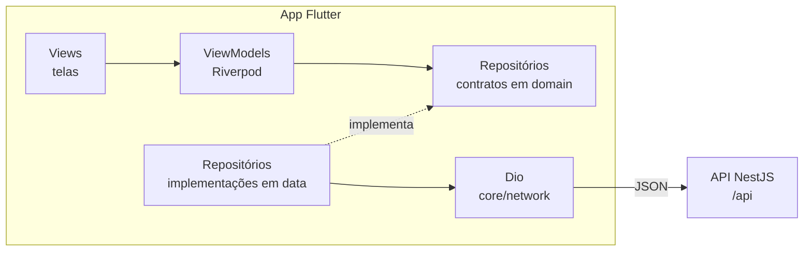
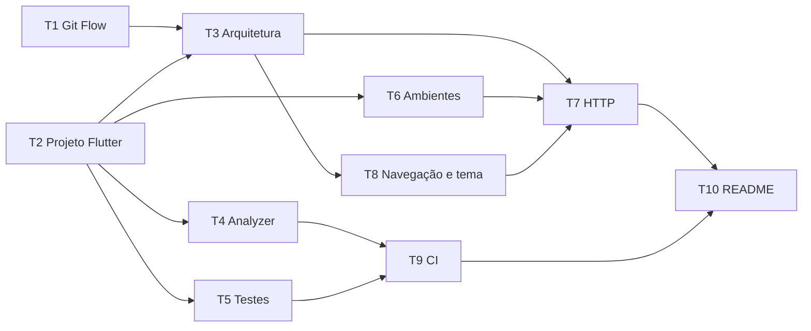

# Sprint 3 (07/10 - 26/10): configuração do app mobile

Plano do mobile para montar a base do app do cidadão em **Flutter**: projeto, arquitetura, qualidade, ambientes, cliente HTTP e pipeline. Nenhuma tela de negócio entra aqui. O épico entrega um app que abre, fala com a API local e segue o mesmo fluxo de trabalho do backend (Git Flow, Conventional Commits e PR com CI).

O login e a tela inicial ficam no plano seguinte, [login e tela inicial](sprint-3-login.md), que começa em cima desta base.

## 1. Decisões

| Tema              | Decisão                                                                                                                                                                                                                                                   |
| ----------------- | --------------------------------------------------------------------------------------------------------------------------------------------------------------------------------------------------------------------------------------------------------- |
| Plataformas       | Android e iOS. Web e desktop ficam fora do projeto (`flutter create --platforms=android,ios`).                                                                                                                                                            |
| Versão do Flutter | A estável mais recente no início da sprint (hoje, a 3.47), fixada com o **FVM** no `.fvmrc`. É o papel do `.nvmrc` no backend: o time inteiro e o CI usam a mesma versão.                                                                                 |
| Arquitetura       | A recomendada pelo Flutter (camada de UI com Views e ViewModels, camada de dados com repositórios), organizada por feature, com uma camada de domínio. É o mesmo desenho do backend: módulos por funcionalidade e regras isoladas de framework e de HTTP. |
| Estado e injeção  | **Riverpod** (`flutter_riverpod`), sem geração de código. Os fakes entram nos testes por override dos providers.                                                                                                                                          |
| Navegação         | **go_router**, com um `redirect` central. No épico de login, ele escolhe a tela a partir do estado da sessão.                                                                                                                                             |
| HTTP              | **Dio**, com uma instância única. É nela que o SDK do SuperTokens registra o interceptor no épico de login.                                                                                                                                               |
| Modelos           | Classes imutáveis escritas à mão, sem `build_runner` nesta sprint. Os modelos são poucos, e a geração de código entra quando compensar.                                                                                                                   |
| Ambientes         | `--dart-define-from-file` com um JSON por ambiente (`env/dev.json`). Sem flavors nativos: por enquanto, só existe o ambiente de dev.                                                                                                                      |
| Análise estática  | `very_good_analysis`, mais rígido que o `flutter_lints`, como o ESLint do backend.                                                                                                                                                                        |
| Formatação        | `dart format` com largura de 100 colunas, a mesma do Prettier do backend.                                                                                                                                                                                 |
| Testes            | `flutter_test`, com fakes escritos à mão para os repositórios (como o `FakeIdentityProvider` do backend) e o `mocktail` para o resto. A pasta `integration_test/` fica pronta para os fluxos ponta a ponta.                                               |
| Hooks e commits   | As mesmas ferramentas do backend (Husky, commitlint e lint-staged), com um `package.json` só de `devDependencies`. As regras de commit e de branch ficam idênticas nos dois repositórios.                                                                 |
| CI                | GitHub Actions: formatação, analyzer, testes com cobertura e build do APK. O build de iOS fica fora (ver os pontos em aberto).                                                                                                                            |
| Idioma            | Só pt-BR, com `flutter_localizations` e `intl`. Os textos ficam direto no código, sem arquivos ARB, enquanto houver um idioma só.                                                                                                                         |
| Tema              | Material 3, com `ColorScheme.fromSeed` e uma cor provisória, nos modos claro e escuro.                                                                                                                                                                    |

## 2. Arquitetura



- A **View** só desenha e repassa as ações do usuário. A lógica da tela fica no **ViewModel**.
- O **ViewModel** conhece só o contrato do repositório, nunca a implementação. Nos testes, o contrato é trocado por um fake.
- O **repositório** fala com a API pelo `Dio` compartilhado e devolve modelos do domínio, não JSON.

### Estrutura de pastas

```
lib/
├── main.dart                    # lê o ambiente, inicializa e roda o app
├── app/
│   ├── app.dart                 # MaterialApp.router, tema e localização
│   ├── router.dart              # rotas e redirect
│   └── theme/                   # cores, tipografia e tema claro e escuro
├── core/                        # código transversal (o shared/ do backend)
│   ├── config/                  # AppConfig: a API_URL, validada na abertura
│   ├── network/                 # Dio, interceptors e exceções da API
│   ├── utils/                   # formatadores (CPF, telefone, datas)
│   └── widgets/                 # componentes reutilizados (botão, campo, erro)
└── features/
    └── <feature>/
        ├── <feature>_providers.dart   # liga o contrato à implementação (o <feature>.module.ts do backend)
        ├── domain/
        │   ├── models/                # modelos imutáveis, só Dart
        │   └── repositories/          # contratos (abstract interface class)
        ├── data/
        │   ├── repositories/          # implementações dos contratos (ex.: ApiUserRepository)
        │   └── dtos/                  # conversão JSON da API <-> modelos
        └── presentation/
            ├── view_models/           # estado e ações da tela
            ├── views/                 # telas (*_view.dart)
            └── widgets/               # widgets usados só nesta feature
test/                            # espelha lib/
├── support/                     # pumpApp e fakes compartilhados
└── architecture_test.dart       # confere a regra de dependência
integration_test/                # fluxos ponta a ponta, contra a API local
env/
├── dev.example.json             # versionado
└── dev.json                     # ignorado pelo Git (o endereço muda por aparelho)
```

As subpastas só são criadas quando houver conteúdo, como no backend.

### Regra de dependência

```
presentation ──► domain ◄── data
```

| Camada                     | Pode importar                                                            | Não pode importar                              |
| -------------------------- | ------------------------------------------------------------------------ | ---------------------------------------------- |
| `domain`                   | só Dart                                                                  | Flutter, Dio, Riverpod, `data`, `presentation` |
| `data`                     | `domain`, `core/network`, pacotes externos (Dio)                         | `presentation`                                 |
| `presentation`             | `domain`, `<feature>_providers.dart`, `core/widgets`, Flutter e Riverpod | `data`                                         |
| `<feature>_providers.dart` | tudo da própria feature                                                  |                                                |

O `test/architecture_test.dart` lê os imports de `lib/` e falha quando a regra é quebrada, no papel da regra do ESLint que, no backend, impede o domínio de importar o SuperTokens.

## 3. Comandos

| Comando                                                | O que faz                                          |
| ------------------------------------------------------ | -------------------------------------------------- |
| `fvm install`                                          | Instala a versão do Flutter do `.fvmrc`            |
| `npm install`                                          | Instala os hooks (Husky e commitlint). Uma vez só  |
| `fvm flutter run --dart-define-from-file=env/dev.json` | Roda o app em dev                                  |
| `dart format .`                                        | Formata o código                                   |
| `fvm flutter analyze --fatal-infos`                    | Análise estática, sem aceitar nenhum aviso         |
| `fvm flutter test --coverage`                          | Testes unitários e de widget, com cobertura (lcov) |
| `fvm flutter test integration_test`                    | Testes de integração, com a API local rodando      |

## 4. Variáveis de ambiente

Lidas do `env/<ambiente>.json` pelo `--dart-define-from-file` e validadas pelo `AppConfig` na abertura:

| Variável  | Exemplo                | Uso                                                                                                         |
| --------- | ---------------------- | ----------------------------------------------------------------------------------------------------------- |
| `API_URL` | `http://10.0.2.2:3000` | Endereço da API, sem o `/api`. Obrigatória. É também o `apiDomain` do SDK do SuperTokens, no épico de login |

O `localhost` do aparelho não é o da sua máquina:

| Onde o app roda              | `API_URL`                     |
| ---------------------------- | ----------------------------- |
| Emulador Android             | `http://10.0.2.2:3000`        |
| Simulador iOS                | `http://localhost:3000`       |
| Aparelho físico (mesma rede) | `http://<IP da máquina>:3000` |

## 5. Labels

O repositório do mobile não tem as labels do backend. Crie **`Epic`**, **`Task`** e **`Sprint 3 - 07/10 - 26/10`**. O epic recebe `Epic` + a label da sprint, e cada task recebe `Task` + a label da sprint.

## 6. Ordem e dependências



T1 e T2 não dependem de nada e podem começar em paralelo. Depois da T2, a T4, a T5 e a T6 também andam em paralelo.

O épico de login depende da T3, da T6, da T7 e da T8. São elas que precisam terminar primeiro para o segundo épico começar dentro da mesma sprint.

---

## 7. Issues

### EPIC

**Título:** `[EPIC] Configuração e arquitetura do app mobile`
**Labels:** `Epic`, `Sprint 3 - 07/10 - 26/10`

```markdown
Base do app mobile do ReportaAi Cm, o app do cidadão, em Flutter. O épico não entrega nenhuma tela de negócio: ele deixa o projeto pronto para as features entrarem com qualidade desde o primeiro PR.

- **Mesmo fluxo do backend**: Git Flow, Conventional Commits, PR com 1 aprovação e CI obrigatório.
- **Arquitetura definida**: camadas de UI, domínio e dados por feature, com as regras isoladas de Flutter e de HTTP e uma regra de dependência conferida por teste.
- **Pronto para falar com a API**: ambiente por arquivo, um cliente HTTP único e os erros da API convertidos em mensagens para a tela.

### Escopo

- Projeto Flutter (Android e iOS) com a versão do SDK fixada pelo FVM
- Git Flow, hooks (Husky + commitlint) e proteção das branches
- Arquitetura de pastas, Riverpod e teste de arquitetura
- Análise estática, formatação e testes (unitários, de widget e a pasta de integração)
- Configuração de ambientes (`API_URL`)
- Cliente HTTP (Dio) com o tratamento dos erros da API e uma tela de diagnóstico
- Navegação (go_router), tema Material 3, pt-BR e componentes base
- CI no GitHub Actions e README

### Fora do escopo

Login e sessão (SuperTokens), telas de negócio, ambientes de homologação e produção, publicação nas lojas, flavors nativos, internacionalização e build de iOS no CI.

### Definição de pronto (vale para todas as tasks)

- `dart format --set-exit-if-changed .`, `flutter analyze --fatal-infos` e `flutter test` passando
- Testes para o código novo: unitários para a lógica e de widget para os componentes
- Testado no emulador Android, e também no simulador iOS quando a task mexer em configuração nativa
- Documentação atualizada quando a task mudar dependências, ambientes ou estrutura

### Tasks

- [ ] T1 [CONFIG] Git Flow, padrão de commits e proteção das branches
- [ ] T2 [CONFIG] Criação do projeto Flutter
- [ ] T3 [CONFIG] Arquitetura de pastas e injeção de dependências
- [ ] T4 [CONFIG] Análise estática e formatação
- [ ] T5 [CONFIG] Testes unitários e de widget
- [ ] T6 [CONFIG] Configuração de ambientes
- [ ] T7 [CONFIG] Infraestrutura HTTP compartilhada
- [ ] T8 [CONFIG] Navegação, tema e componentes base
- [ ] T9 [CONFIG] Pipeline de CI no GitHub Actions
- [ ] T10 [DOCS] README com visão do projeto e onboarding
```

> Depois de criar as tasks, troque cada `T<n>` pelo número da issue (`#2`), para o GitHub linkar automaticamente. Se preferir, adicione as tasks como sub-issues do epic, como no backend.

---

### T1

**Título:** `[CONFIG] Git Flow, padrão de commits e proteção das branches`

```markdown
Levar para o repositório do mobile o mesmo fluxo de trabalho do backend, para o time não ter duas regras para lembrar.

- Criar a `develop` a partir da `main` e torná-la a branch padrão
- `CONTRIBUTING.md` adaptado do backend: Git Flow, tipos de branch, padrão de commits, regras de PR e método de merge. Os comandos de verificação passam a ser os do Flutter
- `.github/pull_request_template.md` igual ao do backend, trocando o item "Migration criada" por "Testado no emulador ou no aparelho"
- Husky, commitlint e lint-staged, com um `package.json` só de `devDependencies`, o mesmo `.commitlintrc.json` e um `.nvmrc` com a mesma versão de Node do backend
- Hooks: `commit-msg` com o commitlint, `pre-commit` com o `dart format` nos arquivos `.dart` staged (o analyzer entra na T4) e `pre-push` com o mesmo script do backend, que valida o nome da branch e bloqueia o push direto na `main` e na `develop`
- `.github/rulesets/main.json` e `develop.json`, iguais aos do backend. Os checks obrigatórios entram depois da T9
- No GitHub: squash e merge commit liberados, rebase desligado, título do PR no squash e exclusão automática da branch depois do merge

**Critérios de aceite**

- Um commit com a mensagem fora do padrão é recusado
- O push de uma branch sem o número da issue (ex.: `feature/login`) é recusado, e o push direto na `develop` também
- A `develop` só recebe mudança por PR com 1 aprovação
```

### T2

**Título:** `[CONFIG] Criação do projeto Flutter`

```markdown
Criar o projeto Flutter do app, com a versão do SDK fixada para todo o time.

- `flutter create --platforms=android,ios`, sem web e desktop
- Versão do Flutter fixada com o FVM (`.fvmrc`), a estável mais recente no início da sprint
- Nome exibido "ReportaAi Cm" no Android (`android:label`) e no iOS (`CFBundleDisplayName`)
- `applicationId` (Android) e bundle id (iOS) definidos e iguais nos dois sistemas (ver os pontos em aberto do plano)
- Permissão `INTERNET` no `AndroidManifest.xml` principal. O Flutter só a declara nos manifests de debug e de profile, e sem ela o build de release não acessa a rede
- `pubspec.lock` versionado, porque é um app e não um pacote
- `.gitignore` do Flutter, mais `.fvm/`, `env/*.json` (menos os `*.example.json`) e `coverage/`
- `.editorconfig` igual ao do backend
- Trocar o contador de exemplo por uma tela simples com o nome do app
- Ícone e splash provisórios

**Critérios de aceite**

- `fvm flutter run` abre o app no emulador Android e no simulador iOS
- `fvm flutter build apk` gera o APK sem erro
- O APK de release instalado num aparelho tem acesso à rede
```

### T3

**Título:** `[CONFIG] Arquitetura de pastas e injeção de dependências`

```markdown
Definir como o código do app é organizado, seguindo a recomendação do Flutter (camada de UI com Views e ViewModels, camada de dados com repositórios) e o mesmo princípio do backend: módulos por funcionalidade e regras isoladas de framework e de HTTP.

- Estrutura de `lib/` da seção 2 do plano: `app/`, `core/` e `features/<feature>/{domain,data,presentation}`
- `flutter_riverpod` (versão exata), sem geração de código, com o `ProviderScope` no `main.dart`
- Um `<feature>_providers.dart` por feature: o único arquivo que liga o contrato do repositório à implementação, no papel do `<feature>.module.ts` do backend
- Contratos de repositório como `abstract interface class` em `domain/repositories/`, implementados em `data/repositories/`
- `test/architecture_test.dart`: lê os imports dos arquivos de `lib/` e falha quando `domain/` importa Flutter, Dio, Riverpod ou `data/`, ou quando `presentation/` importa `data/`
- `docs/ARCHITECTURE.md`: estrutura, regra de dependência, o paralelo com as camadas do backend, as convenções de nomes (arquivos em snake_case, `*_view.dart`, `*_view_model.dart`, `*_repository.dart`, `Api*Repository` para as implementações que chamam a API) e o passo a passo para criar uma feature nova

**Critérios de aceite**

- O teste de arquitetura falha quando um arquivo de `presentation/` importa algo de `data/` (conferir com um import de propósito, depois removido)
- O `ARCHITECTURE.md` diz onde fica cada tipo de arquivo
```

### T4

**Título:** `[CONFIG] Análise estática e formatação`

```markdown
Configurar o analyzer e o formatador, e rodá-los antes de cada commit.

- `very_good_analysis` (versão exata) no `analysis_options.yaml`, com a regra `public_member_api_docs` desligada (é um app, não uma biblioteca)
- Arquivos gerados (`*.g.dart`, `*.freezed.dart`) fora da análise, para quando existirem
- `formatter: page_width: 100` no `analysis_options.yaml`, a largura do Prettier do backend
- O projeto sem nenhum aviso no `flutter analyze --fatal-infos`
- `pre-commit`: além do `dart format` da T1, o `flutter analyze --fatal-infos`
- `.vscode/settings.json` (formatar ao salvar, régua em 100 e o SDK do FVM) e `.vscode/extensions.json` (Dart e Flutter), como no backend

**Critérios de aceite**

- `dart format --set-exit-if-changed .` e `flutter analyze --fatal-infos` passam
- Um arquivo `.dart` mal formatado sai formatado no commit, e um commit com aviso do analyzer é recusado
```

### T5

**Título:** `[CONFIG] Testes unitários e de widget`

```markdown
Configurar os testes e as convenções, para as tasks de feature já nascerem com teste.

- `flutter_test` e `integration_test` (do SDK) e `mocktail` (versão exata)
- `test/` espelhando `lib/` (ex.: `lib/core/config/app_config.dart` → `test/core/config/app_config_test.dart`)
- `test/support/pump_app.dart`: monta o widget com `ProviderScope`, tema e localização pt-BR, e aceita overrides de providers
- Convenção: fakes escritos à mão para os contratos de repositório, em `test/support/`, e o `mocktail` só para o que não compensa ter um fake
- Testes unitários para as regras e os ViewModels, e testes de widget para cada estado das telas (carregando, erro e sucesso)
- Pasta `integration_test/` criada, para os fluxos ponta a ponta do épico de login
- Cobertura com `flutter test --coverage`, sem contar o `main.dart` e os arquivos gerados
- `docs/TESTING.md`: estrutura, o que testar em cada camada, como usar o `pumpApp` e os fakes, e os comandos

**Critérios de aceite**

- `flutter test` passa, com pelo menos um teste unitário e um de widget de exemplo
- `flutter test --coverage` gera o `coverage/lcov.info`
```

### T6

**Título:** `[CONFIG] Configuração de ambientes (URL da API)`

```markdown
Ler a configuração do app no build, sem endereço fixo no código.

- `--dart-define-from-file` com o `env/dev.json` (ignorado pelo Git, porque o endereço muda por aparelho) e o `env/dev.example.json` versionado
- `AppConfig` em `core/config/`, lido com `String.fromEnvironment` e validado na abertura. Sem a `API_URL`, ou com uma URL inválida, o app falha com uma mensagem que diz o que falta, como a API, que não sobe sem as variáveis obrigatórias
- A `API_URL` é guardada sem a barra do final, e um valor terminado em `/api` é recusado (é o erro mais comum, e o SDK do SuperTokens precisa do endereço sem o `/api`)
- HTTP liberado só em dev: no Android, `android:usesCleartextTraffic="true"` só no manifest de debug, e no iOS, `NSAllowsLocalNetworking` no `Info.plist`
- `.vscode/launch.json` com o `--dart-define-from-file=env/dev.json` já configurado

**Critérios de aceite**

- Sem o `env/dev.json`, o app falha na abertura com a mensagem do `AppConfig`
- O app em debug acessa a API por `http://` no emulador Android, no simulador iOS e num aparelho Android na mesma rede
- O build de release do Android não aceita `http://`
- Testes unitários do `AppConfig`: URL válida, ausente, inválida, com barra no final e terminada em `/api`
```

### T7

**Título:** `[CONFIG] Infraestrutura HTTP compartilhada (cliente, erros e logs)`

```markdown
Criar em `core/network/` a base que todas as chamadas à API vão usar, como a infraestrutura HTTP compartilhada do backend (sprint 2, T1).

- `dio` (versão exata), com um `Dio` único fornecido por provider: `baseUrl` `${API_URL}/api`, JSON e timeouts (10 s para conectar e 15 s para a resposta)
- Conversão dos erros da API, no formato padrão (`statusCode`, `error`, `message`, `details`), em exceções do app: `ValidationException` (400, com os erros por campo), `UnauthorizedException` (401), `ForbiddenException` (403), `NotFoundException` (404), `ConflictException` (409, com o campo), `BusinessRuleException` (422), `RateLimitException` (429, com o `Retry-After` em segundos), `ServerException` (5xx e respostas fora do formato) e `NetworkException` (sem conexão e timeout)
- O 403 da sessão pendente da segunda etapa (corpo com `claimValidationErrors` e sem `statusCode`) vira uma exceção própria, separada do 403 de permissão
- Cada exceção traz a `message` em português pronta para a tela. Sem `message` (ex.: sem conexão), usa um texto padrão do app
- Log das requisições só em debug, sem os headers de sessão (`Authorization`, `st-access-token`, `st-refresh-token`, `front-token`, `anti-csrf`) e sem o corpo das rotas de `/auth`
- Feature `health`, o exemplo mínimo de referência (como o módulo `health` do backend): `HealthRepository` → `GET /api/health` → tela de diagnóstico (`/diagnostico`, só em debug) com a URL da API e o resultado

**Critérios de aceite**

- Testes unitários da conversão de cada status, com um adapter fake do Dio
- Um erro inesperado não derruba o app: vira `ServerException` com a mensagem padrão
- A tela de diagnóstico mostra "ok" com a API local no emulador Android, no simulador iOS e num aparelho Android na mesma rede, e uma mensagem clara com a API desligada
- Com o log ligado, nenhum token aparece nele
```

### T8

**Título:** `[CONFIG] Navegação, tema e componentes base`

```markdown
Preparar a navegação, a aparência e os componentes que todas as telas vão usar.

- `go_router` (versão exata), com o router em `app/router.dart` e as rotas iniciais: `/inicio` (provisória, até o épico de login) e `/diagnostico` (só em debug, usada pela T7)
- O router já preparado para o redirect pelo estado de login (`refreshListenable` e `redirect`), mesmo sem regra nesta sprint
- Tema Material 3 em `app/theme/`, com `ColorScheme.fromSeed` (cor provisória), claro e escuro, seguindo o sistema
- Localização: `flutter_localizations` e `intl`, com `pt_BR` como único idioma e datas em `dd/MM/yyyy`
- Componentes em `core/widgets/`: botão principal com o estado de carregando (que ignora o toque enquanto carrega), campo de texto com mensagem de erro, tela de erro com "Tentar de novo" e indicador de carregamento
- Acessibilidade: área de toque de pelo menos 48 dp e telas que aguentam a fonte do sistema em 200% sem cortar texto (com rolagem)

**Critérios de aceite**

- Testes de widget de cada componente, incluindo o botão que ignora o segundo toque enquanto carrega
- Os componentes passam nas verificações de acessibilidade do Flutter (`androidTapTargetGuideline` e `textContrastGuideline`)
- O app troca entre o tema claro e o escuro junto com o sistema
```

### T9

**Título:** `[CONFIG] Pipeline de CI no GitHub Actions`

```markdown
Rodar no GitHub as mesmas verificações dos hooks locais, como no backend.

- `.github/workflows/ci.yml`, disparado em PR e em push na `develop` e na `main`, com `concurrency` e as actions fixadas por SHA, como no backend
- Flutter na versão do `.fvmrc`, com cache do pub
- Job **Qualidade e testes**: `flutter pub get`, `dart format --set-exit-if-changed .`, `flutter analyze --fatal-infos` e `flutter test --coverage`
- Job **Build Android**: `flutter build apk --debug --dart-define-from-file=env/dev.example.json`
- O `lcov.info` publicado como artefato do job
- Os dois jobs como checks obrigatórios nos rulesets da `main` e da `develop` (T1)

**Critérios de aceite**

- Um PR com arquivo mal formatado, aviso do analyzer ou teste quebrado fica bloqueado
- O CI passa num PR sem problemas
```

### T10

**Título:** `[DOCS] README com visão do projeto e onboarding`

```markdown
Reescrever o README do mobile, como foi feito no backend, para uma pessoa nova rodar o app sem ajuda.

- Visão do projeto (o texto do backend, com o foco no cidadão) e o status
- Stack e pré-requisitos: FVM, Android Studio ou Xcode, e Node só para os hooks
- Passo a passo: clonar, `fvm install`, `npm install`, copiar o `env/dev.example.json` para `env/dev.json` e rodar
- Como subir a API local (link para o README do backend) e a tabela de `API_URL` por aparelho
- Comandos: formatar, analisar, testar, cobertura e build
- Estrutura de pastas resumida e links para o `ARCHITECTURE.md`, o `TESTING.md`, o `CONTRIBUTING.md` e os planos das sprints

**Critérios de aceite**

- Uma pessoa nova consegue rodar o app no emulador e ver "ok" na tela de diagnóstico seguindo só o README
```

---

## 8. Pontos em aberto

- **Bundle id:** precisa ser definido antes da T2 (ex.: `br.com.reportaaicm.app`). Depois que o app é publicado numa loja, ele não muda mais.
- **iOS:** rodar e gerar o build de iOS exige um Mac com Xcode, e instalar num iPhone exige uma conta de desenvolvedor da Apple. O CI gera só o build de Android, porque o runner de macOS gasta 10 vezes mais minutos do GitHub Actions. Falta definir quem do time testa no iOS.
- **Identidade visual:** ainda não há protótipo, e o tema usa uma cor provisória. Quando o protótipo existir, o tema muda num lugar só (`app/theme/`).
- **Node no repositório do mobile:** o Husky e o commitlint pedem Node, que quem roda o backend já tem. A alternativa sem Node é o Lefthook, com uma validação própria da mensagem de commit, mas aí as regras deixam de ser as mesmas ferramentas do backend.
- **Ambientes de homologação e produção:** só existe o `dev`. O `env/prod.json` e a URL de produção dependem do deploy do backend (ponto em aberto da sprint 2 do backend).
- **Distribuição para testes:** como o time e os avaliadores vão instalar o app (APK no GitHub Releases ou Firebase App Distribution) fica para a primeira release.
