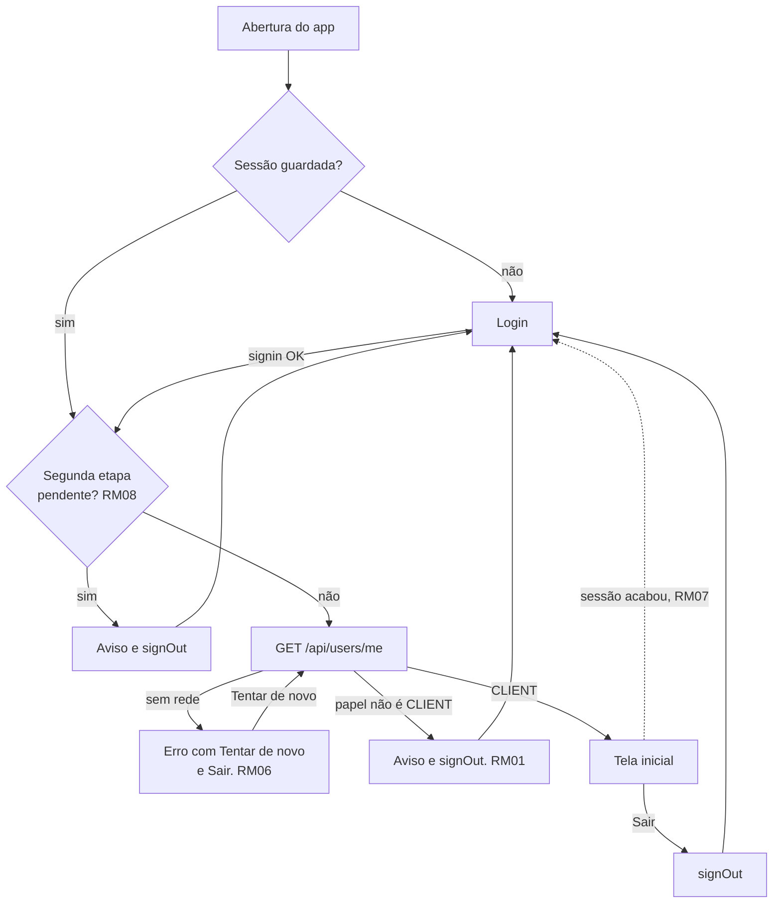
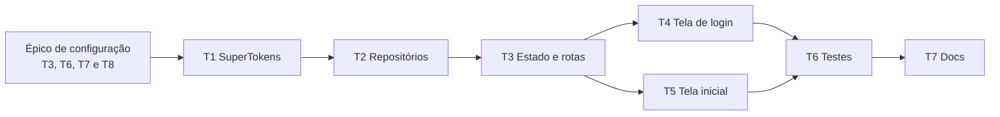

# Sprint 3 (07/10 - 26/10): login e tela inicial do app

Plano do mobile para o cidadão entrar no app e ver os próprios dados. Usa o que o backend entregou nas sprints 2 e 3: o login pelo **SuperTokens** (`POST /api/auth/signin`), a sessão por header com renovação automática e o `GET /api/users/me`. Roda em cima da base do [plano de configuração](sprint-3-configuracao.md).

As regras do backend (RN01 a RN25) continuam valendo e são citadas quando o app depende delas. As regras próprias do app usam o prefixo **RM**.

## 1. Decisões

| Tema                | Decisão                                                                                                                                                                                                                      |
| ------------------- | ---------------------------------------------------------------------------------------------------------------------------------------------------------------------------------------------------------------------------- |
| SDK de sessão       | **`supertokens_flutter` 0.6.5**, que suporta a FDI 4.1, aceita pelo `supertokens-node` 24.0.3 do backend. O `FRONTEND.md` do backend orienta o `supertokens-react-native`, que não serve para Flutter, e é atualizado na T7. |
| Transporte          | Tokens por header, o padrão do SDK e o modo que a API espera do app. O access token vai no `Authorization`, e o SDK guarda os tokens que voltam nos headers das respostas.                                                   |
| Login               | Chamada direta ao `POST /api/auth/signin` pelo `Dio` compartilhado. O SDK de Flutter, como o de React Native, só cuida da sessão e não tem função de login. O interceptor do SDK guarda os tokens da resposta.               |
| Renovação           | Automática, pelo interceptor do SDK no `Dio`: num 401, ele renova a sessão e repete a chamada.                                                                                                                               |
| Onde o SDK fica     | Só em `lib/core/auth/`, atrás da interface `SessionManager`, como o `IdentityProvider` do backend. O resto do app não importa o pacote, e o teste de arquitetura barra.                                                      |
| Quem entra          | Só o CLIENT (RM01). O ADM e o SuperAdm usam o painel web.                                                                                                                                                                    |
| Perfil e papel      | `GET /api/users/me`, depois do login e a cada abertura do app.                                                                                                                                                               |
| Estado de login     | Um `AuthController` (Riverpod) é a fonte da verdade, e o `redirect` do go_router escolhe a tela a partir dele. Nenhuma tela navega sozinha depois do login ou do "Sair".                                                     |
| Fim da sessão       | Evento `UNAUTHORISED` do SDK (`eventHandler`), que leva ao login (RM07).                                                                                                                                                     |
| Segunda etapa (MFA) | Detectada pela claim `mfa-verified` do access token. A tela do código fica para o próximo épico (RM08).                                                                                                                      |

## 2. Fluxo e telas



| Tela     | Rota        | O que mostra                                                                            |
| -------- | ----------- | --------------------------------------------------------------------------------------- |
| Abertura | `/abertura` | Indicador enquanto confere a sessão. Sem rede, a mensagem com "Tentar de novo" e "Sair" |
| Login    | `/login`    | E-mail, senha, "Entrar" e, quando houver, o motivo de ter voltado ao login              |
| Inicial  | `/inicio`   | Saudação, os dados do usuário e "Sair"                                                  |

### Integração com o SuperTokens

O SDK é inicializado uma vez, no `main.dart`, antes do `runApp`, e registra o interceptor no `Dio` compartilhado:

```dart
SuperTokens.init(
  apiDomain: config.apiUrl, // ex.: http://10.0.2.2:3000, sem o /api
  apiBasePath: '/api/auth',
  eventHandler: (event) {
    // Eventype.UNAUTHORISED: a sessão acabou. O SessionManager repassa ao AuthController.
  },
);

dio.interceptors.add(SuperTokensInterceptorWrapper(client: dio));
```

| Função do SDK                                 | Uso no app                                                    |
| --------------------------------------------- | ------------------------------------------------------------- |
| `SuperTokens.doesSessionExist()`              | Decide, na abertura, entre o login e a tela inicial           |
| `SuperTokens.getAccessTokenPayloadSecurely()` | Lê a claim `mfa-verified` (`v == false` é a sessão pendente)  |
| `SuperTokens.signOut()`                       | "Sair": encerra a sessão na API e apaga os tokens do aparelho |
| `eventHandler` (`UNAUTHORISED`)               | A sessão acabou e não renova mais: volta ao login             |

### Respostas do login

O signin responde 200 nos três casos de erro do SuperTokens, com o resultado no campo `status`. O 429 vem no formato de erro da aplicação, sem `status`: o app confere o status HTTP antes de ler o corpo.

| Resposta da API                | O que o app mostra                                                                                    |
| ------------------------------ | ----------------------------------------------------------------------------------------------------- |
| 200, `OK`                      | Segue o fluxo: segunda etapa, `/users/me` e papel                                                     |
| 200, `WRONG_CREDENTIALS_ERROR` | "E-mail ou senha incorretos." A senha é apagada, e o e-mail continua preenchido (RM02)                |
| 200, `FIELD_ERROR`             | A mensagem de cada campo (`formFields[].error`) embaixo do campo                                      |
| 200, `GENERAL_ERROR`           | A `message` da API: e-mail bloqueado por tentativas (RN17, RM03)                                      |
| 429                            | "Muitas tentativas. Tente de novo em N s.", com o botão desativado até o fim da contagem (RN18, RM04) |
| Sem conexão ou timeout         | "Não foi possível conectar ao servidor. Confira a sua internet."                                      |
| 5xx ou resposta inesperada     | "Algo deu errado. Tente de novo em instantes."                                                        |

### Dados da tela inicial

| Campo do `/users/me` | Na tela                                                                        |
| -------------------- | ------------------------------------------------------------------------------ |
| `name`               | "Olá, Maria" (primeiro nome) e o nome completo                                 |
| `email`              | O e-mail, com o selo "E-mail não confirmado" quando `emailVerifiedAt` é `null` |
| `cpf`                | `***.982.247-**` (RM09)                                                        |
| `phone`              | `(44) 99999-8888`, ou `(44) 3333-4444` no fixo                                 |
| `birthDate`          | `20/05/1990`, sem conversão de fuso                                            |
| `createdAt`          | "No ReportaAi desde outubro de 2026"                                           |

## 3. Regras do app

| Código | Regra                                                                                                                                                                                                                           |
| ------ | ------------------------------------------------------------------------------------------------------------------------------------------------------------------------------------------------------------------------------- |
| RM01   | O app é do CLIENT. Depois do login e a cada abertura, o app confere o `role` do `GET /api/users/me`. Com outro papel, encerra a sessão e mostra no login: "Este aplicativo é para cidadãos. Administradores usam o painel web." |
| RM02   | O login mostra a mesma mensagem ("E-mail ou senha incorretos.") para a senha errada e para a conta inexistente, inativa ou excluída, como a API (RN09). O app nunca tenta adivinhar o motivo.                                   |
| RM03   | No bloqueio por tentativas (RN17), o app mostra a `message` do `GENERAL_ERROR`, sem contagem regressiva: a API não informa quanto falta.                                                                                        |
| RM04   | No limite por IP (RN18), o botão "Entrar" fica desativado com a contagem regressiva do `Retry-After` e volta sozinho ao fim dela.                                                                                               |
| RM05   | Antes de enviar, o app confere só que o e-mail está preenchido e no formato e que a senha está preenchida. A política de senha (RN08) não é conferida no login, só no cadastro.                                                 |
| RM06   | Com a sessão guardada, o app abre direto na tela inicial, sem passar pelo login. Sem rede na abertura, a sessão não é apagada: o app mostra o erro com "Tentar de novo" e "Sair".                                               |
| RM07   | Quando a sessão acaba (refresh expirado, usuário inativado, sessão encerrada em outro aparelho ou senha trocada), o app volta ao login com "Sua sessão expirou. Entre de novo."                                                 |
| RM08   | Com a sessão pendente da segunda etapa (RN25), enquanto a tela do código não existe, o app encerra a sessão e mostra no login: "A verificação em duas etapas ainda não está disponível no app."                                 |
| RM09   | Senha, tokens e CPF nunca vão para log nem para mensagem de erro. Na tela inicial, o CPF aparece mascarado (`***.982.247-**`), como no painel (RN12).                                                                           |
| RM10   | "Sair" pede confirmação e encerra a sessão na API pelo `signOut` do SDK. Sem conexão, o app avisa e mantém o usuário logado, porque o SDK só apaga os tokens depois que a API responde (ver os pontos em aberto).               |

## 4. Rotas da API usadas

Nenhuma rota nova no backend. Todas existem desde a sprint 2:

| Método | Rota                        | Acesso      | Uso no app                                                           |
| ------ | --------------------------- | ----------- | -------------------------------------------------------------------- |
| `POST` | `/api/auth/signin`          | Público     | Login. Corpo `{ formFields: [{ id: 'email' }, { id: 'password' }] }` |
| `POST` | `/api/auth/session/refresh` | Pelo SDK    | Renovação automática da sessão                                       |
| `POST` | `/api/auth/signout`         | Pelo SDK    | "Sair"                                                               |
| `GET`  | `/api/users/me`             | Autenticado | Perfil e papel                                                       |

O `GET /api/health` continua só na tela de diagnóstico, do épico de configuração.

## 5. Variáveis de ambiente

Nenhuma variável nova. A `API_URL` do épico de configuração é o `apiDomain` do SDK.

Para testar a renovação da sessão sem esperar 15 minutos, baixe o `ACCESS_TOKEN_VALIDITY` do SuperTokens Core local (no `docker-compose.yml` do backend) para 60 segundos. Não faça commit dessa mudança.

## 6. Labels

As mesmas do épico de configuração: o epic recebe `Epic` + `Sprint 3 - 07/10 - 26/10`, e cada task recebe `Task` + a label da sprint.

## 7. Ordem e dependências



Para não travar as telas, entregue primeiro os contratos e os fakes da T2, num PR pequeno. Com eles, o layout da T4 e da T5 começa antes de a T3 ficar pronta.

---

## 8. Issues

### EPIC

**Título:** `[EPIC] Login e tela inicial do app`
**Labels:** `Epic`, `Sprint 3 - 07/10 - 26/10`

```markdown
O cidadão entra no app com e-mail e senha e vê os próprios dados. É a primeira entrega de negócio do mobile e a base de todas as telas autenticadas que vêm depois (cadastro, reportes e perfil).

- **Entrar**: login com mensagens claras para cada resposta da API (credenciais, bloqueio por tentativas e limite por IP), sem revelar se o e-mail tem conta.
- **Continuar logado**: a sessão fica guardada no aparelho e é renovada sozinha. O app abre direto na tela inicial e só volta ao login quando a sessão acaba.
- **Ver os próprios dados**: a tela inicial mostra o perfil do `GET /api/users/me`.

### Escopo

- Integração com o SuperTokens pelo `supertokens_flutter`, com a sessão por header
- Repositórios de autenticação e de perfil
- Estado de login, abertura do app e proteção das rotas
- Tela de login
- Tela inicial com os dados do usuário e o "Sair"
- Testes de widget dos fluxos e teste de integração contra a API local
- Documentação do login no app e atualização do `FRONTEND.md` do backend

### Fora do escopo

Cadastro do Client, "Esqueci minha senha", reenvio da verificação de e-mail, tela do código da segunda etapa, edição do perfil, troca de senha, sessões abertas, exclusão da conta, biometria e deep link. São os próximos épicos do app.

### Definição de pronto (vale para todas as tasks)

- Os itens da definição de pronto do épico de configuração (formatação, analyzer, testes e emulador)
- Testes de widget de cada estado das telas (carregando, erro e sucesso), com os fakes dos repositórios
- O pacote `supertokens_flutter` importado só em `lib/core/auth/` (teste de arquitetura)
- Nenhuma senha, token ou CPF em log
- Testado contra a API local, na `develop` do backend

### Tasks

- [ ] T1 [CONFIG] Integração com o SuperTokens (sessão por header)
- [ ] T2 [FEAT] Repositórios de autenticação e de perfil
- [ ] T3 [FEAT] Estado de login, abertura do app e proteção das rotas
- [ ] T4 [FEAT] Tela de login
- [ ] T5 [FEAT] Tela inicial com os dados do usuário
- [ ] T6 [TEST] Testes dos fluxos de login e da tela inicial
- [ ] T7 [DOCS] Documentar o login no app
```

> Depois de criar as tasks, troque cada `T<n>` pelo número da issue, para o GitHub linkar automaticamente, ou adicione as tasks como sub-issues do epic.

---

### T1

**Título:** `[CONFIG] Integração com o SuperTokens (sessão por header)`

```markdown
Ligar o SDK do SuperTokens ao app, para guardar, enviar e renovar a sessão. O SDK de Flutter só cuida da sessão: a chamada de login fica na T2.

- `supertokens_flutter` (versão exata, 0.6.5)
- `SuperTokens.init` no `main.dart`, antes do `runApp`, com `apiDomain` igual à `API_URL` (sem o `/api`), `apiBasePath: '/api/auth'` e o `eventHandler`
- Interceptor do SDK (`SuperTokensInterceptorWrapper`) no `Dio` compartilhado, antes do interceptor de log
- Interface `SessionManager` em `core/auth/`: `hasSession()`, `isSecondFactorPending()` (claim `mfa-verified` com `v == false`, pelo `getAccessTokenPayloadSecurely`), `signOut()` e um `Stream` de eventos (sessão acabou e saída)
- Implementação `SuperTokensSessionManager` e um `FakeSessionManager` para os testes
- Teste de arquitetura: só `lib/core/auth/` importa `package:supertokens_flutter`
- Backup automático do Android desligado (`android:allowBackup="false"`), para os tokens, que o SDK guarda no SharedPreferences, não irem para o backup na nuvem

**Critérios de aceite**

- Com a API local, um `POST /api/auth/signin` feito pelo `Dio` guarda a sessão, e o `GET /api/users/me` em seguida responde 200
- Depois de fechar e abrir o app, `hasSession()` continua `true`
- Com o access token vencido, a chamada seguinte renova a sessão sozinha e responde 200
- Com a sessão encerrada pela API (pela listagem de sessões de outro login, ou com o usuário inativado pelo painel), o `SessionManager` emite o evento de sessão acabada na renovação seguinte
- Os tokens não aparecem no log do `Dio`
```

### T2

**Título:** `[FEAT] Repositórios de autenticação e de perfil`

```markdown
Criar as camadas de domínio e de dados do login e do perfil, sem tela. As telas da T4 e da T5 conhecem só os contratos.

- `features/auth`: contrato `AuthRepository` com `signIn(email, password)`, `signOut()`, `hasSession()` e `isSecondFactorPending()`. A implementação `ApiAuthRepository` chama o `POST /api/auth/signin` no formato do SuperTokens (`formFields`) e usa o `SessionManager` (T1) no resto
- Resultado do login como `sealed class SignInResult`: `SignInSuccess`, `SignInWrongCredentials`, `SignInFieldError` (campo e mensagem), `SignInLocked` (`GENERAL_ERROR`, com a `message` da API) e `SignInRateLimited` (429, com o `Retry-After`). Sem conexão e 5xx seguem como as exceções do `core/network`
- O e-mail vai com `trim` e em minúsculas (RN02)
- `features/profile`: contrato `ProfileRepository` com `getMe()`, implementado pelo `ApiProfileRepository` (`GET /api/users/me`)
- Modelo `UserProfile` (imutável) com os campos do `/users/me`, e `Role` com `client`, `admin`, `superAdmin` e um `unknown` para valores que o app ainda não conhece
- `birthDate` lida como data sem hora, sem conversão de fuso
- Fakes `FakeAuthRepository` e `FakeProfileRepository` em `test/support/`, com o resultado configurável em cada teste
- Providers em `auth_providers.dart` e `profile_providers.dart`

**Critérios de aceite**

- Testes unitários da conversão de cada resposta do signin: `OK`, `WRONG_CREDENTIALS_ERROR`, `FIELD_ERROR`, `GENERAL_ERROR`, 429 com e sem `Retry-After` e sem conexão
- Testes da leitura do `/users/me` com o JSON de exemplo do `FRONTEND.md` do backend, com e sem os campos do Client, e com um `role` desconhecido
- `1990-05-20` vira 20/05/1990 no fuso do Brasil (UTC-3), sem voltar um dia
- A senha não aparece em nenhum log nem na mensagem de nenhuma exceção
```

### T3

**Título:** `[FEAT] Estado de login, abertura do app e proteção das rotas`

```markdown
Fazer o app decidir sozinho qual tela mostrar, a partir da sessão e do perfil, na abertura, depois do login e quando a sessão acaba.

- `AuthController` (Notifier do Riverpod) com os estados `checking` (abertura), `unauthenticated` (com o motivo, quando houver: sessão acabou, papel não permitido ou segunda etapa pendente), `authenticated` (com o `UserProfile`) e `loadFailed` (há sessão, mas o perfil não carregou por falta de rede)
- Os passos depois que existe uma sessão são os mesmos na abertura e no login: segunda etapa pendente (RM08), `GET /api/users/me`, papel CLIENT (RM01) e tela inicial
- Redirect do go_router a partir do estado: `checking` e `loadFailed` vão para `/abertura`, `unauthenticated` para `/login` e `authenticated` para `/inicio`. Nenhuma rota autenticada abre sem sessão
- Tela de abertura: indicador de carregamento e, no `loadFailed`, a mensagem com "Tentar de novo" e "Sair" (RM06)
- O evento de sessão acabada do `SessionManager` leva ao `unauthenticated` com o motivo (RM07). A saída pelo "Sair" não mostra esse aviso
- O "voltar" do Android na tela inicial fecha o app, sem voltar ao login
- Remover a `/inicio` provisória do épico de configuração

**Critérios de aceite**

- Com a sessão guardada, o app abre direto na tela inicial, sem mostrar o login
- Sem rede na abertura, com sessão, a tela de erro aparece. Com a rede de volta, o "Tentar de novo" leva à tela inicial
- Um ADMIN que faz login no app sai da sessão e vê o aviso da RM01
- Uma sessão encerrada em outro aparelho volta ao login com o aviso da RM07 na renovação seguinte
- Testes unitários do `AuthController`, com os fakes, cobrindo cada transição de estado
```

### T4

**Título:** `[FEAT] Tela de login`

```markdown
Tela para o cidadão entrar com e-mail e senha (`/login`).

- Campo de e-mail (teclado de e-mail, sem correção automática) e campo de senha (oculta, com botão para mostrar e ocultar), num `AutofillGroup` com as dicas `email` e `password`, para o gerenciador de senhas do aparelho preencher e salvar
- Validação local antes de enviar (RM05)
- Botão "Entrar" com o estado de carregando, que não envia duas vezes. O "concluir" do teclado no campo de senha também envia
- A mensagem de cada resposta, como na tabela "Respostas do login" do plano (RM02, RM03 e RM04): o aviso geral acima do botão e os erros de campo embaixo de cada campo
- No 429, o botão fica desativado com a contagem regressiva e volta sozinho ao fim dela
- O motivo de ter voltado ao login, vindo do `AuthController` (sessão acabou, papel não permitido ou segunda etapa)
- Depois do `WRONG_CREDENTIALS_ERROR`, o e-mail continua preenchido e a senha é apagada
- Com sucesso, `TextInput.finishAutofillContext()` para o gerenciador de senhas oferecer salvar. A navegação fica com o redirect da T3
- Rolagem, para o teclado não cobrir o botão e para a tela aguentar a fonte em 200%
- Sem os links "Criar conta" e "Esqueci minha senha" nesta sprint: eles entram junto com as telas, no próximo épico

**Critérios de aceite**

- Testes de widget de cada linha da tabela de respostas, com o `FakeAuthRepository`
- O segundo toque em "Entrar" durante o carregamento não faz outra chamada
- O leitor de tela (TalkBack e VoiceOver) lê o rótulo dos campos e anuncia a mensagem de erro
- Com a API local: o login de um Client entra, a senha errada mostra a mensagem, e 5 erros seguidos mostram o bloqueio da API
```

### T5

**Título:** `[FEAT] Tela inicial com os dados do usuário`

```markdown
Primeira tela autenticada (`/inicio`), com os dados do `GET /api/users/me`.

- Barra superior com o nome do app e a ação "Sair"
- Saudação com o primeiro nome ("Olá, Maria")
- Cartão "Seus dados" com os campos da tabela "Dados da tela inicial" do plano: nome, e-mail (com o selo "E-mail não confirmado" quando o `emailVerifiedAt` é `null`, só informativo nesta sprint), CPF mascarado (RM09), telefone, data de nascimento e "No ReportaAi desde"
- Um cartão informativo, sem ação, avisando que os reportes chegam em breve
- Puxar para atualizar chama o `GET /api/users/me` de novo e atualiza o perfil do `AuthController` (ex.: depois de o Client confirmar o e-mail no navegador)
- Se a atualização falhar, os dados já mostrados continuam na tela, com um aviso do erro
- "Sair" com confirmação. Sem conexão, mostra o erro e continua logado (RM10)
- Formatadores em `core/utils/`: CPF mascarado, telefone com 10 ou 11 dígitos, data em `dd/MM/yyyy` e mês e ano por extenso

**Critérios de aceite**

- Testes unitários dos formatadores, incluindo o telefone fixo e o celular
- Testes de widget com um perfil de exemplo: todos os campos formatados, e o selo aparece só sem o `emailVerifiedAt`
- Um nome de uma palavra só ("Maria") e um nome com espaços sobrando aparecem certos na saudação
- O CPF completo não aparece em nenhum lugar da tela
- Depois do "Sair", o "voltar" do Android não volta para a tela inicial
```

### T6

**Título:** `[TEST] Testes dos fluxos de login e da tela inicial`

```markdown
Cobrir os fluxos do épico de ponta a ponta: com fakes, no CI, e contra a API de verdade, localmente.

- Testes de widget do app inteiro (router, telas e `AuthController`), com o `FakeSessionManager` e os fakes dos repositórios:
  - abertura sem sessão → login → tela inicial
  - abertura com sessão → tela inicial direto
  - abertura com sessão e sem rede → erro → "Tentar de novo" → tela inicial
  - login de um ADMIN → aviso → login
  - sessão pendente da segunda etapa → aviso → login
  - sessão acabada na tela inicial → login com o aviso
  - "Sair" → login, e o "voltar" não volta
- Teste de integração (`integration_test/`) contra a API local: login de um Client → tela inicial com os dados → "Sair". O Client é criado pelo `POST /api/clients` no início do teste
- Como rodar o teste de integração no `TESTING.md`. Ele não roda no CI, porque precisaria da API, do SuperTokens Core e de um emulador
- Cobertura mínima de 80% em `domain/`, `data/`, nos ViewModels e no `AuthController`, conferida no CI
- Gravação de tela do fluxo completo no emulador, anexada ao PR como evidência da sprint

**Critérios de aceite**

- `flutter test` passa localmente e no GitHub Actions
- `flutter test integration_test` passa com a API local na `develop` do backend
- Cada regra de RM01 a RM10 tem pelo menos um teste (a RM09, pelo CPF mascarado na tela)
```

### T7

**Título:** `[DOCS] Documentar o login no app`

```markdown
Atualizar a documentação com o que foi entregue no épico, no mobile e no backend.

- `docs/AUTH.md` do mobile: como o SDK está integrado (init, interceptor e `SessionManager`), os estados do `AuthController`, o redirect das rotas, a tabela de respostas do login, as regras RM01 a RM10 e como criar uma tela autenticada nova
- `docs/ARCHITECTURE.md`: a pasta `core/auth/` e a regra de import do SuperTokens
- `README.md`: como criar um Client de teste (pelo `docs/api.http` do backend) e entrar no app
- Abrir uma issue e um PR no backend para registrar a troca do app de React Native para Flutter, que hoje orienta o `supertokens-react-native`:
  - `docs/FRONTEND.md`: a tabela do início (SDK e onde os tokens ficam), a seção "App mobile" (instalação, `SuperTokens.init`, interceptor do Dio e login pelo Dio) e os trechos marcados "App:" nas seções da verificação em duas etapas e de quando a sessão acaba (o `onHandleEvent` vira o `eventHandler`)
  - `docs/AUTH.md`: a tabela "Sessão: cookie ou header", que cita o SDK de React Native no modo header
  - O plano da sprint 2 do backend não muda: é o registro do que foi decidido na época

**Critérios de aceite**

- Uma pessoa nova do time mobile consegue criar uma tela autenticada nova seguindo só o `AUTH.md`
- O `FRONTEND.md` e o `AUTH.md` do backend não citam mais o React Native para o app
```

---

## 9. Pontos em aberto

- **Tokens no SharedPreferences:** o `supertokens_flutter` guarda o access token e o refresh token no SharedPreferences, sem criptografia. No Android, é um arquivo privado do app, e o backup desligado (T1) evita que ele vá para a nuvem. Guardar no Keychain ou no Keystore exigiria trocar o armazenamento do SDK. Vale reavaliar quando os reportes trouxerem dados mais sensíveis.
- **"Sair" sem internet não apaga a sessão:** o `signOut` do SDK só apaga os tokens depois da resposta da API. A RM10 propõe avisar e manter o usuário logado. A alternativa é apagar os tokens do aparelho por conta própria, o que deixa a sessão aberta na API até o refresh token vencer (7 dias).
- **Segunda etapa no app:** o Client só ativa a verificação em duas etapas pelo app (o painel recusa o Client), e essa opção ainda não existe. Por isso, a RM08 só aparece para uma conta alterada fora do app. A tela do código entra junto com a opção de ativar.
- **Cadastro e "Esqueci minha senha":** sem eles, só entra quem já tem conta, criada pelo `docs/api.http` do backend. A ordem sugerida para o próximo épico é cadastro, "Esqueci minha senha" e reenvio da verificação de e-mail.
- **CPF na tela inicial:** a proposta mostra o CPF mascarado. Falta decidir se o Client vê o próprio CPF completo, com um botão para mostrar.
- **Validade do refresh token (ponto da sprint 2 do backend):** com 7 dias, o cidadão que passa uma semana sem abrir o app precisa entrar de novo. Para um app de uso esporádico, como o de reportes, 30 dias combina mais.
- **Biometria para reabrir o app:** fica para depois.
