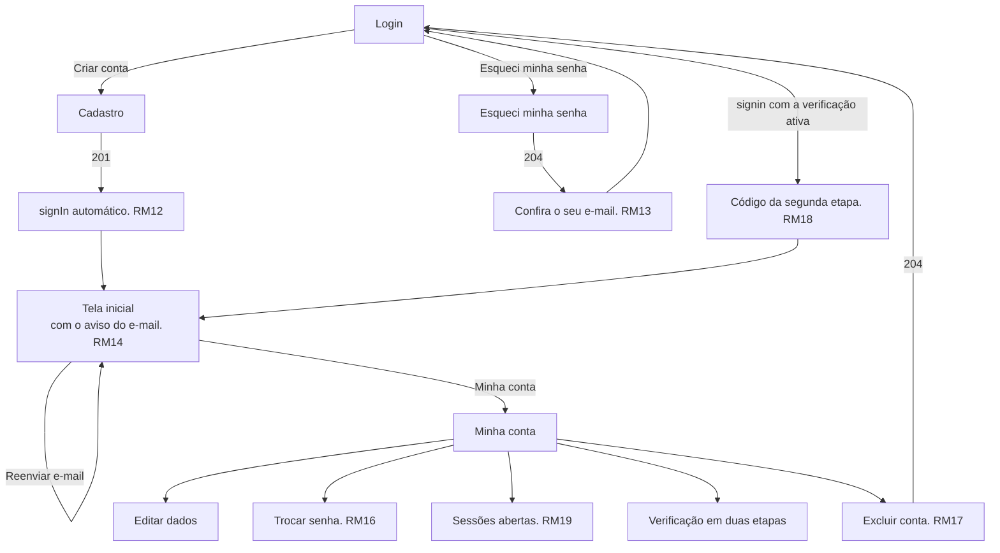
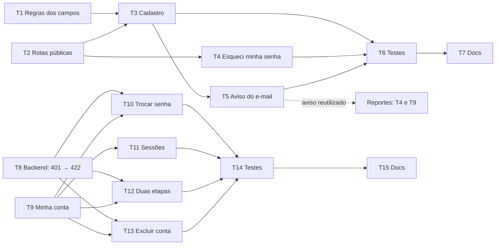

# Sprint 4 (26/10 - 04/11): cadastro, recuperação de acesso e minha conta

Plano do mobile para completar o acesso do cidadão. O [épico de login](sprint-3-login.md) entregou a entrada de quem já tem conta. Faltam o cadastro, o "Esqueci minha senha", a confirmação do e-mail e a área "Minha conta" (dados, senha, sessões, verificação em duas etapas e exclusão da conta). Todas as rotas da API já existem desde as sprints 2 e 3 do backend, menos um ajuste no 401 da senha de confirmação (T8).

O cadastro e a confirmação do e-mail vêm primeiro: sem eles, só entra quem tem conta criada pelo `api.http` do backend, e o [plano dos reportes](sprint-4-reportes.md) exige o e-mail confirmado para abrir e validar um reporte.

São dois epics. As regras RM01 a RM10 seguem valendo, e as novas continuam a numeração (RM11 a RM19). A RM08 é substituída pela RM18.

## 1. Decisões

| Tema                        | Decisão                                                                                                                                                                                                                                                                                                     |
| --------------------------- | ----------------------------------------------------------------------------------------------------------------------------------------------------------------------------------------------------------------------------------------------------------------------------------------------------------- |
| Ordem                       | Epic 1 (cadastro, "Esqueci minha senha" e o aviso do e-mail) antes dos reportes. O epic 2 (Minha conta) corre em paralelo aos reportes e é o que pode passar para a sprint seguinte.                                                                                                                        |
| Rotas públicas              | `/cadastro` e `/esqueci-senha` abrem sem sessão. O `redirectFor` ganha a lista das rotas públicas: com o Client dentro, elas levam à tela inicial.                                                                                                                                                          |
| Regras dos campos           | Repetidas no `domain`, com o mesmo comportamento dos value objects do backend (`Cpf`, `Phone`, `BirthDate`, `Password` e o tamanho do nome), como o e-mail já é ([ARCHITECTURE.md](../ARCHITECTURE.md#o-paralelo-com-o-backend)). O app confere antes de enviar, e a API continua sendo a fonte da verdade. |
| Máscaras                    | `TextInputFormatter` próprios em `core/utils/` (CPF, telefone e data), sem pacote novo. O app envia só os dígitos, e a data em `AAAA-MM-DD`.                                                                                                                                                                |
| Depois do cadastro          | O app entra sozinho, pelo `AuthController.signIn`, com o e-mail e a senha que o cidadão acabou de digitar. A senha não fica guardada: só o gerenciador de senhas do aparelho a salva (autofill).                                                                                                            |
| Senha nova                  | Definida na página `/redefinir-senha` do painel web, aberta pelo link do e-mail, como decidido na sprint 3 do backend. O app só pede o link.                                                                                                                                                                |
| E-mail confirmado           | O app atualiza o perfil quando volta para o primeiro plano (`AppLifecycleListener`), para o aviso sumir sozinho depois de o cidadão confirmar o e-mail no navegador.                                                                                                                                        |
| Senha de confirmação errada | Uma task no backend (T8) troca o 401 dessas rotas por 422. Com o 401, o SDK do SuperTokens renova a sessão e repete a chamada até 10 vezes antes de desistir, e o app não consegue diferenciar a senha errada da sessão vencida ([AUTH.md](../AUTH.md#cuidados)).                                           |
| Segunda etapa               | A tela do código substitui a RM08: o `AuthController` ganha o estado `AuthSecondFactorPending`, e o redirect leva à `/verificacao`.                                                                                                                                                                         |
| Identificação do aparelho   | O `Dio` passa a mandar um `User-Agent` do app (`ReportaAiCm/<versão> (<sistema> <versão>)`), com a versão do `package_info_plus`, para a lista de sessões mostrar algo legível.                                                                                                                             |
| Exclusão da conta           | Dentro do app, como a Google Play exige dos apps que permitem criar conta.                                                                                                                                                                                                                                  |

## 2. Fluxos e telas



| Tela                       | Rota                 | Sessão   | O que mostra                                                                         |
| -------------------------- | -------------------- | -------- | ------------------------------------------------------------------------------------ |
| Cadastro                   | `/cadastro`          | Não      | Nome, e-mail, senha (com a regra), CPF, telefone, data de nascimento e "Criar conta" |
| Esqueci minha senha        | `/esqueci-senha`     | Não      | E-mail, "Enviar link" e a mensagem depois do envio                                   |
| Código da segunda etapa    | `/verificacao`       | Pendente | Campo de 6 dígitos, "Confirmar", "Enviar outro código" e "Sair"                      |
| Minha conta                | `/conta`             | Sim      | Os dados (com o CPF mascarado) e as entradas de cada tela abaixo                     |
| Editar dados               | `/conta/dados`       | Sim      | Nome, telefone e data de nascimento. O e-mail e o CPF aparecem, sem edição           |
| Trocar senha               | `/conta/senha`       | Sim      | Senha atual, senha nova e a confirmação                                              |
| Sessões abertas            | `/conta/sessoes`     | Sim      | As sessões, com "Este aparelho", e as ações de encerrar                              |
| Verificação em duas etapas | `/conta/verificacao` | Sim      | O estado, o interruptor e a senha atual                                              |
| Excluir conta              | `/conta/excluir`     | Sim      | O que acontece com a conta, a senha e a confirmação                                  |

### Respostas do cadastro

| Resposta da API    | O que o app mostra                                                                              |
| ------------------ | ----------------------------------------------------------------------------------------------- |
| 201                | Entra sozinho e abre a tela inicial (RM12)                                                      |
| 400                | A mensagem de cada campo do `details`, embaixo dele                                             |
| 409, campo `email` | A `message` da API no campo do e-mail, com os atalhos "Entrar" e "Esqueci minha senha"          |
| 409, campo `cpf`   | A `message` da API no campo do CPF                                                              |
| 429                | "Muitas tentativas. Tente de novo em N s.", com o botão desativado até o fim da contagem (RM04) |
| Sem conexão, 5xx   | As mensagens padrão do `core/network`. Os campos continuam preenchidos                          |

## 3. Regras do app

| Código | Regra                                                                                                                                                                                                                                              |
| ------ | -------------------------------------------------------------------------------------------------------------------------------------------------------------------------------------------------------------------------------------------------- |
| RM11   | O cadastro confere antes de enviar as regras dos campos da API (nome, e-mail, senha da RN08, CPF com os dígitos verificadores, telefone e data de nascimento no passado), com as mesmas mensagens. Os erros da API aparecem embaixo de cada campo. |
| RM12   | Depois do cadastro, o app entra sozinho com o e-mail e a senha digitados e abre a tela inicial com o aviso do e-mail. Se o login automático falhar, o app vai ao login com o e-mail preenchido. O app não guarda a senha.                          |
| RM13   | "Esqueci minha senha" mostra sempre a mesma mensagem, com ou sem conta (RN20), e o "Enviar de novo" fica desativado por 60 s.                                                                                                                      |
| RM14   | Enquanto o e-mail não for confirmado, a tela inicial mostra o aviso com "Reenviar e-mail", desativado por 60 s depois de cada envio e logo depois do cadastro. Ao voltar para o primeiro plano, o app atualiza o perfil, e o aviso some sozinho.   |
| RM15   | Nas telas que pedem a senha atual (trocar a senha, verificação em duas etapas e excluir a conta), a senha errada aparece no campo ("Senha atual incorreta."), e o campo é apagado. Ela nunca leva ao login como sessão expirada.                   |
| RM16   | A troca de senha avisa antes que os outros aparelhos vão sair (RN13). Este aparelho continua logado.                                                                                                                                               |
| RM17   | A exclusão da conta explica o que acontece, pede a senha e uma confirmação explícita, e volta ao login com "Sua conta foi excluída."                                                                                                               |
| RM18   | Com a verificação em duas etapas ativa, o login leva à tela do código, na abertura e depois do signin (substitui a RM08). O "Enviar outro código" fica desativado por 60 s, e o "Sair" encerra a sessão pendente.                                  |
| RM19   | A lista de sessões marca "Este aparelho", que não tem o "Encerrar". "Encerrar todas as outras" pede confirmação.                                                                                                                                   |

## 4. Rotas da API usadas

Todas existem no backend. Só a T8 muda a resposta da senha errada (401 → 422).

| Método           | Rota                                | Acesso          | Uso no app                                      |
| ---------------- | ----------------------------------- | --------------- | ----------------------------------------------- |
| `POST`           | `/api/clients`                      | Público         | Cadastro                                        |
| `POST`           | `/api/password-resets`              | Público         | "Esqueci minha senha"                           |
| `POST`           | `/api/users/me/email-verification`  | Autenticado     | Reenvio do link de confirmação do e-mail        |
| `PATCH`          | `/api/users/me`                     | Autenticado     | Editar nome, telefone e data de nascimento      |
| `PATCH`          | `/api/users/me/password`            | Autenticado     | Trocar a senha                                  |
| `GET` e `DELETE` | `/api/users/me/sessions` e `/:id`   | Autenticado     | Sessões abertas                                 |
| `PATCH`          | `/api/users/me/mfa`                 | Autenticado     | Ativar e desativar a verificação em duas etapas |
| `POST`           | `/api/mfa/verify` e `/api/mfa/code` | Sessão pendente | Tela do código                                  |
| `DELETE`         | `/api/users/me`                     | CLIENT          | Excluir a conta                                 |

O corpo e as respostas de cada rota estão no [FRONTEND.md](https://github.com/jgtsuchiya/projeto_integrador_reportaAiCm_backend/blob/develop/docs/FRONTEND.md) do backend.

## 5. Variáveis de ambiente e pacotes

Nenhuma variável nova. Um pacote novo: **`package_info_plus`** (versão exata, conferida no pub.dev na T11), para a versão do app no `User-Agent`.

## 6. Labels

Crie a label **`Sprint 4 - 26/10 - 04/11`** (as labels `Epic` e `Task` já existem). Os dois epics recebem `Epic` + a label da sprint, e cada task recebe `Task` + a label da sprint. A T8 é aberta no repositório do backend, com as labels de lá.

## 7. Ordem e dependências



T1, T2 e T8 não dependem de nada e podem começar em paralelo. A T5 (o `EmailVerificationNotice`) é usada pelas telas dos reportes: entregue-a antes da T4 do plano dos reportes.

A T11 (sessões) e a T12 (duas etapas) são as que menos pesam para o cidadão. Se a sprint apertar, são as que passam para a seguinte.

---

## 8. Issues

### EPIC 1

**Título:** `[EPIC] Cadastro e recuperação de acesso no app`
**Labels:** `Epic`, `Sprint 4 - 26/10 - 04/11`

```markdown
O cidadão cria a conta pelo próprio app, recupera o acesso quando esquece a senha e confirma o e-mail. Sem isso, só entra no app quem tem uma conta criada pelo `api.http` do backend, e os reportes, que exigem o e-mail confirmado, ficam sem uso.

- **Criar conta**: cadastro com os dados do cidadão, com as regras conferidas antes de enviar, e o login automático no fim.
- **Recuperar o acesso**: "Esqueci minha senha", que envia o link para criar uma senha nova.
- **Confirmar o e-mail**: aviso na tela inicial, com o reenvio do link, que some sozinho depois da confirmação.

### Escopo

- Regras dos campos do cadastro no `domain` e máscaras de CPF, telefone e data
- Rotas públicas no redirect e os links no login
- Tela de cadastro e repositório do cadastro
- Tela "Esqueci minha senha"
- Aviso de e-mail não confirmado, com o reenvio, reutilizável pelas telas dos reportes
- Testes de widget dos fluxos e teste de integração contra a API local

### Fora do escopo

A página de senha nova (fica no painel web), deep link dos e-mails, termos de uso, troca de e-mail e a área "Minha conta" (epic 2).

### Definição de pronto (vale para todas as tasks)

- Os itens da definição de pronto dos épicos anteriores (formatação, analyzer, testes, teste de arquitetura e aparelho)
- Testes de widget de cada estado das telas (carregando, erro e sucesso), com os fakes dos repositórios
- Nenhuma senha, token ou CPF em log (RM09)
- Testado contra a API local, na `develop` do backend

### Tasks

- [ ] T1 [FEAT] Regras dos campos do cadastro e máscaras
- [ ] T2 [FEAT] Rotas públicas e links no login
- [ ] T3 [FEAT] Tela de cadastro do Client
- [ ] T4 [FEAT] Tela "Esqueci minha senha"
- [ ] T5 [FEAT] Aviso e reenvio da confirmação do e-mail
- [ ] T6 [TEST] Testes dos fluxos de cadastro e recuperação de acesso
- [ ] T7 [DOCS] Documentar o cadastro e a recuperação de acesso
```

> Depois de criar as tasks, troque cada `T<n>` pelo número da issue, para o GitHub linkar automaticamente, ou adicione as tasks como sub-issues do epic.

---

### T1

**Título:** `[FEAT] Regras dos campos do cadastro e máscaras`

```markdown
Repetir no app as regras dos campos do `POST /api/clients`, para o cadastro conferir antes de enviar (RM11). O comportamento é o dos value objects do backend (`Cpf`, `Phone`, `BirthDate` e `Password`), como o `isValidEmail` já é.

- `features/auth/domain/models/`: `isValidCpf` (dígitos verificadores, recusando os repetidos, como `111.111.111-11`), `isValidPhone` (DDD + celular com 9 dígitos começando por 9, ou fixo com 8), `isValidBirthDate` (data que existe, no passado), `validatePassword` (RN08: de 8 a 128 caracteres, com pelo menos uma letra e um número) e o tamanho do nome (de 1 a 120, com `trim`)
- `validateRegistration(...)`, no estilo do `validateSignIn`, com as mesmas mensagens da API (o `register-client.dto.spec.ts` do backend tem a lista)
- `core/utils/`: `TextInputFormatter` de CPF (`000.000.000-00`), telefone (`(00) 00000-0000` ou `(00) 0000-0000`) e data (`dd/mm/aaaa`), e as funções que tiram a máscara (só os dígitos, e a data em `AAAA-MM-DD`)
- A política de senha fica num lugar só: o cadastro e a troca de senha (epic 2) usam a mesma função, e a tela mostra cada item da regra

**Critérios de aceite**

- Os casos dos testes dos value objects do backend (`cpf.spec.ts`, `phone.spec.ts`, `birth-date.spec.ts` e `password.spec.ts`) dão o mesmo resultado no app
- 29/02 de um ano que não é bissexto é recusado
- As máscaras aceitam colar o valor com ou sem pontuação, e o cursor não pula ao apagar
- A cobertura do `domain` continua ≥ 80% (o `tool/check_coverage.dart` do CI)
```

### T2

**Título:** `[FEAT] Rotas públicas e links no login`

```markdown
Liberar as telas que abrem sem sessão e ligá-las ao login.

- `AppRoutes.register` (`/cadastro`) e `AppRoutes.forgotPassword` (`/esqueci-senha`)
- `redirectFor`: sem sessão, as rotas públicas abrem. Com o Client dentro, levam à tela inicial. Na abertura (`AuthChecking`), continuam levando à `/abertura`
- No login, os links "Criar conta" e "Esqueci minha senha", abertos com `context.push`, para o "voltar" voltar ao login. O e-mail digitado vai junto para o "Esqueci minha senha"
- Telas provisórias até a T3 e a T4 (só o título), para o PR ficar pequeno

**Critérios de aceite**

- Testes do `redirectFor` com cada rota pública em cada estado do `AuthController`
- Sem sessão, um deep link para `/inicio` continua levando ao login
- Depois do login automático do cadastro (T3), o "voltar" do Android não volta ao cadastro
```

### T3

**Título:** `[FEAT] Tela de cadastro do Client`

```markdown
Tela de cadastro (`/cadastro`), com o `POST /api/clients` (RM11 e RM12).

- `RegistrationRepository.register(...)`, com a implementação `ApiRegistrationRepository`, o DTO e o `FakeRegistrationRepository`. O resultado é uma `sealed class`: `RegistrationSuccess`, `RegistrationFieldErrors` (400 e 409, com o campo e a mensagem) e `RegistrationRateLimited` (429, com o `Retry-After`). Sem conexão e 5xx seguem como as exceções do `core/network`
- Campos: nome, e-mail, senha (com o botão de mostrar e a regra embaixo, marcando o que já foi cumprido), CPF, telefone e data de nascimento, num `AutofillGroup` (dicas `name`, `email`, `newPassword` e `telephoneNumber`)
- Validação local antes de enviar (T1) e as respostas da tabela "Respostas do cadastro" do plano
- Com o 201, o `AuthController.signIn` com o e-mail e a senha digitados. A navegação fica com o redirect. Se o login automático falhar, o app vai ao login com o e-mail preenchido e a mensagem "Sua conta foi criada. Entre com o e-mail e a senha."
- Um aviso curto, antes do botão, de que o app vai mandar um link para confirmar o e-mail
- Rolagem, teclado sem cobrir o botão e fonte em 200%

**Critérios de aceite**

- Testes de widget de cada resposta (201, 400, 409 de cada campo, 429 e sem conexão), com o `FakeRegistrationRepository`
- O segundo toque em "Criar conta" durante o envio não faz outra chamada
- A senha e o CPF não aparecem no log do `Dio` (conferir o corpo do cadastro no `ApiLogInterceptor`)
- Com a API local: o cadastro de um Client novo cai na tela inicial com o aviso do e-mail, e o e-mail chega no Mailpit
```

### T4

**Título:** `[FEAT] Tela "Esqueci minha senha"`

```markdown
Tela `/esqueci-senha`, com o `POST /api/password-resets` (RM13).

- `AuthRepository.requestPasswordReset(email)`, com o e-mail pelo `normalizeEmail`
- Campo de e-mail, preenchido com o que veio do login, e "Enviar link"
- Com o 204, sempre a mesma mensagem: "Se este e-mail tiver uma conta, você vai receber um link para criar uma senha nova. O link vale por 60 minutos." e o botão "Voltar ao login"
- A tela explica que o link abre no navegador e que, depois de criar a senha, o cidadão volta ao app para entrar
- "Enviar de novo" desativado por 60 s, com a contagem (a API manda no máximo um e-mail por minuto para a mesma conta)
- 429: a contagem do `Retry-After`, como no login

**Critérios de aceite**

- A mensagem é a mesma para um e-mail com e sem conta
- Testes de widget do 204, do 400, do 429 e sem conexão
- Com a API local: o e-mail chega no Mailpit, e a senha nova entra no app (definida pelo `POST /api/password-resets/confirm` do `api.http`, enquanto a página do painel não existir)
```

### T5

**Título:** `[FEAT] Aviso e reenvio da confirmação do e-mail`

```markdown
Aviso de e-mail não confirmado na tela inicial, com o reenvio do link (RM14).

- `ProfileRepository.resendEmailVerification()` (`POST /api/users/me/email-verification`)
- Widget `EmailVerificationNotice`, reutilizável: "Confirme o seu e-mail", o endereço, uma linha dizendo por que (abrir e validar reportes) e "Reenviar e-mail". As telas dos reportes usam o mesmo widget
- Na tela inicial, o aviso entra no lugar do selo "E-mail não confirmado" da sprint 3
- "Reenviar e-mail" desativado por 60 s depois de cada envio e logo depois do cadastro. O 422 mostra a `message` da API (e-mail já confirmado, ou menos de 1 minuto desde o último envio)
- `AppLifecycleListener`: ao voltar para o primeiro plano, o app chama o `AuthController.refreshProfile`, no máximo uma vez a cada 30 s, e o aviso some sozinho

**Critérios de aceite**

- O aviso aparece só com o `emailVerifiedAt` nulo
- Ao voltar do navegador com o e-mail confirmado, o aviso some sem o "puxar para atualizar"
- Uma falha no `refreshProfile` feito ao voltar para o app não mostra erro na tela (o "puxar para atualizar" continua mostrando)
- O leitor de tela anuncia o resultado do reenvio
```

### T6

**Título:** `[TEST] Testes dos fluxos de cadastro e recuperação de acesso`

```markdown
Cobrir os fluxos do epic de ponta a ponta: com fakes, no CI, e contra a API de verdade, localmente.

- Fluxos do app inteiro (`test/flows/`), com os fakes:
  - login → "Criar conta" → cadastro → tela inicial com o aviso do e-mail
  - cadastro com o e-mail já cadastrado → atalho "Entrar" → login
  - login → "Esqueci minha senha" → mensagem → "Voltar ao login"
  - tela inicial → "Reenviar e-mail" → contagem
  - app em segundo plano → volta com o e-mail confirmado → o aviso some
- Teste de integração (`integration_test/`) contra a API local: cadastro pelo app → tela inicial com o aviso → confirmação pelo link do e-mail → o aviso some. O `TestApi` ganha a leitura do link pela API do Mailpit (`/api/v1/search`) e a exclusão, no `addTearDown`, da conta criada pela tela
- A cobertura mínima continua 80% por grupo

**Critérios de aceite**

- `flutter test` passa localmente e no GitHub Actions
- `flutter test integration_test` passa com a API local na `develop` do backend
- Cada regra de RM11 a RM14 tem pelo menos um teste
```

### T7

**Título:** `[DOCS] Documentar o cadastro e a recuperação de acesso`

```markdown
- `docs/AUTH.md`: as rotas públicas no redirect, o cadastro (resultado e login automático), o "Esqueci minha senha", o aviso do e-mail com o `EmailVerificationNotice` e as regras RM11 a RM14
- `docs/ARCHITECTURE.md`: as regras dos campos no `domain`, as máscaras em `core/utils/` e a tabela de rotas
- `docs/TESTING.md`: o `TestApi` com o Mailpit e os fluxos novos
- `README.md`: o status e como criar uma conta pelo app (substitui a criação pelo `api.http`)

**Critérios de aceite**

- Uma pessoa nova do time consegue criar uma conta de teste e entrar no app seguindo só o README
```

---

### EPIC 2

**Título:** `[EPIC] Minha conta no app`
**Labels:** `Epic`, `Sprint 4 - 26/10 - 04/11`

```markdown
O cidadão cuida da própria conta pelo app: corrige os dados, troca a senha, vê e encerra as sessões abertas, liga a verificação em duas etapas e exclui a conta. A exclusão dentro do app é exigência da Google Play para apps que permitem criar conta.

- **Dados**: editar o nome, o telefone e a data de nascimento.
- **Segurança**: trocar a senha, encerrar sessões de outros aparelhos e ligar a verificação em duas etapas, com o código pedido no login.
- **Exclusão**: excluir a conta, com a senha e a confirmação.

### Escopo

- Ajuste no backend: a senha de confirmação errada responde 422 em vez de 401
- Tela "Minha conta" e edição dos dados
- Troca de senha
- Sessões abertas e o `User-Agent` do app
- Ativar e desativar a verificação em duas etapas, e a tela do código no login (substitui a RM08)
- Exclusão da conta
- Testes e documentação

### Fora do escopo

Troca de e-mail, biometria, "lembrar este aparelho" na segunda etapa e aplicativo autenticador (TOTP).

### Definição de pronto (vale para todas as tasks)

- A mesma do epic de cadastro e recuperação de acesso
- As telas que pedem a senha atual tratam a senha errada como erro do campo, nunca como sessão expirada (RM15)

### Tasks

- [ ] T8 [FIX] Backend: senha de confirmação incorreta responde 422 em vez de 401
- [ ] T9 [FEAT] Tela "Minha conta" e edição dos dados
- [ ] T10 [FEAT] Trocar a senha
- [ ] T11 [FEAT] Sessões abertas
- [ ] T12 [FEAT] Verificação em duas etapas: ativar, desativar e o código no login
- [ ] T13 [FEAT] Excluir a conta
- [ ] T14 [TEST] Testes dos fluxos da conta
- [ ] T15 [DOCS] Documentar a área "Minha conta"
```

### T8

> Abrir no repositório do **backend**, com o link do epic acima. As labels são as de lá (`Task` + `Sprint 4 - 26/10 - 04/11`).

**Título:** `[FIX] Senha de confirmação incorreta responde 422 em vez de 401`

```markdown
O `PATCH /api/users/me/password`, o `PATCH /api/users/me/mfa` e o `DELETE /api/users/me` respondem 401 quando a senha informada está errada. Os SDKs do SuperTokens tratam todo 401 como sessão vencida: renovam a sessão e repetem a chamada até 10 vezes (`maxRetryAttemptsForSessionRefresh`) e só então desistem, com um erro genérico, sem o corpo da resposta. Uma senha errada custa 21 requisições, gira o refresh token 10 vezes, e o front não consegue mostrar "Senha atual incorreta" com segurança. O problema é o mesmo no painel web.

- Trocar o erro dessas três rotas por um que responde 422 (`BusinessRuleError`), com o mesmo `details` (`{ "field": "currentPassword" }` ou `{ "field": "password" }`) e a mesma mensagem
- O 401 fica só para a falta de sessão, como o SuperTokens espera
- Atualizar o `ARCHITECTURE.md` (a tabela de erros usa a senha atual incorreta como exemplo do 401), o `FRONTEND.md` (o aviso "Atenção à senha de confirmação incorreta" sai), o `AUTH.md`, o `api.http` e os testes
- Avisar o time do painel web, se ele já trata o 401 nessas rotas

**Critérios de aceite**

- Senha errada nas três rotas: 422 com o `details` do campo
- No log da API, uma senha errada vinda do app gera uma requisição só, sem as chamadas ao refresh
- Os e2e das sprints 2 e 3 continuam passando, com as expectativas trocadas de 401 para 422
```

### T9

**Título:** `[FEAT] Tela "Minha conta" e edição dos dados`

```markdown
Entrada da área da conta e edição dos dados pessoais, com o `PATCH /api/users/me`.

- Ação "Minha conta" na barra da tela inicial, que abre a `/conta` com `context.push`
- `/conta`: os dados do perfil do `AuthController` (nome, e-mail, CPF mascarado, telefone e data de nascimento) e as entradas "Editar dados", "Trocar senha", "Sessões abertas", "Verificação em duas etapas", "Excluir conta" e "Sair" (o `SignOutButton`)
- `/conta/dados`: nome, telefone e data de nascimento, com as regras e as máscaras da T1 do epic 1. O e-mail e o CPF aparecem, sem edição
- `ProfileRepository.updateMe(...)`, que devolve o perfil atualizado. O `AuthController` ganha o `replaceProfile(profile)`, e a tela inicial mostra os dados novos sem recarregar
- Envia só os campos que mudaram. Sem mudança, o "Salvar" fica desativado. Ao sair com alterações não salvas, a tela pergunta se quer descartar

**Critérios de aceite**

- Testes de widget do sucesso, do 400 por campo e sem conexão
- Depois de salvar, a tela inicial e a `/conta` mostram os dados novos
- O CPF continua mascarado (RM09)
```

### T10

**Título:** `[FEAT] Trocar a senha`

```markdown
Tela `/conta/senha`, com o `PATCH /api/users/me/password` (RM15 e RM16).

- Senha atual, senha nova (com a regra visível, da T1 do epic 1) e a confirmação da senha nova, num `AutofillGroup` (dicas `password` e `newPassword`)
- Antes de enviar, o aviso de que os outros aparelhos vão sair
- 204: "Senha alterada. Os outros aparelhos vão precisar entrar de novo.", e volta para a `/conta`. A sessão deste aparelho continua
- Senha atual errada (422, depois da T8): "Senha atual incorreta." no campo, que é apagado
- `TextInput.finishAutofillContext()` no sucesso, para o gerenciador de senhas oferecer atualizar a senha guardada

**Critérios de aceite**

- Testes de widget de cada resposta (204, 400, 422 e sem conexão)
- Com a API local: a senha nova entra, e uma sessão aberta em outro lugar (outro aparelho ou o `api.http`) deixa de renovar
```

### T11

**Título:** `[FEAT] Sessões abertas`

```markdown
Tela `/conta/sessoes`, com o `GET /api/users/me/sessions`, o `DELETE /api/users/me/sessions/:id` e o `DELETE /api/users/me/sessions` (RM19).

- `SessionsRepository`, com o `ApiSessionsRepository`, o DTO, o fake e o modelo `UserSession` (`id`, `createdAt`, `expiresAt`, `ipAddress`, `userAgent` e `current`)
- Lista com a data e a hora do login, o aparelho lido do user agent ("App ReportaAi (Android 14)", "Navegador" ou "Aparelho desconhecido") e o IP. A sessão atual vem primeiro, marcada "Este aparelho", sem o "Encerrar"
- "Encerrar" em cada uma e "Encerrar todas as outras", com confirmação
- Puxar para atualizar
- `User-Agent` do app no `Dio`: `ReportaAiCm/<versão> (<sistema> <versão>)`, com a versão do `package_info_plus` (versão exata) e o `Platform.operatingSystem` e `operatingSystemVersion`. Vale para os logins feitos depois desta task
- O IP e o user agent não vão para o log (`ApiLogInterceptor`)

**Critérios de aceite**

- Testes de widget da lista, do encerramento de uma e de todas as outras, do 404 (a sessão já tinha acabado: some da lista, sem erro) e sem conexão
- Com a API local: entrar em dois lugares (o app e o `api.http`), encerrar o outro pelo app, e ele deixa de renovar
```

### T12

**Título:** `[FEAT] Verificação em duas etapas: ativar, desativar e o código no login`

```markdown
Ligar a verificação em duas etapas pelo app e pedir o código no login (RN24, RN25 e RM18, que substitui a RM08).

**Ativar e desativar** (`/conta/verificacao`):

- O estado atual (o `mfaEnabled` do `UserProfile`), o interruptor e a senha atual
- `ProfileRepository.setMfa(enabled, password)` (`PATCH /api/users/me/mfa`), que devolve o perfil, repassado ao `AuthController.replaceProfile`
- Ativar exige o e-mail confirmado: sem ele, a tela mostra o `EmailVerificationNotice` (T5) no lugar do interruptor
- Ao ativar, o aviso de que os outros aparelhos saem e vão pedir o código no próximo login
- Senha errada (422, depois da T8): no campo (RM15)

**Código no login** (`/verificacao`):

- `AuthState` ganha o `AuthSecondFactorPending`. Com a sessão pendente, na abertura e depois do signin, o `AuthController` vai para ele, em vez de encerrar a sessão (fim da RM08)
- `redirectFor`: `AuthSecondFactorPending` leva à `/verificacao`, e nenhuma outra rota autenticada abre
- `AuthRepository.verifyLoginCode(code)` (`POST /api/mfa/verify`) e `resendLoginCode()` (`POST /api/mfa/code`)
- Campo de 6 dígitos (teclado numérico e `autofillHints: [AutofillHints.oneTimeCode]`), "Confirmar", "Enviar outro código" (desativado por 60 s) e "Sair"
- Com o 204, o access token novo já volta na resposta (a claim `mfa-verified` vira `true`), e o `AuthController` segue para o perfil, como depois do login
- 422: a `message` da API (código errado ou vencido). Depois do 5º erro, a API invalida o código, e a tela orienta a pedir outro

**Critérios de aceite**

- Testes do `AuthController` com a sessão pendente na abertura e depois do login, e do `redirectFor` com o estado novo
- Com a API local: ativar → sair → entrar → código do Mailpit → tela inicial. Desativar → o próximo login não pede o código
- O código não aparece no log (o `ApiLogInterceptor` já mascara o campo `code`)
- O aviso da RM08 sai do app e dos testes
```

### T13

**Título:** `[FEAT] Excluir a conta`

```markdown
Tela `/conta/excluir`, com o `DELETE /api/users/me` (RN11, RN15 e RM17).

- Antes da senha, o que acontece: os dados pessoais (CPF, telefone e data de nascimento) são apagados, o nome vira "Usuário excluído", a sessão acaba em todos os aparelhos, e o e-mail e o CPF ficam livres para um novo cadastro. Os reportes abertos continuam com a prefeitura, sem o nome do autor
- Senha atual e a caixa "Entendo que a exclusão não pode ser desfeita". O botão "Excluir minha conta", na cor de erro, só fica ativo com as duas
- 204: o app apaga a sessão do aparelho e volta ao login com "Sua conta foi excluída." (`UnauthenticatedReason` novo). Confira como o SDK limpa os tokens quando a sessão já não existe na API: o motivo mostrado tem de ser o da exclusão, e não o da RM07
- Senha errada (422, depois da T8): no campo (RM15)

**Critérios de aceite**

- Testes de widget de cada resposta e do motivo no login
- Com a API local: excluir → login com o aviso → o login com a conta excluída é recusado → o mesmo e-mail se cadastra de novo
```

### T14

**Título:** `[TEST] Testes dos fluxos da conta`

```markdown
- Fluxos do app inteiro (`test/flows/`), com os fakes: editar os dados → tela inicial atualizada; trocar a senha com a senha atual errada e depois a certa; encerrar outra sessão; login com a verificação em duas etapas → código → tela inicial; excluir a conta → login com o aviso
- Teste de integração contra a API local: trocar a senha e entrar com a nova; ativar a verificação em duas etapas e entrar com o código lido no Mailpit; excluir a conta pela tela
- A cobertura mínima continua 80% por grupo

**Critérios de aceite**

- `flutter test` passa localmente e no GitHub Actions, e `flutter test integration_test` passa com a API local
- Cada regra de RM15 a RM19 tem pelo menos um teste
```

### T15

**Título:** `[DOCS] Documentar a área "Minha conta"`

```markdown
- `docs/AUTH.md`: o estado `AuthSecondFactorPending` e a tela do código (no lugar da RM08), a exclusão da conta e o motivo novo do login, as regras RM15 a RM19, e a seção "Cuidados" sem o aviso do 401 (depois da T8). Atualizar o "Fora do escopo"
- `docs/ARCHITECTURE.md`: as rotas novas, o `User-Agent` do `Dio` e o `package_info_plus`
- `README.md`: o status do app
- Abrir uma issue e um PR no backend, se o `FRONTEND.md` de lá ainda citar o 401 nessas telas

**Critérios de aceite**

- O `AUTH.md` não cita mais a RM08 como comportamento atual
```

---

## 9. Pontos em aberto

- **Página de senha nova no painel web:** o "Esqueci minha senha" do app depende da página `/redefinir-senha` do painel, e a confirmação do e-mail, da `/verificar-email`. Enquanto o painel não tiver as duas, os links dos e-mails não funcionam para o cidadão. A alternativa é abrir as duas no próprio app, por App Links, o que exige o domínio de produção com o `assetlinks.json` (ponto em aberto da sprint 3).
- **Termos de uso e política de privacidade:** o cadastro coleta CPF, telefone e data de nascimento. Antes da publicação, o cadastro precisa do aceite dos termos e de um link para a política de privacidade (LGPD), e a loja exige a URL da política.
- **Idade mínima:** a API aceita qualquer data no passado. Os dados de crianças e adolescentes têm regras próprias na LGPD (art. 14). Falta decidir a idade mínima para o cadastro, no backend e no app.
- **Exclusão sem o app:** a Google Play também pede um caminho para pedir a exclusão da conta sem o app instalado (uma página ou um e-mail de contato).
- **E-mail digitado errado:** a API não tem troca de e-mail. Quem se cadastra com o e-mail errado não consegue confirmá-lo e só sai disso excluindo a conta e se cadastrando de novo.
- **Biometria e "lembrar este aparelho":** ficam para depois.
