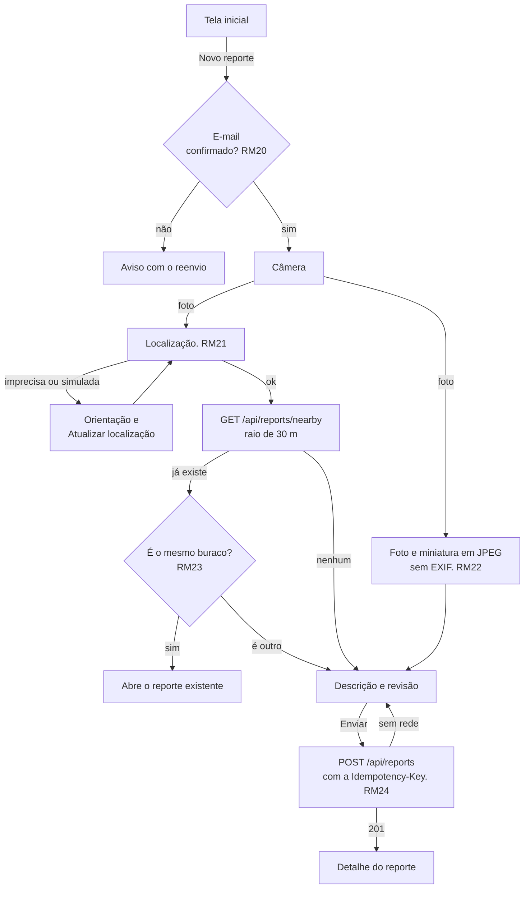
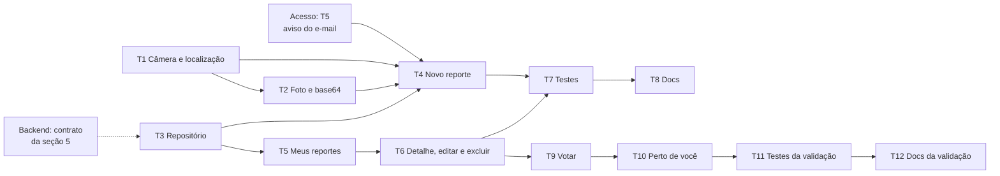

# Sprint 4 (26/10 - 04/11): reportes no app

Plano do mobile para o cidadão abrir um reporte de buraco com a foto e a localização do aparelho, acompanhar, editar e excluir os próprios reportes, e validar os reportes dos outros, na mesma ideia do Waze e do Google Maps: com 10 confirmações de outros cidadãos, o reporte passa a ser considerado verdadeiro.

Usa as rotas do [plano dos reportes do backend](https://github.com/jgtsuchiya/projeto_integrador_reportaAiCm_backend/blob/develop/docs/sprints/sprint-4-reportes.md) (regras RN26 a RN40) e o aviso do e-mail do [plano de acesso](sprint-4-acesso.md). As regras do app continuam a numeração (RM20 a RM30).

São dois epics, como no backend: **reportes** (abrir, listar, editar e excluir) e **validação**.

## 1. Decisões

| Tema                  | Decisão                                                                                                                                                                                                                                                                 |
| --------------------- | ----------------------------------------------------------------------------------------------------------------------------------------------------------------------------------------------------------------------------------------------------------------------- |
| Câmera                | `image_picker`, só a câmera, sem a galeria: a foto e a localização são do mesmo momento (RM21).                                                                                                                                                                         |
| Tratamento da foto    | **No app**, com o `flutter_image_compress` (nativo, fora da thread da tela): a foto com o maior lado em 1600 px (JPEG 80) e a miniatura com 400 px (JPEG 70), com a orientação aplicada nos pixels e sem EXIF. A API só confere a imagem e remove os metadados de novo. |
| Encode e decode       | `encodeJpegBase64` e `decodeJpegBase64` no `domain` da feature, com o `dart:convert` e a conferência da assinatura do JPEG. O DTO usa as duas. A foto grande passa pelo `Isolate.run`, para a tela não engasgar.                                                        |
| Localização           | `geolocator`, com precisão alta e tempo limite de 20 s. A posição simulada (`isMocked`, no Android) e a precisão pior que 50 m bloqueiam o envio.                                                                                                                       |
| Onde os pacotes ficam | `core/location/` (`geolocator`) e `core/media/` (`image_picker` e `flutter_image_compress`), atrás de interfaces, como o SuperTokens em `core/auth/`. O teste de arquitetura barra o import em outro lugar, e os testes usam fakes.                                     |
| Envio                 | JSON com a foto e a miniatura em base64 no `POST /api/reports`, com a `Idempotency-Key` criada quando a tela abre (a mesma em todas as tentativas) e tempo limite de 60 s, maior que o padrão do `Dio`, para a foto em rede móvel.                                      |
| Exibição da foto      | `GET /api/reports/:id/photo`, decodificada para o `Image.memory`. Cache em memória pelo id da foto, que muda quando ela é trocada: o cache nunca mostra a foto antiga. As miniaturas da lista são buscadas só quando o item aparece.                                    |
| Regras de edição      | O app não repete as RN33 e RN34: mostra "Editar" e "Excluir" a partir do `canEdit` e do `canDelete` da API (e o voto, do `canVote`).                                                                                                                                    |
| Reporte repetido      | Depois de capturar a localização, o app consulta os reportes a até 30 m e oferece abrir o existente, em vez de abrir outro (RM23).                                                                                                                                      |
| Estado entre as telas | Cada tela tem o seu ViewModel. Depois de criar, editar, excluir ou votar, o ViewModel invalida os providers das listas e do detalhe (`ref.invalidate`): nenhum estado global novo.                                                                                      |
| Mapa                  | Fora do escopo. As telas mostram a precisão e a distância (ponto em aberto).                                                                                                                                                                                            |

## 2. Fluxos e telas

### Abrir um reporte



| Tela                   | Rota                   | O que mostra                                                                                                                      |
| ---------------------- | ---------------------- | --------------------------------------------------------------------------------------------------------------------------------- |
| Inicial (muda)         | `/inicio`              | O botão "Novo reporte" e as entradas "Meus reportes" e "Reportes perto de você", no lugar do cartão "os reportes chegam em breve" |
| Meus reportes          | `/reportes`            | Lista paginada com a miniatura, o status, "3 de 10 confirmações" e a data. Filtro por status e o botão "Novo reporte"             |
| Novo reporte           | `/reportes/novo`       | A foto, a localização com a precisão, a descrição e "Enviar"                                                                      |
| Detalhe                | `/reportes/:id`        | A foto, o status e o progresso, a descrição, as datas e as ações permitidas. No reporte de outro, a distância e o voto            |
| Editar                 | `/reportes/:id/editar` | A descrição e "Trocar a foto"                                                                                                     |
| Reportes perto de você | `/reportes/perto`      | Os reportes em validação a até 500 m, do mais perto ao mais longe, com "Está lá" e "Não está lá"                                  |

As rotas `/reportes/novo` e `/reportes/perto` são declaradas antes de `/reportes/:id`.

### A foto, da câmera ao JSON

| Etapa       | Onde                             | Como                                                                                                                                   |
| ----------- | -------------------------------- | -------------------------------------------------------------------------------------------------------------------------------------- |
| Captura     | `core/media` (`PhotoCapture`)    | `image_picker`, só a câmera                                                                                                            |
| Compressão  | `core/media` (`ImageCompressor`) | Foto: 1600 px, JPEG 80. Miniatura: 400 px, JPEG 70. Orientação aplicada e sem EXIF. Acima do limite, tenta de novo com qualidade menor |
| Conferência | `features/reports/domain`        | JPEG, foto até 2 MB e 2048 px, miniatura até 100 KB e 480 px: os mesmos limites da API (RN29)                                          |
| Encode      | `features/reports/domain`        | `encodeJpegBase64`, no `toJson` do DTO                                                                                                 |
| Envio       | `data` (`ApiReportRepository`)   | `POST /api/reports`, com a `Idempotency-Key` e o tempo limite de 60 s                                                                  |
| Exibição    | `data` e `presentation`          | `GET /api/reports/:id/photo`, `decodeJpegBase64` e `Image.memory`, com o cache pelo `photo.id`                                         |

### Respostas da abertura

| Resposta da API           | O que o app mostra                                                                                                   |
| ------------------------- | -------------------------------------------------------------------------------------------------------------------- |
| 201                       | O detalhe do reporte, com "Reporte enviado. Agora ele precisa de 10 confirmações de outros cidadãos."                |
| 400 de um campo da foto   | "Não foi possível usar esta foto. Tire outra." (não deveria acontecer: o app confere antes)                          |
| 400 de outro campo        | A mensagem embaixo do campo (a descrição)                                                                            |
| 413                       | A mesma mensagem da foto                                                                                             |
| 422                       | A `message` da API: e-mail não confirmado, fora de Campo Mourão, localização imprecisa ou limite de 10 por dia       |
| Sem conexão, timeout, 5xx | "Não foi possível enviar. Seus dados continuam aqui." com "Tentar de novo", que repete com a mesma `Idempotency-Key` |

### Status na tela

| `status`    | Na tela           | Detalhe                                                                      |
| ----------- | ----------------- | ---------------------------------------------------------------------------- |
| `PENDING`   | Em validação      | "3 de 10 confirmações", com a barra de progresso                             |
| `CONFIRMED` | Confirmado        | "Confirmado por outros cidadãos em 09/11/2026"                               |
| `REJECTED`  | Descartado        | "Outros cidadãos não encontraram o buraco"                                   |
| outro       | Em acompanhamento | Os status que o painel vai criar (`ReportStatus.unknown`), sem quebrar o app |

### Permissões

| Permissão   | Android                                                    | iOS                                   | Quando é pedida                                  |
| ----------- | ---------------------------------------------------------- | ------------------------------------- | ------------------------------------------------ |
| Localização | `ACCESS_FINE_LOCATION` e `ACCESS_COARSE_LOCATION`          | `NSLocationWhenInUseUsageDescription` | Na primeira captura, depois de explicar o porquê |
| Câmera      | Nenhuma: o `image_picker` abre o app da câmera do aparelho | `NSCameraUsageDescription`            | Na primeira foto                                 |

A permissão `CAMERA` não é declarada no Android: com ela no manifest, o Android passa a exigi-la para abrir a câmera por outro app. Negada uma vez, a tela explica e pede de novo. Negada para sempre, "Abrir as configurações". Com o GPS desligado, "Ativar a localização".

## 3. Regras do app

| Código | Regra                                                                                                                                                                                                                                                            |
| ------ | ---------------------------------------------------------------------------------------------------------------------------------------------------------------------------------------------------------------------------------------------------------------- |
| RM20   | Só o Client com o e-mail confirmado abre e vota (RN26 e RN37). Sem ele, o "Novo reporte" e o voto dão lugar ao aviso com o reenvio (RM14).                                                                                                                       |
| RM21   | A foto vem só da câmera, na hora do reporte, e a localização é capturada junto. Com a precisão pior que 50 m, ou de um app de localização falsa, o envio fica bloqueado, com a orientação para tentar num lugar aberto e o "Atualizar localização".              |
| RM22   | O app trata a foto antes de enviar: foto com o maior lado em 1600 px (JPEG 80) e miniatura em 400 px (JPEG 70), na orientação certa e sem metadados (o EXIF pode ter o GPS e o modelo do aparelho). Se a foto passar de 2 MB, o app reduz a qualidade até caber. |
| RM23   | Antes do envio, o app avisa quando já existe um reporte a até 30 m e oferece abrir o existente. O cidadão pode seguir com um novo: dois buracos podem estar perto um do outro.                                                                                   |
| RM24   | O envio usa a `Idempotency-Key` criada quando a tela abre: repetir depois de uma falha não cria outro reporte (RN31). Sem rede, os dados ficam na tela com "Tentar de novo".                                                                                     |
| RM25   | "Editar" e "Excluir" aparecem só quando a API permite (`canEdit` e `canDelete`), e excluir pede confirmação. A localização não muda na edição.                                                                                                                   |
| RM26   | O status aparece em texto, nunca só pela cor: "Em validação" com "3 de 10 confirmações", "Confirmado" e "Descartado".                                                                                                                                            |
| RM27   | A foto (o base64) e as coordenadas nunca vão para o log. O reporte de outro cidadão não mostra nenhum dado do autor.                                                                                                                                             |
| RM28   | "Reportes perto de você" lista os reportes em validação a até 500 m da posição atual, do mais perto ao mais longe, sem os do próprio cidadão.                                                                                                                    |
| RM29   | Votar pede confirmação ("O voto não pode ser desfeito.") e envia a localização atual, que não fica guardada no app nem na API (RN38).                                                                                                                            |
| RM30   | Depois do voto, o reporte é atualizado na tela com a resposta da API (contagem e status), sem recarregar a lista inteira.                                                                                                                                        |

## 4. Rotas da API usadas

Todas do plano dos reportes do backend. O formato do reporte e dos corpos está na seção 5 de lá.

| Método   | Rota                     | Epic do backend | Uso no app                                                       |
| -------- | ------------------------ | --------------- | ---------------------------------------------------------------- |
| `POST`   | `/api/reports`           | 1               | Novo reporte, com o header `Idempotency-Key`                     |
| `GET`    | `/api/reports/mine`      | 1               | Meus reportes, paginado, com o filtro `status`                   |
| `GET`    | `/api/reports/nearby`    | 1               | Reporte repetido (30 m) e "Reportes perto de você" (500 m)       |
| `GET`    | `/api/reports/:id`       | 1               | Detalhe                                                          |
| `GET`    | `/api/reports/:id/photo` | 1               | A foto (`size=full`) e a miniatura (`size=thumbnail`), em base64 |
| `PATCH`  | `/api/reports/:id`       | 1               | Editar a descrição e trocar a foto                               |
| `DELETE` | `/api/reports/:id`       | 1               | Excluir                                                          |
| `POST`   | `/api/reports/:id/votes` | 2               | Votar                                                            |

## 5. Variáveis de ambiente e pacotes

Nenhuma variável nova. Os limites da foto (1600 e 400 px, 2 MB e 100 KB) e da localização (50 m, 30 m e 500 m) são constantes do `domain` da feature, iguais aos padrões da API.

| Pacote                   | Uso                                                           | Onde fica        |
| ------------------------ | ------------------------------------------------------------- | ---------------- |
| `image_picker`           | Abrir a câmera                                                | `core/media/`    |
| `flutter_image_compress` | Redimensionar, comprimir, aplicar a orientação e tirar o EXIF | `core/media/`    |
| `geolocator`             | Localização, permissão e posição simulada                     | `core/location/` |

Versões exatas, conferidas no pub.dev na T1 e na T2, compatíveis com o Flutter 3.47.7.

Para testar fora de Campo Mourão, aumente a `REPORT_AREA_BOUNDS` do `.env` local do backend, ou use o `FakeLocationService` com um ponto da cidade.

## 6. Labels

As mesmas do plano de acesso: os dois epics recebem `Epic` + `Sprint 4 - 26/10 - 04/11`, e cada task recebe `Task` + a label da sprint.

## 7. Ordem e dependências



A T1 e a T3 começam em paralelo. A T3 precisa só do contrato da seção 5 do plano do backend: com o `FakeReportRepository`, as telas andam antes de a API ficar pronta. O teste contra a API local espera a T4 a T6 do backend (e a T10, para a validação).

---

## 8. Issues

### EPIC 1

**Título:** `[EPIC] Reportes no app: abrir, acompanhar, editar e excluir`
**Labels:** `Epic`, `Sprint 4 - 26/10 - 04/11`

```markdown
O cidadão abre um reporte de buraco pelo app, com a foto tirada na hora e a localização do aparelho, e acompanha os próprios reportes até a validação pelos outros cidadãos. É a entrega principal do app.

- **Abrir**: câmera, foto tratada no aparelho (tamanho, qualidade e sem metadados), localização com a precisão conferida, aviso de reporte repetido e envio seguro em rede ruim.
- **Acompanhar**: lista dos próprios reportes, com o status e quantas confirmações faltam, e o detalhe com a foto.
- **Corrigir**: editar a descrição e trocar a foto enquanto ninguém votou, e excluir enquanto o reporte está em validação.

### Escopo

- Câmera e localização atrás de interfaces em `core/`, com as permissões do Android e do iOS
- Tratamento da foto no app e o encode e o decode em base64
- Repositório dos reportes, com o cache das fotos
- Telas "Novo reporte", "Meus reportes", detalhe e edição, e a exclusão
- Entradas dos reportes na tela inicial
- Testes de widget, fluxos e teste de integração contra a API local

### Fora do escopo

Voto (epic da validação), mapa, ajuste manual do pino, galeria, fila para enviar sem internet, notificações e endereço do reporte.

### Definição de pronto (vale para todas as tasks)

- Os itens da definição de pronto dos épicos anteriores (formatação, analyzer, testes, teste de arquitetura e aparelho)
- Testes de widget de cada estado das telas (carregando, erro, vazio e sucesso), com os fakes
- Os pacotes da câmera e da localização importados só em `core/media/` e `core/location/` (teste de arquitetura)
- Nenhuma foto, base64 ou coordenada em log (RM27)
- Testado num aparelho Android físico, com a câmera e o GPS de verdade

### Tasks

- [ ] T1 [CONFIG] Câmera e localização no app
- [ ] T2 [FEAT] Tratamento da foto e base64
- [ ] T3 [FEAT] Repositório dos reportes
- [ ] T4 [FEAT] Tela "Novo reporte"
- [ ] T5 [FEAT] Tela "Meus reportes" e entradas na tela inicial
- [ ] T6 [FEAT] Detalhe, edição e exclusão do reporte
- [ ] T7 [TEST] Testes dos fluxos dos reportes
- [ ] T8 [DOCS] Documentar os reportes no app
```

> Depois de criar as tasks, troque cada `T<n>` pelo número da issue, para o GitHub linkar automaticamente, ou adicione as tasks como sub-issues do epic.

---

### T1

**Título:** `[CONFIG] Câmera e localização no app`

```markdown
Ligar a câmera e o GPS ao app, atrás de interfaces, como o SuperTokens em `core/auth/`. Não cria tela.

- Pacotes `image_picker` e `geolocator`, com a versão exata, conferida no pub.dev (compatível com o Flutter 3.47.7 e com o `minSdk` do app)
- `core/location/`: interface `LocationService` (`isServiceEnabled`, `checkPermission`, `requestPermission`, `getCurrentPosition` com precisão alta e tempo limite de 20 s, `openAppSettings` e `openLocationSettings`), o modelo `DevicePosition` (latitude, longitude, precisão em metros, `isMocked` e o horário) e as exceções (GPS desligado, permissão negada, negada para sempre e tempo esgotado). Implementação `GeolocatorLocationService`
- `core/media/`: interface `PhotoCapture.takePhoto()` (só a câmera traseira; devolve os bytes, ou `null` se o cidadão cancelar), com a implementação pelo `image_picker`, e o `retrieveLostData`, para recuperar a foto quando o Android fecha o app com a câmera aberta (aparelhos com pouca memória)
- Providers `locationServiceProvider` e `photoCaptureProvider`, e os fakes `FakeLocationService` e `FakePhotoCapture` em `test/support/`
- Teste de arquitetura: só `core/location/` importa o `geolocator`, e só `core/media/` importa o `image_picker`
- Android: `ACCESS_FINE_LOCATION` e `ACCESS_COARSE_LOCATION` no manifest, sem a `CAMERA`
- iOS: `NSCameraUsageDescription` e `NSLocationWhenInUseUsageDescription` no `Info.plist`, com o texto em português

**Critérios de aceite**

- No aparelho: a câmera abre e devolve a foto, e a localização volta com a precisão, nas três situações da permissão (aceita, negada e negada para sempre) e com o GPS desligado
- O build de release do Android no CI continua passando
- Testes das implementações com os pacotes trocados por fakes, e do teste de arquitetura com o import recusado
```

### T2

**Título:** `[FEAT] Tratamento da foto e base64`

```markdown
Preparar a foto para o envio e converter entre os bytes e o base64 do JSON (RM22). Não cria tela.

- Pacote `flutter_image_compress`, com a versão exata, só em `core/media/` (regra no teste de arquitetura)
- `core/media/`: interface `ImageCompressor.compressToFit(bytes, maxSide, quality, maxBytes, minQuality)`, que devolve os bytes, a largura e a altura, com a orientação aplicada nos pixels e sem EXIF. Se o resultado passar de `maxBytes`, tenta de novo com qualidade menor, até a `minQuality`. Implementação pelo `flutter_image_compress` e o `FakeImageCompressor`
- `features/reports/domain/models/`: `PreparedPhoto` (os bytes da foto e da miniatura, a largura e a altura) e as regras iguais às da API (RN29): JPEG, foto até 2 MB e 2048 px, miniatura até 100 KB e 480 px
- `features/reports/domain/models/jpeg_base64.dart`: `encodeJpegBase64(bytes)` e `decodeJpegBase64(text)`, que lança `FormatException` quando o texto não é base64 ou não é um JPEG (assinatura `FF D8 FF`)
- O ViewModel da T4 gera a foto (1600 px, JPEG 80, mínimo 60) e a miniatura (400 px, JPEG 70, mínimo 50) com duas chamadas ao `compressToFit` e monta o `PreparedPhoto`
- O encode e o decode da foto grande rodam no `Isolate.run`

**Critérios de aceite**

- `decodeJpegBase64(encodeJpegBase64(bytes))` devolve os mesmos bytes, e um PNG em base64 é recusado
- No aparelho: uma foto de 12 MP vira um JPEG de 1600 px com menos de 2 MB, sem EXIF (conferido com o `exiftool`), na orientação certa com o aparelho em pé e deitado
- Os testes do `domain` cobrem os limites (exatamente 2 MB passa, 1 byte a mais não)
```

### T3

**Título:** `[FEAT] Repositório dos reportes`

```markdown
Camadas de domínio e de dados dos reportes, sem tela, no contrato da seção 5 do plano do backend. Com os fakes, as telas começam antes de a API ficar pronta.

- Modelos imutáveis: `Report` (id, status, descrição, localização com a precisão, `ReportPhotoInfo` com o id e as dimensões, `ReportVotes` com as contagens e os limites, `isMine`, `canEdit`, `canDelete`, as datas e o `distanceMeters` opcional), `ReportStatus` (`pending`, `confirmed`, `rejected` e `unknown`, para os status que o painel vai criar), `GeoPoint` e `ReportPage` (itens, página, total e `hasMore`)
- Contrato `ReportRepository`: `create(draft, idempotencyKey)`, `listMine(page, pageSize, status)`, `listNearby(point, radiusMeters)`, `getById(id)`, `getPhoto(reportId, size)`, `update(id, changes)` (a descrição e a foto, com "apagar a descrição" diferente de "não mudar") e `delete(id)`
- `ApiReportRepository`, com cada chamada no `callApi`. O `create` e o `update` usam tempo limite de 60 s no envio e na resposta, e o `create` manda o header `Idempotency-Key`
- DTOs com `fromJson` (que lança `FormatException`) e `toJson`, com o `encodeJpegBase64` e o `decodeJpegBase64` da T2
- `ApiLogInterceptor`: os campos `content` e `thumbnail` saem como `*** (512 KB)`, e `latitude`, `longitude` e `accuracyMeters`, como `***`, no corpo e na query (RM27)
- `reportRepositoryProvider` em `reports_providers.dart`. `FakeReportRepository` em `test/support/`, com a lista em memória e os erros configuráveis, e o JSON de exemplo do plano do backend
- Cache das fotos: `reportPhotoProvider` (family pelo id do reporte, o id da foto e o tamanho), que guarda os bytes enquanto a foto está em uso e por alguns minutos depois (`ref.keepAlive` com um timer)

**Critérios de aceite**

- Testes do DTO com o JSON de exemplo, com e sem a `description` e o `distanceMeters`, e com um `status` desconhecido
- Testes do repositório com o `FakeHttpAdapter`: o header `Idempotency-Key`, o corpo do `create` (base64 válido), os tempos limite e cada erro (400, 404, 413 e 422)
- O base64 e as coordenadas não aparecem no log
```

### T4

**Título:** `[FEAT] Tela "Novo reporte"`

```markdown
Tela `/reportes/novo` (RM20 a RM24).

- `NewReportViewModel` (`Notifier`, `autoDispose`) com os passos: foto (vazia, processando, pronta ou erro), localização (capturando, pronta, imprecisa, simulada, sem permissão, GPS desligado ou erro), reportes já abertos perto, descrição e envio
- A `Idempotency-Key` (UUID v4 com o `Random.secure`, numa função de `core/utils/`) nasce com o ViewModel e é a mesma em todas as tentativas
- Sem o e-mail confirmado, a tela mostra o `EmailVerificationNotice` (plano de acesso, T5) no lugar do formulário
- Ao abrir, a câmera. Com a foto, o tratamento (T2) e a localização (T1), em paralelo. "Tirar outra" refaz a foto e a localização
- Localização: a precisão na tela ("Precisão de 8 m"). Pior que 50 m, ou simulada, o envio fica bloqueado, com a orientação e "Atualizar localização". Sem permissão, a explicação antes do pedido. Negada para sempre, "Abrir as configurações". GPS desligado, "Ativar a localização"
- Com a localização, o `listNearby` com 30 m. Se houver reporte, o aviso "Já existe um reporte a 12 m daqui", com a miniatura, "Ver o reporte" (abre o detalhe, onde o cidadão vai poder confirmar, no epic 2) e "É outro buraco"
- Descrição opcional, até 500 caracteres, com o contador
- "Enviar" com o carregando, que não envia duas vezes, e as respostas da tabela "Respostas da abertura" do plano. Com o 201, vai para o detalhe com `context.pushReplacement`
- Ao sair com a foto tirada e sem enviar, a tela pergunta se quer descartar
- Ao abrir, confere o `retrieveLostData` (T1) e reaproveita a foto, se o Android tiver fechado o app com a câmera aberta
- Rolagem e fonte em 200%. A foto tem descrição para o leitor de tela

**Critérios de aceite**

- Testes de widget de cada estado da foto e da localização, do aviso de reporte perto e de cada resposta do envio, com os fakes
- Teste do ViewModel: repetir o envio depois de um timeout manda a mesma `Idempotency-Key`
- No aparelho, contra a API local: abrir um reporte e vê-lo no detalhe, com a foto
```

### T5

**Título:** `[FEAT] Tela "Meus reportes" e entradas na tela inicial`

```markdown
Tela `/reportes` e a entrada dos reportes na tela inicial.

- `MyReportsViewModel` com a paginação (20 por página), a rolagem infinita, o "puxar para atualizar" e o filtro por status (Todos, Em validação, Confirmados e Descartados)
- Cada item: a miniatura (carregada só quando aparece, pelo `reportPhotoProvider`), o status em texto e cor (RM26), "3 de 10 confirmações" com a barra de progresso no `PENDING`, a descrição em uma linha e a data. O toque abre o detalhe
- Vazio: "Você ainda não abriu nenhum reporte", com o "Novo reporte". Erro na primeira página: o `ErrorView` com "Tentar de novo". Erro numa página seguinte: o aviso no fim da lista, sem perder o que já carregou
- Tela inicial: sai o cartão "os reportes chegam em breve" da sprint 3. Entram o botão "Novo reporte" e as entradas "Meus reportes" e "Reportes perto de você" (esta, ligada no epic 2)
- Depois de criar, editar ou excluir, a lista é atualizada (`ref.invalidate`)

**Critérios de aceite**

- Testes de widget: vazio, uma página, rolagem até a segunda página, filtro, erro na primeira e na segunda página, e o "puxar para atualizar"
- A miniatura que falha mostra um ícone no lugar, sem derrubar a lista
- Com a fonte em 200%, o status não é cortado
```

### T6

**Título:** `[FEAT] Detalhe, edição e exclusão do reporte`

```markdown
Telas `/reportes/:id` e `/reportes/:id/editar`, e a exclusão (RM25 e RM26).

- Detalhe: a foto (com toque para ampliar), o status e o progresso, a descrição, a data de abertura, a data da mudança de status e a precisão da localização. No reporte de outro cidadão, a distância e nenhum dado do autor
- "Editar" e "Excluir" só com o `canEdit` e o `canDelete` da API
- Editar: a descrição e "Trocar a foto" (câmera e tratamento da T2). A tela explica que a localização não muda: para mudar o lugar, é preciso excluir e abrir outro. Envia só o que mudou. Com o 422 (alguém votou enquanto a tela estava aberta), mostra a `message` da API e volta ao detalhe atualizado
- Excluir: confirmação ("Excluir o reporte? Esta ação não pode ser desfeita."), e, com o 204, volta para a lista com "Reporte excluído."
- 404 no detalhe (excluído em outro aparelho): a mensagem e o "Voltar"
- "Puxar para atualizar" no detalhe

**Critérios de aceite**

- Testes de widget do detalhe do próprio reporte, com e sem as ações, e do de outro cidadão
- Testes da edição (só a descrição, só a foto e o 422) e da exclusão (confirmar, cancelar e sem conexão)
- Depois de trocar a foto, a tela mostra a nova (o cache usa o id novo)
- Depois de excluir, o "voltar" não volta para o detalhe
```

### T7

**Título:** `[TEST] Testes dos fluxos dos reportes`

```markdown
Cobrir os fluxos do epic de ponta a ponta: com fakes, no CI, e contra a API de verdade, localmente.

- Fluxos do app inteiro (`test/flows/`), com os fakes:
  - tela inicial → "Novo reporte" → câmera → localização → envio → detalhe → "Meus reportes"
  - localização imprecisa → "Atualizar localização" → envio
  - reporte a menos de 30 m → "É outro buraco" → envio
  - sem o e-mail confirmado → aviso com o reenvio
  - detalhe → editar → detalhe atualizado
  - detalhe → excluir → lista sem o reporte
- Teste de integração (`integration_test/`) contra a API local, com o `FakePhotoCapture` (uma foto de exemplo em `integration_test/fixtures/`) e o `FakeLocationService` (um ponto de Campo Mourão): abrir um reporte, vê-lo na lista, editar e excluir. O Client do teste confirma o e-mail pelo Mailpit (o `TestApi` do plano de acesso)
- A cobertura mínima de 80% por grupo inclui os ViewModels dos reportes

**Critérios de aceite**

- `flutter test` passa localmente e no GitHub Actions
- `flutter test integration_test` passa com a API local na `develop` do backend
- Cada regra de RM20 a RM27 tem pelo menos um teste
- Gravação de tela do fluxo completo no aparelho, na rua, anexada ao PR como evidência da sprint
```

### T8

**Título:** `[DOCS] Documentar os reportes no app`

```markdown
- `docs/REPORTS.md` (novo): a feature, o caminho da foto (da câmera ao JSON e de volta), a localização e as permissões, a `Idempotency-Key`, o cache das fotos, as regras RM20 a RM27 e como testar sem sair na rua (os fakes e a `REPORT_AREA_BOUNDS` do backend)
- `docs/ARCHITECTURE.md`: `core/location/` e `core/media/`, as regras de import novas, as rotas e o UUID em `core/utils/`
- `docs/TESTING.md`: os fakes novos e a foto de exemplo
- `README.md`: o status e as permissões do app

**Critérios de aceite**

- Uma pessoa nova do time consegue rodar o fluxo "Novo reporte" num aparelho seguindo só o `REPORTS.md`
```

---

### EPIC 2

**Título:** `[EPIC] Validação dos reportes no app`
**Labels:** `Epic`, `Sprint 4 - 26/10 - 04/11`

```markdown
O cidadão confirma ou nega os reportes abertos por outros perto dele, como nos alertas do Waze. Com 10 confirmações, o reporte passa a ser considerado verdadeiro; com 10 votos "não está lá", é descartado. O app só deixa votar quem está perto do buraco.

- **Encontrar**: a lista dos reportes em validação a até 500 m, do mais perto ao mais longe.
- **Votar**: "Está lá" ou "Não está lá", com a confirmação e a localização conferida pela API.
- **Ver o resultado**: a contagem e o status atualizados na hora, nas listas e no detalhe.

### Escopo

- O voto no repositório e no detalhe do reporte de outro cidadão
- Tela "Reportes perto de você" e a entrada na tela inicial
- Testes e documentação

### Fora do escopo

Mapa, desfazer o voto e notificações.

### Definição de pronto (vale para todas as tasks)

- A mesma do epic dos reportes
- A localização do voto não fica guardada no app nem vai para o log (RM29)

### Tasks

- [ ] T9 [FEAT] Votar num reporte
- [ ] T10 [FEAT] Tela "Reportes perto de você"
- [ ] T11 [TEST] Testes da validação dos reportes
- [ ] T12 [DOCS] Documentar a validação dos reportes no app
```

### T9

**Título:** `[FEAT] Votar num reporte`

```markdown
O voto, no repositório e no detalhe do reporte de outro cidadão (RN37 a RN40, RM29 e RM30).

- `ReportRepository.vote(id, vote, position)` (`POST /api/reports/:id/votes`), com o `VoteType` (`confirm` e `deny`). O `Report` ganha o `votes.mine` e o `canVote`
- Widget `ReportVoteBar`: "Está lá" e "Não está lá", com a confirmação ("Confirmar que o buraco está lá? O voto não pode ser desfeito.")
- Antes de enviar, a localização atual pelo `LocationService`, com as mesmas regras da abertura (precisão e posição simulada). Ela não fica guardada no app
- No detalhe do reporte de outro cidadão: a barra, com o `canVote`. Depois do voto, "Você confirmou" ou "Você disse que não está lá"
- Sem o e-mail confirmado, o `EmailVerificationNotice` no lugar da barra (RM20)
- 201: o detalhe é atualizado com o reporte da resposta (contagem e status), e as listas abertas também (RM30). 409 e 422: a `message` da API ("Você precisa estar a até 500 m do reporte para votar.", "Este reporte não está mais em validação.")
- No "Novo reporte" (T4), o "Ver o reporte" do aviso de reporte repetido passa a levar ao detalhe com a barra

**Critérios de aceite**

- Testes de widget da barra (confirmar e cancelar), de cada resposta e da localização ruim
- O voto que muda o status para "Confirmado" mostra o status novo sem recarregar a tela
```

### T10

**Título:** `[FEAT] Tela "Reportes perto de você"`

```markdown
Tela `/reportes/perto`, aberta pela tela inicial (RM28).

- `NearbyReportsViewModel`: a localização atual e o `listNearby` com 500 m. Mostra os reportes em validação de outros cidadãos, do mais perto ao mais longe. Os que o cidadão já votou ficam no fim, marcados
- Cada item: a miniatura, a distância ("a 120 m"), "3 de 10 confirmações", a data e a `ReportVoteBar` (T9). O toque abre o detalhe
- "Atualizar" refaz a localização e a lista, e o "puxar para atualizar" também
- Vazio: "Nenhum reporte em validação perto de você." Sem permissão de localização, a explicação e o pedido, como na abertura do reporte
- Liga a entrada "Reportes perto de você" da tela inicial (T5)

**Critérios de aceite**

- Testes de widget: lista, vazio, sem permissão, GPS desligado, erro e o voto que move o item para o fim da lista
- No aparelho, com duas contas: a conta B vê o reporte da conta A e confirma, e a conta A vê "1 de 10 confirmações"
```

### T11

**Título:** `[TEST] Testes da validação dos reportes`

```markdown
- Fluxos do app inteiro, com os fakes: tela inicial → "Reportes perto de você" → "Está lá" → confirmação → item marcado; reporte que chega a 10 → "Confirmado"; voto longe demais → mensagem da API; sem o e-mail confirmado → aviso
- Teste de integração contra a API local: dois Clients (criados pelo `TestApi`), o primeiro abre o reporte, e o segundo confirma pela tela
- Cada regra de RM28 a RM30 tem pelo menos um teste

**Critérios de aceite**

- `flutter test` passa no GitHub Actions, e `flutter test integration_test` passa com a API local
```

### T12

**Título:** `[DOCS] Documentar a validação dos reportes no app`

```markdown
- `docs/REPORTS.md`: a validação (a tela, o voto, a localização que não fica guardada e as regras RM28 a RM30)
- `README.md`: o status

**Critérios de aceite**

- O `REPORTS.md` explica como testar o voto com duas contas
```

---

## 9. Pontos em aberto

- **Mapa:** as telas mostram a distância, sem mapa. Um mapa ajudaria a achar o buraco e a validar: o `flutter_map` com o OpenStreetMap não tem custo de chave, e o Google Maps exige chave e tem cota.
- **Ajustar o pino:** a localização é a do aparelho. Quem tira a foto do outro lado da rua deixa o reporte alguns metros longe do buraco. Com o mapa, o cidadão poderia arrastar o pino por alguns metros, com um limite.
- **Galeria:** só a câmera, para a foto e a localização serem do mesmo momento. A galeria ajudaria quem está sem sinal ou com pressa, mas abre espaço para a foto de outro lugar.
- **Sem internet na rua:** se o app fechar antes do envio, o reporte se perde. Uma fila no aparelho (o reporte guardado e enviado quando a rede volta, com a mesma `Idempotency-Key`) é o passo seguinte.
- **Cache das fotos em disco:** o cache é só em memória. Guardar as miniaturas em disco evitaria baixá-las de novo a cada abertura do app.
- **Notificação quando o reporte for confirmado:** push (FCM), junto com o backend.
- **Endereço do reporte:** o pacote `geocoding` mostraria a rua sem custo, pelo serviço do sistema, mas o resultado muda de aparelho para aparelho. Melhor vir do backend, quando ele tiver.
- **Foto e localização sem o EXIF:** o app tira o EXIF e a API tira de novo. Se um dia a galeria entrar, a localização da foto (do EXIF) teria de ser lida antes de ser removida.
- **Tokens no SharedPreferences (ponto da sprint 3):** os reportes não trazem dado mais sensível que o perfil, então a decisão continua valendo.
